Build a joint you can turn in your hands, look inside, and gradually make your own. Starting with a few small fit samples, you will model two triangulated octagonal housings in Fusion, print and assemble them around a metal shaft, and measure how the assembly behaves. Along the way, you will learn how to explain a design choice—and how to change it without losing track of what the change affects.

This is a first mechanical prototype, with no motor or electronics. The supplied geometry has been checked digitally, but **the parts have not been physically printed, assembled or load-tested**. Your fit samples, assembly checks and measurements are the next evidence. A successful build means the joint moves freely, its parts remain retained, and you can explain what carries the load. It does not yet give the joint a proven payload rating.

# Before you start

You do not need to arrive knowing bearing fits, truss analysis or every button in Fusion. You should be able to open a design, select an object, and orbit or pan the view. We will explain the less familiar tools when they become useful. If an operation produces a different result from the picture, pause at that step; a small mistake is easier to find before several later features depend on it.

The project uses **Autodesk Fusion on a Mac**, millimeter units, and a **Bambu Lab X1 Carbon with a 0.4 mm nozzle and PLA** for the initial trials. Keep the same filament and process for a trial and the part it represents. The larger housings are a substantial print, so there is no benefit in rushing past the small samples.

**About the version labels:** this is the **Rev4.2 teaching guide**. It uses the unchanged **V4.1 CAD and print geometry**, so V4.1 still appears on figures and evidence files. Checkpoint 15 contains the final reference assembly; Step 52 explains the earlier comparison checkpoints.

Use the work phases below to plan your sessions. A phase may take several sittings, especially when printing and measuring are involved. Save at the end of a session so the next one begins from a known state.

| Work phase | Make or inspect | What you should be able to explain before moving on |
| --- | --- | --- |
| Hardware and first fit samples, Steps 1–6 | Bearings, nuts, shaft and small printed coupons | Why a nominal 22 mm bearing does not automatically fit a printed 22 mm pocket |
| Shared shape, Steps 7–12 | One centered octagon, then two open tubes | How dimensions and constraints keep a change predictable |
| Frame layout, Steps 13–19 | One carefully built face, then the remaining faces | Where the rails, braces and nodes carry load |
| Joint core, Steps 20–31 | Bearing supports, caps and hub adapter | Which surfaces locate the shaft and which must remain free to move |
| Digital assembly, Steps 32–34 | Motion and tool-access checks | The difference between a part fitting in its final position and being possible to install |
| Print preparation and trials, Steps 35–40 | Finished edges, exported parts, brace trials and full-part slices | What the local trials establish and which support contacts need inspection |
| Bench assembly, Steps 41–43 | Dry fits, fixed bearing support and moving hub assembly | Which contacts retain the parts and whether tightening changes rotation |
| Fixtures and measurements, Steps 44–51 | Backers, clamp shoes, two force cases and one measured revision | How to distinguish a fit or fixture problem from repeatable assembly movement |

Save your own work at the end of each session. Use the downloadable Fusion checkpoints for comparison: if you get stuck, open the relevant one in a separate document, inspect its sketch or feature, then return to your version. Resume work from a checkpoint only at a route explicitly identified in the lesson; the historical file numbers do not always follow this teaching order. You will learn more from identifying one difference than from replacing all your work with the finished model.

Keep a short build notebook. A useful entry can be only four lines: **what I expected; what happened; what I changed; what happened next**. Photograph the printed sample beside its label and record the filament and settings. That small habit turns a pile of almost-fitting parts into information you can reuse.

## A few Fusion words we will use

| Word | Meaning in this project |
| --- | --- |
| **Sketch** | A drawing on a plane. A circle in a sketch can become a bearing pocket. |
| **Profile** | A closed region in a sketch, usually shown with shading. Extrude acts on the region, not merely its boundary lines. |
| **Dimension** | A size or distance that you enter, such as a 22.2 mm pocket diameter. |
| **Constraint** | A relationship that the sketch must preserve, such as a circle center staying on the origin or a line staying horizontal. |
| **Feature** | An operation in the design history: an extrusion, cut, shell, chamfer or pattern. |
| **Body** | A connected solid shape. Each finished printed part should be one solid body. |
| **Component** | The container for a part's bodies, sketches and features. Components can have assembly relationships and move relative to one another. |
| **Parameter** | A named value or expression, such as `bodyWidth`, which several features can use. |

The **Browser** at the left organizes the design; the **Timeline** along the bottom records the modeling operations. Selecting a component highlights it. **Activating** it makes it the working container for new geometry. Use the activation control beside its Browser entry, or right-click the component and choose **Activate**. We will call out which component should be active before adding features.

When a menu path begins **Solid**, use the Solid tab in the Design workspace. When you edit a sketch, the contextual **Sketch** tools appear. Press **Esc** to leave a drawing tool before selecting something else. You can also press **S** and search for a named command if its toolbar location differs in your version. A command appearing in search does not choose its plane, profile or operation for you; those selections still determine the result.

If constraints feel unfamiliar, Autodesk's [nine-minute sketch-constraints lesson](https://www.autodesk.com/learn/ondemand/tutorial/sketch-constraints) is a useful companion to the first sample. Watch for the difference between defining a shape's size and fixing its location. Then return here and use that distinction on an actual bearing pocket.

# Part 1 Read the integrated frame and its load path

## 1 Identify the six printed parts

The finished assembly begins as a long octagonal tube, split diagonally through its middle. The two halves rotate against that diagonal interface around a shaft perpendicular to it. **The 45° describes the split geometry; it is not a 45° limit on rotation.** A half-turn of the shaft changes the straight assembly into a 90° elbow. Intermediate positions include twist as well as bend, so the shaft's rotation angle and the body's bend angle are different quantities.

The reference design is **150 mm across opposite flats and 260 mm end to end in its straight pose**. “Across flats” means from one flat outside face of the octagon to the opposite flat face, rather than from corner to corner. The open sides give you room to inspect the mechanism and reach its screws. Each housing integrates its corner rails, diagonal braces, end ring and central support into one printed body.

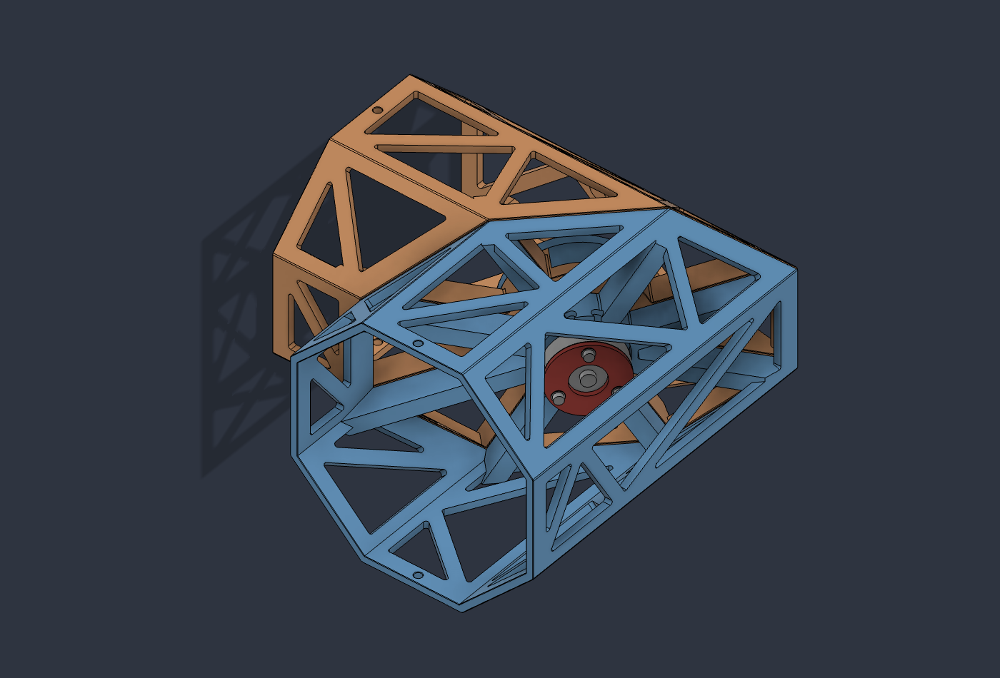

The larger envelope gives the bearing supports and tools room to work. It does not make every dimension larger: the bearing, shaft, collar and hub dimensions come from purchased hardware and stay independent of the housing width.

| Part | Job | What to notice |
| --- | --- | --- |
| **A Housing** | Holds the front bearing and the fixed integrated frame | The central bearing carrier connects to the outer frame through deep spokes. |
| **B Moving Body** | Carries the moving integrated frame | Its central mount connects to the shaft through the hub and adapter. |
| **C Front Bearing Cap** | Retains the front bearing's outer ring | Its central opening must clear the rotating inner ring and nearby hardware. |
| **D Rear Bearing Holder** | Supports the second bearing | Metal posts establish its distance behind A's front bearing support. |
| **E Rear Bearing Cap** | Retains the rear bearing's outer ring | It closes the rear pocket without squeezing the whole shaft stack together. |
| **F Metal Hub Adapter** | Connects the purchased metal hub to B | Metal sleeves carry the compression at its hub mounting screws. |

There are six main printed pieces, plus the small fit samples and test fixtures. Bearings, shaft, collars, hub, metal spacers and fasteners are purchased. In Fusion, their simplified reference bodies begin with **REF**. They show how much room hardware needs; they are not parts to send to the printer.

**Check your understanding:** point to the two pieces that must move relative to each other, then name the metal part that links B to the bearings. The answer is A and B, connected through the hub and shaft. C, D and E stay with A; F moves with B. If that arrangement is clear, the later component names will have a purpose rather than becoming six letters to memorize.

## 2 Follow the force through the frame

Imagine holding A while a neighboring robot module hangs from B. The load must get from the attachment on B to your hand. Trace it through **B's end ring → rails and braces → central hub support → hub and shaft → bearing supports → A's frame**. A strong-looking outside frame cannot compensate for a loose bearing pocket or a weak connection at its center. We need to examine the whole path.

There are two kinds of motion to distinguish. Rotation **around the shaft** is the joint's intended freedom. A motor or brake may control it later, but this version should turn freely; bearing friction is not a holding brake. Tilting or rattling **across the shaft axis** is unwanted movement. Bearing spacing, shaft stiffness, fits, printed supports and frame connections all influence it.

A force can also try to bend the joint because it acts at a distance. The perpendicular distance from a reference point to the force's line of action is the **lever arm**. For this simple case, the bending moment is:

`moment = force × perpendicular lever arm`

A 250 g mass has a weight of about 2.45 N under gravity. With a 100 mm, or 0.100 m, perpendicular arm, it produces about **0.245 N·m**. These are example inputs for learning the calculation, not a tested payload. The real module's center of mass and pose determine its arm. The open textbook [Engineering Statics](https://engineeringstatics.org/) develops this distinction between force, moment and equilibrium with worked examples and interactive figures.

### Why use two bearings

Two separated bearing stations give the shaft two places to react against a bending load. To get a feeling for the relationship, isolate a *pure moment* in a simplified sketch: two equal and opposite support forces separated by a distance `s` produce a moment `R × s`. Their magnitude is therefore `R = moment / s`.

At our nominal **25.1 mm** bearing spacing, the example moment gives `0.245 / 0.0251`, or about **9.8 N**, for that moment-related force pair. The full bearing reactions also have to balance the applied force and depend on where it acts; 9.8 N is not a complete bearing-load calculation. It does show why a small external weight can create appreciable forces inside a closely spaced support.

**Predict before reading on:** if the same moment were resisted by bearing stations twice as far apart, what would happen to that force pair? Its magnitude would halve. That makes spacing a useful design choice—but a wider spacing also needs a longer shaft, room for the supports, alignment, and access for assembly. We will preserve the reference spacing while learning the build, then investigate changes deliberately.

### Why triangulate the surfaces

A rectangular frame with freely pivoting corners can shear into a parallelogram without changing its side lengths. A diagonal restricts that movement by making triangles. That is the starting idea behind the repeated diagonal members here: material follows connected paths between the long corner rails instead of being spread over a closed wall.

Our printed frame is **not an ideal pin-jointed truss**. Its members have width, its nodes are solid, and it carries bending and torsion as well as tension and compression. A diagonal is only useful if it reaches a meaningful connection and can be printed without losing too much material during support removal. We will lay out the member paths before cutting openings, keep material at their shared nodes, and measure the result rather than assume triangles guarantee strength.

The diagram uses **q** for distance along the pivot axis: positive q goes into A and negative q goes into B. It is a ruler aligned with the shaft, not another physical part. We use it because the shaft is diagonal to the long body axis. Later, a plane at `q = 10 mm` will mean 10 mm along that shaft direction from the joint's middle plane.

The rear holder provides a second radial support. It does not force both bearing inner rings against a long printed spacer. That distinction allows us to locate the shaft at the front bearing while leaving allowance at the rear. [SKF's bearing-arrangement guidance](https://www.skf.com/binaries/pub12/Images/0901d196802809de-Rolling-bearings---17000_1-EN_tcm_12-121486.pdf) explains why shaft support and axial location are separate jobs.

## 3 Plan the printer orientation before the edge details

An FDM printer builds a solid by laying down one layer at a time. A surface that looks ordinary in Fusion may ask the printer to place a new line with too little material beneath it. Before choosing a chamfer or making a brace thinner, decide which way the part will grow from the bed.

Each housing will print with its **diagonal joint face against the bed**. A grows in the positive q direction; B grows in negative q. The long body X axis therefore rises at 45° to the bed. A sketch's plane in Fusion and a part's print orientation are different choices: one makes construction convenient, and the other determines how the layers support the geometry.

Look along that build direction at an opening. A steep brace may gain support from the layer immediately below. A shallow brace or the roof of a pocket may need temporary **support material**. The opening being triangular does not settle the question: its orientation, dimensions, layer height and the surface on its underside matter. We will inspect the actual sliced layers and use removable support where the geometry needs it.

Two edge tools will appear often:

| Tool | Shape it makes | A useful job here |
| --- | --- | --- |
| **Chamfer** | A flat bevel across an edge | Guide hardware into a hole or relieve a bed-contact edge |
| **Fillet** | A rounded transition | Round a sharp opening root so the frame has a less abrupt change in shape |

Neither is a universal finishing pass. A round bed-facing fillet can begin with a very shallow underside; a chamfer can offer a more consistent slope. Conversely, a flat bearing shoulder needs to remain flat because it locates the ring. Choose an edge treatment for a job, inspect it in the print direction, and leave functional contact faces alone. [Prusa's modeling guide](https://help.prusa3d.com/article/modeling-with-3d-printing-in-mind_164135) illustrates these orientation and edge-treatment tradeoffs.

Before printing the full housings, we will also print a small piece of the actual brace geometry. This **coupon**, or test sample, lets you inspect the underside and practice removing support before committing to a housing. It cannot reproduce every cooling or long-print effect of the full part, but it can answer a much cheaper question: does this local shape print cleanly enough with this process, and can you reach the support afterward? The bearing and fastener fit samples come first.

**Check your reasoning:** adding a 0.3 mm bevel to the edge of a long shallow brace does not change the angle of the brace's broad underside. It may improve that edge, but it cannot remove the need for support beneath the whole span. Keep that distinction in mind when we make the final edge pass.

## 4 Measure the hardware before setting the printed fits

Before opening a complicated sketch, put a bearing, screw, nut and washer on the desk. Reading these parts is a CAD skill: their real shapes decide the holes, pockets, shoulders and tool passages you need to model.

### Read a metric screw label

Take **M3 × 0.5 × 45 mm, socket-head cap screw** as an example:

| Part of the name | What it tells you | What it does not tell you |
| --- | --- | --- |
| **M** | The screw uses an ISO metric thread. | It does not identify the head shape. |
| **3** | The nominal outside diameter of the thread is 3 mm. | A printed clearance hole should not automatically be 3 mm. |
| **0.5** | The thread pitch is 0.5 mm from one crest to the next; an ordinary single-start screw advances that far per full turn. | It is not the hex-key size. |
| **45 mm** | The screw length measured from beneath this head to its tip. | It excludes the head height for a socket-head cap screw. |
| **Socket-head cap** | A cylindrical head with an internal hex drive. | A button head or countersunk head has different geometry even at the same M size. |

Suppliers often omit the pitch when selling a standard coarse thread: **M3 × 45** usually means M3 × 0.5 × 45. Match the pitch on the nut or threaded hub as well as the diameter. The coarse pitches we use are **0.5 mm for M3** and **0.7 mm for M4**. [Metric thread-pitch reference](https://boltdepot.com/fastener-information/Measuring/Metric-Thread-Pitch)

A countersunk screw is normally measured including its head because the head seats within the part; that convention does not apply to our socket heads. When you compare two screw lengths, first check their head styles. [Fastener measurement conventions](https://boltdepot.com/Fastener-Information/Identifying-Fasteners)

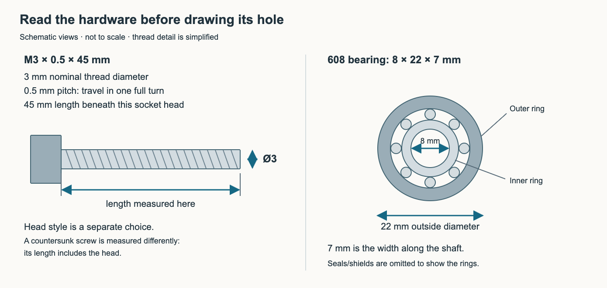

**Try it with hardware:** measure a screw's outside thread diameter and under-head length with your calipers. A caliper reading is a check, not a reason to rename an M3 screw if it measures a little under 3 mm. Compare its nut's width across two opposite flat faces. Our M3 nuts use a 5.5 mm wrench; our M4 nuts use a 7 mm wrench. Those wrench sizes are different from the screws' 2.5 mm and 3 mm internal hex drives.

### Know what each fastener is doing

A screw through a **clearance hole** should pass through without cutting a thread in that hole. Its thread engages a nut or a tapped metal part farther along the stack. Tightening pulls the screw head and that thread engagement toward each other, clamping the parts between them. That is why the thickness of every washer, flange and sleeve affects the screw length you need.

A **plain hex nut** supplies threads. A matching hexagonal pocket keeps it from turning while you reach the screw from the other side; this is a **captive nut** arrangement. Our B housing uses that approach. A **nylon-insert locknut** adds resistance to turning once the screw reaches its nylon insert. Our long M3 support screws use these locknuts. Resistance to rotation does not correct poor seating or make crushed plastic acceptable.

A **flat washer** spreads the head or nut's contact over a larger area and gives it a defined bearing surface. A wide washer can bridge a larger opening, as the 12 mm OD washers do at F's sleeve holes. A **compression sleeve** is different: it passes through the plastic so a metal-length stop can carry compression through the joint. The sleeve length and actual printed thickness must agree; an overly long sleeve can leave the plastic loose, and an overly short one allows the plastic to be squeezed first.

**Heat-set inserts** are another useful option for future printed parts. They embed a metal thread in a deliberately sized plastic boss. They are especially useful for repeatedly opened covers, but they are not interchangeable with the captive nuts in this model. Their outside diameter, length and installation process need their own design and fit trial.

### Read a bearing and its contacts

Your **608 bearings are nominally 8 mm bore × 22 mm outside diameter × 7 mm width**. The bore is the central hole. The **inner ring** surrounds the shaft; the **outer ring** sits in the housing. Balls between the two let one ring turn relative to the other. Seals or shields keep contamination out; they are not useful surfaces to clamp against. “608” identifies a bearing size series—do not assume the final digits of every bearing number are its bore in millimeters.

Hold the outer ring and turn the inner ring gently. You have isolated the motion we want the joint to allow. Now identify what will touch each ring in the assembly: the printed pocket shoulder and cap retain the **outer ring**, while the small metal spacers and collars locate the shaft at the front **inner ring**. A spacer that also rubs the seal or outer ring can turn a free-moving assembly into a brake.

**Radial** means across the shaft axis, toward or away from its centerline. **Axial** means along the shaft. The pocket supports the bearing radially; shoulders, caps, spacers and collars control different axial contacts. Keeping those directions separate helps you diagnose a problem: sideways rocking suggests a different issue from a shaft that becomes tight only after an end cap is tightened.

### Separate size, allowance and tolerance

The **nominal size** is the named size, such as a 22 mm bearing. **Tolerance** is the permitted variation in a manufactured dimension. A **fit allowance** is a deliberate size difference between mating features. Here, a 22.2 mm modeled pocket around a nominal 22 mm bearing has a 0.2 mm **diametral** allowance, or 0.1 mm on each side if perfectly centered. That does not guarantee the printed hole will actually measure 22.2 mm.

Printed fit also depends on orientation, extrusion, shrinkage and cleanup. Instead of arguing with a drawing, we will print several pocket sizes and try the actual bearing. The small chamfer at a mouth helps start insertion; it does not enlarge the straight fit region deeper inside the pocket.

**Predict, then check:** changing a bearing pocket from 22.2 to 22.3 mm adds 0.1 mm to its diameter, so the ideal clearance increases by **0.05 mm per side**, not 0.1 mm per side. This distinction matters when you begin making your own fit adjustments.

### Gather and measure the joint hardware

Use calipers to record the bearing width and outside diameter, shaft diameter, retaining hardware, screw lengths beneath their heads, and the outside dimensions of the tools that must reach the screws. Calipers are useful workshop checks; they do not establish a precision shaft tolerance. Use the purchased shaft specification and gentle actual-fit checks together.

The table below describes the hardware envelope used by the supplied model. Exact part numbers matter where they determine clearance or tool access. Check current availability, and measure substitutes before treating them as equivalent.

| Quantity | Hardware | Dimensions or part |
| --- | --- | --- |
| 2 | Bearings | Your 608 bearings, nominal 8 × 22 × 7 mm |
| 1 | Smooth round metal shaft | 8 mm diameter × 60 mm length; supplier-configured MISUMI SFJ8-60 is one documented route |
| 2 | Two-piece shaft collars | [Ruland MSP-8-F](https://www.ruland.com/msp-8-f.html), 8 mm bore, 18 mm body diameter, 9 mm width; supplied collar screws |
| 2 | Inner-ring spacers | [goBILDA 1522-0010-0040](https://www.gobilda.com/1522-series-8mm-id-spacer-10mm-od-4mm-length-4-pack/), 8 mm ID × 10 mm OD × 4 mm long |
| 1 | Shaft clamp hub | [goBILDA 1309-0016-0008 Sonic Hub](https://www.gobilda.com/1309-series-sonic-hub-8mm-bore/), round 8 mm bore, with its two pinch bolts |
| 3 | Unthreaded metal support posts | [DREMEC 316/3.2X12](https://www.tme.com/us/en-us/details/dr316_3.2x12/metal-spacers/dremec/316-3-2x12/), 3.2 mm ID × 6 mm OD × 12 mm long |
| 4 | Metal compression sleeves | [DREMEC 318/4.3X06](https://www.tme.com/us/en-us/details/dr318_4.3x6/metal-spacers/dremec/318-4-3x06/), 4.3 mm ID × 8 mm OD × 6 mm long |
| 3 | Long bearing-support screws | M3 × 45 mm socket-head screws |
| 6 | M3 washers | Approximately 3.2–3.3 mm ID, 7 mm OD, 0.5 mm thick |
| 3 | M3 locknuts | Nylon-insert nuts, 5.5 mm across flats and 4 mm high in the reference stack |
| 4 | Hub mounting screws | M4 × 12 mm socket-head screws |
| 4 | Housing mounting screws | M4 × 30 mm socket-head screws |
| 4 | Wide M4 hub washers | Approximately 4.3 mm ID, 12 mm OD, 1 mm thick, such as the nominal DIN 9021 size |
| 4 | M4 outer-attachment washers | Reference model: approximately 4.3 mm ID, 9 mm OD, 1 mm thick; check the actual stack as described below |
| 4 | M4 nuts | Plain hex nuts, 7 mm across flats and 3.2 mm thick |

**A washer is part of the dimension chain.** Ordinary M4 flat washers with a 9 mm OD are commonly nominally **0.8 mm thick**, while the reference outer-attachment stack above uses **1 mm**. For the same screw and parts, a washer 0.2 mm thinner lets the tip project 0.2 mm farther. Measure your washers and recheck screw-tip clearance in the assembly lesson before closing the housings; the stock washer is not an automatically verified substitute. Do not replace it with a conical spring washer merely because a catalog lists a 1 mm thickness. [Example M4 flat-washer dimensions](https://boltdepot.com/Product-Details?product=4514)

The shaft needs a smooth, round bearing surface along its working length. The [MISUMI shaft catalog](https://us.misumi-ec.com/pdf/fa/2010/p0107.pdf) documents diameter/length configurations; verify the current configuration and tolerance before ordering. Threaded rod, D-shaped shaft, 8REX shaft and a press-fit dowel are different parts even if their labels include “8 mm.” Test the actual shaft through each bearing, spacer, loose collar and hub before printing the full assembly. It should enter without hammering or using the screws to pull it through. No shaft drilling or threading is required by this design.

Before comparing the posts, practice a repeatable caliper measurement:

1. Clean the caliper jaws and the post's two flat ends. Close the jaws gently and check zero; set zero if needed according to your caliper's instructions.
2. Place the post between the broad **outside measuring faces**. Keep those faces square to its flat ends, away from the chamfered edges. You want the end-to-end length, not a slanted contact across two corners.
3. Close with light, consistent pressure. Record the reading, release the post, rotate it, and measure again. If the readings change appreciably, check cleanliness and squareness before deciding the part is a different length.
4. Repeat for all three posts. Their **spread is the largest measured length minus the smallest**. For example, repeatable readings of 11.98, 12.00 and 12.02 mm give a 0.04 mm spread.

A display that changes in 0.01 mm steps has 0.01 mm **resolution**; that does not establish its accuracy. Use the instrument's specification and the consistency of your technique when interpreting small differences. [Mitutoyo's caliper-use guidance](https://www2.mitutoyo.co.jp/eng/useful/E11003/pdf/23.pdf)

Measure the three **12 mm posts as a set**. Their stated length tolerance is ±0.1 mm, so they can be individually within specification but differ from one another. Unequal posts can tilt D and misalign the bearings. Select closely matched posts, aiming for a spread around **0.05 mm or less** as a build target, then check rotation as the support is tightened. Extra screw force is not a remedy for a tilted holder. The **6 mm sleeves** have the same stated length tolerance and need to finish flush with F's actual flange. [DREMEC spacer drawing](https://www.tme.com/Document/57c711dbc574743fa61171ef7ac3c9c0/DR314.pdf)

For assembly, have calipers, a straightedge, a scale for small masses, a **2.5 mm hex tool with at least 100 mm usable straight reach** for the M3 screws and collars, a **bare 3 mm hex tool with at least 120 mm usable straight reach** for the M4 heads and hub pinch bolts, and tools for 5.5 mm and 7 mm nuts. The longest modeled internal approaches are about 81.5 mm for A's M3 screws and 94.7 mm for B's outer M4 screws, before engagement and handling room. Measure the usable shaft, not a tool's overall “long arm” label. A fat bit holder cannot travel through a narrow passage simply because its bit fits the screw. A torque tool is useful for following the metal collar manufacturer's instructions; those instructions do not supply a tightening torque for our printed parts.

Also prepare **three rigid, flat shim strips or gap gauges, each measured 1 mm thick**. Make them long enough to grasp and remove. During final mating they sit at three separated **broad, unchamfered lands** of the diagonal outer frames, establishing the face gap while the hub is still free to slide. A printed gauge needs measurement too; its CAD thickness is not proof of its finished thickness. These are temporary tools: remove all three and count them back onto the bench before rotating the joint.

For the later load test, you will also need a rigid bench vise with **at least 162 mm jaw opening, plus lining and insertion clearance**, two narrow soft-jaw strips, **2–3 mm cord**, small known masses and a hanger, a scale, a rigid independent reference or dial indicator, and a soft catch surface. We will model the end backers, jaw strips and temporary 45° setup block before using them.

## 5 Model and print the fit samples

Your first modeling task is a small ring. It teaches the same pattern we will use many times: **choose the component → choose a plane → constrain a sketch → create or cut a solid → inspect the result**. The ring also answers a real build question, so it is worth making even if you use the supplied full-size models later.

We need two orientations. A's bearing pocket opens downward toward the print bed; D's opens upward. Turning one printed ring over afterward does not reproduce the way the other was manufactured. We will model and print both.

### Start a separate fit-trial document

1. Choose **File > New…**. If the new-design dialog offers a type, select **Hybrid Design**, then **Create New**. Use the Design workspace and keep design history on so the operations appear in the Timeline.
2. In the Browser, expand **Document Settings** and set the document units to **millimeters**. Save the file with a clear name, such as `Pivot fit trials`.
3. Choose **Solid > Assemble > New Component**. Uncheck **External**, name it **Seat 22.2 mouth down**, and leave **Activate** enabled. This component will contain one test piece.
4. Expand that component's **Origin** folder. Its XY plane is the flat reference we will use as the print-bed plane for this coupon. Keep track of this plane; several later sketches will use it again.

### Make the mouth-down bearing ring

1. Click **Create Sketch**, then select the component's **XY plane**. Use **Sketch > Create > Circle > Center Diameter Circle**. Click the origin for the center, move outward, type **30 mm**, and confirm. Press **Esc** to leave the circle tool.
2. Check the diameter. If you placed the circle without a dimension, press **D**, select its edge, click to place the dimension, and enter **30 mm**. The center must be coincident with the origin. That fixes location; the diameter fixes size. In the normal sketch colors, fully constrained geometry becomes black. Do not use **Fix** simply to hide a missing size or centering relationship. [Fully defining sketches](https://help.autodesk.com/cloudhelp/ENU/Fusion-Sketch/files/SKT-FULLY-DEFINE-CONSTRAIN-SKETCH.htm)
3. Click **Finish Sketch**. Choose **Solid > Create > Extrude**, select the shaded disk profile, and set **Distance: 10.1 mm**, **Direction: One Side**, **Operation: New Body**. The preview should grow upward from XY, in positive Z. Confirm and name the feature **Down trial blank**.
4. Create another sketch on the **same XY plane**, not on the top face. Make an origin-centered, dimensioned **19.5 mm** circle and finish the sketch.
5. Extrude that circular profile **10.1 mm upward**, with **Operation: Cut**. If Fusion is trying to add a cylinder, change the operation before accepting. You should now have a ring with a hole all the way through.
6. Create one more sketch on **XY**. Draw a centered **22.2 mm** circle and finish. Extrude its profile **7.1 mm upward**, again as **Cut**. If the existing hole appears as a separate inner boundary, select the annular region around it; the cut should remove the wider pocket from the ring, not the entire outside ring.
7. Orbit to look at the underside. The wide pocket must open at **Z = 0** and stop short of the top. The remaining **3 mm shoulder** is the flat ring that will support the bearing's outer ring. If your pocket opens at the top, check the sketch plane and cut direction rather than turning the whole part over.
8. Choose **Solid > Modify > Chamfer**. Select the **circular mouth of the 22.2 mm pocket at Z = 0**, use **Equal Distance**, and enter **0.4 mm**. Confirm. Make a separate **0.3 mm** chamfer on the **outside bottom circular edge**. Keep the bearing shoulder and its smaller opening unchanged.

The large outside diameter gives the trial enough material to handle. The 19.5 mm through opening clears the inner ring and shields, while the larger pocket locates the outer ring. The 0.4 mm mouth chamfer helps the bearing begin entering squarely. None of those jobs requires rounding the flat shoulder that determines where the bearing stops.

**Checkpoint:** the mouth-down component should contain one ring-shaped body, 30 mm outside diameter and 10.1 mm tall. From below, you should see the larger 22.2 mm pocket; from above, the opening is 19.5 mm. Use **Inspect > Measure** if the appearance is ambiguous. A bearing-shaped hole with no remaining shoulder means the wider cut went too far.

### Make the mouth-up comparison

1. Activate the **root** of the document before choosing **New Component**, so the new trial is a sibling of the first. Name it **Seat 22.2 mouth up** and activate it. Hide the first component using its visibility control; otherwise the overlapping solids will make selection confusing.
2. Repeat the centered **30 mm** outside-circle sketch, but extrude the blank **10.2 mm upward**. Cut a centered **19.5 mm** opening through all **10.2 mm**.
3. Choose **Construct > Offset Plane**, select this component's XY plane, and enter **3 mm** toward positive Z. The new plane marks the top of the shoulder, rather than the opening of the pocket.
4. Sketch the centered **22.2 mm** circle on that offset plane. Extrude-cut **7.2 mm upward**. The pocket should now open at the top of the ring, at Z = 10.2 mm.
5. Chamfer the **upper pocket mouth** by **0.4 mm**. Chamfer only the **outside bottom edge** by **0.3 mm**. Leave the shoulder flat.

Both coupons print in the orientation in which you modeled them, with XY at the bed. Their 0.1 mm difference in pocket depth reproduces the reference A and D pockets; we are comparing actual local features, not assuming a generic fit ring represents every seat.

### Make a sleeve and nut trial

This second coupon puts a round metal sleeve and a hex nut in the same small block. We are testing their fits independently; they share a block to save handling and print time.

1. Activate the root, create **Sleeve 8.2 and Nut 7.2 Trial**, activate it, and hide the bearing trials.
2. Create a sketch on XY. Use **Center Rectangle**, click the origin, and dimension the rectangle to **40 mm in X × 22 mm in Y**. Finish and extrude **6 mm upward** as **New Body**.
3. Sketch on XY again. Draw a line from the origin toward negative X. Select it and change its line type to **Construction** in the Sketch Palette; a construction line locates things but does not create a cutting profile. Apply **Horizontal/Vertical** if needed, and dimension its length to **10 mm**.
4. At the left endpoint, draw a circle, keep its center coincident with the endpoint, and dimension the diameter **8.2 mm**. Finish and extrude-cut through **6 mm upward**. This is the sleeve hole.
5. In a new XY sketch, use the same construction-line method toward **positive X**, length **10 mm**. Put a **4.3 mm** circle at its endpoint and cut through the **6 mm** block. This is the screw clearance hole at the center of the future nut pocket.
6. Create another sketch on XY. Locate the nut center at **X = +10, Y = 0** using the same constrained construction-line method. Choose **Sketch > Create > Polygon > Circumscribed Polygon**, click that endpoint for its center, and set **6 sides**. The tool's initial size input is a radius; **3.6 mm** gives a 7.2 mm construction-circle diameter. After placing the polygon, press **Esc**.
7. Inspect the polygon's construction-circle dimension. If the tool already created one, edit that dimension rather than adding a second one. If there is no size dimension, use **D** to add one. Set **7.2 mm diameter**, or **3.6 mm** if Fusion displays a radius dimension. Do not enter 7.2 as a radius: that would double the nut pocket's intended across-flats size. Apply **Horizontal/Vertical** to one polygon side so the hexagon cannot rotate. The circle passes through the side midpoints, so its diameter controls the **distance across flats**. [Circumscribed polygons](https://help.autodesk.com/cloudhelp/ENU/Fusion-Sketch/files/SKT-CREATE-POLYGONS.htm)
8. Finish the sketch. Select the hexagonal profile around the existing screw hole and extrude-cut **4 mm upward**. The pocket opens at the bed face and leaves **2 mm of material above it**. That roof will need support when printed; its small 4.3 mm hole still runs through the block.
9. Choose **Modify > Chamfer**, use **Equal Distance**, and turn **Tangent Chain off**. Looking at the bottom face, **Z = 0**, select the sleeve-hole circular mouth and the **six edges around the hexagonal pocket mouth**. Enter **0.3 mm**. Leave the upper sleeve mouth, the pocket floor and the small screw hole unchanged.

This last bevel reproduces the entry treatment at F's sleeve holes and B's nut pockets. It makes the first approach less sensitive to a sharp edge, but the straight region inside still determines the fit.

### Complete the fit set

You have modeled a mouth-down ring, a mouth-up ring and one sleeve/nut block. Those three pieces introduce the different operations. Choose how to prepare the remaining variants:

- **More modeling practice:** repeat the ring pair for pocket diameters **22.0, 22.1 and 22.3 mm**. Keep their outside diameter, through opening, shoulder, heights and chamfers unchanged. Then make two more blocks with **8.0 / 7.0 mm** and **8.1 / 7.1 mm** sleeve-diameter / nut-across-flats pairs, retaining the 0.3 mm bottom-mouth chamfers. If using radius dimensions for the nut construction circles, the three nut sizes use **3.5, 3.55 and 3.6 mm**. Activate the root before creating each new component and hide completed ones while working.
- **Move on to the print experiment:** export your three modeled pieces and use the supplied meshes below for the remaining six rings and two blocks. Compare the first three with the editable checkpoint before slicing. Keep the supplied filenames so you can identify the sizes later.

Both routes produce the same **eleven-specimen test set: eight bearing rings and three fastener blocks**. Print, identify and compare the full set in Step 6, then carry the selected labeled dimensions into your fitted model. The choice changes how much CAD repetition you do; it preserves the fit experiment.

Name each modeled component with its fit size and, for rings, `down` or `up`. Name its exported mesh the same way. Avoid **Move/Copy** during construction; the samples can stay at the origin because you export them one component at a time. The figure below displays the supplied STL meshes separately for identification; you do not need to reproduce those display positions in Fusion.

**Checkpoint:** have eleven distinct trial meshes ready to slice, using either route above. Each piece you modeled should be a separate component with one body. In a finished sketch, a line that can still be dragged has an unresolved relationship. Look first for an unconstrained circle center, construction-line length, or hexagon rotation. Hiding a sketch after finishing it does not delete its feature history.

### Compare or use the supplied trials

[Open the editable fit-trial checkpoint](checkpoints/14-bearing-and-fastener-fit-trials.f3d) to compare your feature order and dimensions. To print your own trial, finish its active sketch, right-click its component or body in the Browser and choose **Save As Mesh**, then use **STL**, millimeter units and a fine enough refinement to keep the circular surfaces smooth. Export one trial per file. The detailed export lesson in Step 36 explains the full-part workflow; supplied meshes below are ready for these first tests.

| Pocket diameter | Mouth down for A | Mouth up for D |
| --- | --- | --- |
| 22.0 mm | [Down 22.0](print-files/PRINT-FIRST-seat-22.0-down.stl) | [Up 22.0](print-files/PRINT-FIRST-seat-22.0-up.stl) |
| 22.1 mm | [Down 22.1](print-files/PRINT-FIRST-seat-22.1-down.stl) | [Up 22.1](print-files/PRINT-FIRST-seat-22.1-up.stl) |
| 22.2 mm | [Down 22.2](print-files/PRINT-FIRST-seat-22.2-down.stl) | [Up 22.2](print-files/PRINT-FIRST-seat-22.2-up.stl) |
| 22.3 mm | [Down 22.3](print-files/PRINT-FIRST-seat-22.3-down.stl) | [Up 22.3](print-files/PRINT-FIRST-seat-22.3-up.stl) |

The combined trials are [8.0 sleeve / 7.0 nut](print-files/PRINT-FIRST-sleeve-8.0-nut-7.0.stl), [8.1 / 7.1](print-files/PRINT-FIRST-sleeve-8.1-nut-7.1.stl), and [8.2 / 7.2](print-files/PRINT-FIRST-sleeve-8.2-nut-7.2.stl).

## 6 Slice the trials and keep a fit log

The slicer turns the solid model into paths the printer can follow. A clean-looking CAD pocket can still print with a first-layer lip or support residue inside it, so this stage includes inspecting the paths and the physical result.

### Set the shared print process

In Bambu Studio's **Prepare** view, choose the **X1 Carbon**, **0.4 mm nozzle**, and your actual **PLA** filament profile. In **Process > Quality > Layer height**, set both **Layer height** and **Initial layer height** to **0.20 mm**. In **Quality > Precision**, set **Elephant foot compensation** to **0.15 mm**; enable **Advanced** settings if the field is hidden. The initial-layer height is a separate setting, so changing ordinary layer height alone does not set both. The compensation addresses the first layers' outward spread; keep it the same for the samples and the parts whose fits they represent. [Bambu Studio setting definitions](https://github.com/bambulab/BambuStudio/blob/master/src/libslic3r/PrintConfig.cpp), [Quality-panel groups](https://github.com/bambulab/BambuStudio/blob/master/src/slic3r/GUI/Tab.cpp)

Set **4 wall loops**, **4 top and bottom layers**, **0.8 mm minimum top/bottom shell thickness**, and **15% gyroid infill**. Walls trace the part boundaries; infill fills the enclosed interior. Several walls can occupy much of a small ring's section, which is why a higher infill percentage is not the only way to add material.

Use the following support and brim values for the **four mouth-down bearing rings and all three sleeve/nut blocks**. Open **Process > Support** and enable Advanced settings if the style or interface controls are hidden; find the brim controls by their names in the process settings. No manual support painting is needed for this reference process.

| Bambu Studio setting | Reference value |
| --- | --- |
| Enable support | On |
| Support type | Tree (auto) |
| Tree style | Tree Hybrid |
| Threshold angle | 45° |
| On build plate only | On |
| Top / bottom Z distance | 0.2 / 0.2 mm |
| Top / bottom interface layers | 2 / 2 |
| Support/object XY distance | 0.35 mm |
| Brim type and width | Outer only, 5 mm |
| Brim/object gap | 0.1 mm |

For the **four mouth-up rings**, turn **Enable support off**, keeping the other shared settings, including the brim, unchanged. Separate plates are a straightforward way to keep the two support choices distinct. Save the process settings with your trial project so you can reuse them later.

The **interface** is the support material closest to the part. The Z distances leave vertical separation; the XY distance leaves lateral separation. Those gaps affect the supported surface and how readily the support releases. Keep them fixed during this first fit comparison. “On build plate only” tells the slicer where support may start; you still need to check how you will remove its branches from the pocket.

### Slice, inspect, then try the hardware

1. With that printer, filament and process selected, import the trial meshes at **100% scale**. If prompted whether separate trial files are one object with multiple parts, keep them as separate objects so you can name and identify them.
2. Keep each file's modeled bed face downward. Check the object dimensions: bearing rings are **30 mm across**, not 3 mm or 300 mm. If a file imports at the wrong size, correct the units or export rather than guessing a scale factor.
3. Check that the shared process above is applied: both layer heights are **0.20 mm**, elephant-foot compensation is **0.15 mm**, and the wall, shell and infill settings match. Check support is on for the down rings and fastener blocks, and off for the up rings.
4. Confirm the support and brim values in the table. The mouth-down process reproduces support inside A's bearing pocket and B's nut pockets; changing that condition would make the trial less representative.
5. Name the objects by their filenames and keep a simple plate map. After printing, several sizes will look nearly identical. Mark each cooled sample immediately after removal, before moving on to the next.
6. Slice, switch to **Preview > Line Type**, and move the layer slider through the downward seat shoulder and nut-pocket roof. Identify the support and interface paths beneath those surfaces. Check that there is an open route through which you can remove the support afterward. Compare the upward-opening ring, whose shoulder is built from material below without that cavity support.
7. Print the trials. Let them cool, remove the supports and interface material through the open mouths, and clean loose strands or an obvious first-layer lip. Keep the flat bearing shoulders and nut-pocket floors intact. Removing a trapped fragment is cleanup; sanding away the shoulder is a geometry change.
8. Give your **two actual bearings distinct identities**, such as Bearing 1 and Bearing 2, and keep them in labeled trays when they are out of a sample. Test both bearings in the down and up trials by **gentle hand pressure**. Each should enter squarely and reach the shoulder without hammering; check both full seating and sideways rocking. A fit achieved with one bearing does not establish the other bearing's fit. Try each nut and sleeve independently.

Record each result in the [fit log](fit-log.csv). Duplicate a bearing-trial row for the second bearing and put its identity in **notes**. Keep **down** associated with **A's front bearing seat**, and **up** with **D's rear bearing seat**. When you select the fits, record which bearing will occupy each station and keep those assignments identifiable through assembly. The combination block may have the best sleeve fit but an overly loose nut pocket; there is no requirement to choose the two dimensions as a pair in your final design.

| Trial and orientation | Measured hardware | Seats fully by hand | Rocking or spin | Entry or roof defect | Decision |
| --- | --- | --- | --- | --- | --- |
| Bearing identity, diameter and down/up station | OD and width | Record | Record | Record | Select or revise |
| Sleeve diameter | OD and actual length | Record | Record | Record | Select or revise |
| Nut across flats | AF and thickness | Record | Record | Record | Select or revise |

### Read a failed fit before changing its size

| What you observe | Inspect first | What the observation may mean |
| --- | --- | --- |
| Hardware catches only at the mouth | First-layer lip, support residue and the entrance chamfer | The entrance may be obstructed even if the deeper fit is large enough. |
| A bearing starts squarely but binds all the way in | Cleaned pocket diameter and the next larger sample | The straight fit may be too tight for this printer and process. |
| Hardware enters but cannot reach the bottom | Residue on the shoulder or pocket floor; actual hardware depth | A blocked or too-shallow pocket can imitate a tight diameter. |
| A seated bearing rocks sideways | Actual pocket fit and damaged wall material | The fit may be too loose; increasing screw force will not restore the missing support. |
| A nut spins as you try a screw | Across-flats fit, nut orientation and pocket damage | The pocket is not holding the nut adequately. |
| Down and up rings behave differently at the same nominal diameter | Print orientation, support cleanup and local surface quality | Those two seats may need different allowances. |

Choose the smallest bearing pocket that seats fully without force or noticeable rocking, and a nut pocket that accepts the nut without allowing it to turn freely. The reference **22.2 mm seats, 8.2 mm sleeve holes and 7.2 mm nut pockets are trial values**, not universal printer tolerances. If none of the samples works, make another small trial around the useful end of the range before committing to the housings.

### Carry the fit log into the full model

The later lessons use **22.2 mm seats, 8.2 mm sleeve holes and 7.2 mm nut pockets** to describe the supplied reference model. Your selected trial dimensions must become the dimensions in the model you print. Keep a saved **reference version** for comparing the lesson, and make a separately named **fitted version** for your printer and hardware. Record the chosen values and bearing assignments in the fit log before continuing.

For this handoff, the **chosen size is the trial's labeled CAD dimension**, the number that produced the successful print. Your measured physical hole size is an observation about that print; it is not the number to substitute for the labeled dimension in the following expressions.

| Result from your log | What to enter later |
| --- | --- |
| One chosen bearing-pocket diameter works for both assigned stations | In Step 20, set `seatAllowance = chosen pocket diameter - 22 mm`; leave `seatDiameter = bearingOD+seatAllowance`. For example, a selected 22.1 mm pocket means a 0.1 mm allowance. |
| A's down seat and D's up seat need different diameters | Create separate mm parameters, `frontSeatDiameter` and `rearSeatDiameter`, set to the respective chosen diameters. Use the front parameter in A's bearing-pocket sketch in Step 22 and the rear parameter in D's pocket sketch in Step 29. Do not leave both sketches using the shared `seatDiameter`. |
| Chosen sleeve-hole diameter | In Step 31, set `sleeveAllowance = chosen sleeve-hole diameter - 8 mm`; the hole expression remains `sleeveOD+sleeveAllowance`. A selected 8.1 mm hole therefore means 0.1 mm allowance. |
| Chosen nut-pocket across-flats size | Set `nutAF` directly to that size when adding it in Step 24; use it for the four pockets in Step 25. A selected 7.1 mm pocket means `nutAF = 7.1 mm`. |

Make this transfer **before printing the full parts**. If you built the reference geometry first, update the fitted copy, inspect the changed features and relevant contact/clearance checks, then **export fresh meshes and re-slice them**. Editing Fusion does not update a previously exported STL or a saved slicer plate automatically. The supplied digital checks describe the reference geometry; they do not become validation of your changed geometry simply because the edit is small.

Keep F's actual flange thickness matched to the **6 mm sleeves**: a diameter trial does not establish whether a sleeve is flush axially. Fit selection is several small decisions—front seat, rear seat, sleeve diameter, nut flats and sleeve length—not one general correction for the whole model.

**Checkpoint before the larger model:** show someone one sample that fits and one that does not, then explain the difference using **size, orientation, surface condition and contact**. If your explanation is only “the printer is inaccurate,” take one more look. Finding the specific source of the mismatch is the skill that will let you design the next joint yourself.

# Part 2 Give the joint a reliable foundation in Fusion

We will begin with one solid octagonal blank, then divide it into the two moving halves. That shared beginning matters: both halves inherit the same size, center and split plane. Later, when you ask for a little more room inside, you can change the envelope without redrawing the bearing seats.

This part teaches a habit you can reuse in almost every mechanical model: **describe what must stay related before adding detail**. A centered sketch, a named width and a stable reference plane do more useful work than a carefully positioned collection of unconstrained lines.

Keep the Browser open on the left and the Timeline visible along the bottom. The Browser answers “which part owns this?” The Timeline answers “which earlier decision created this?” When something goes wrong, those two questions usually lead to a smaller repair than deleting the model and starting again.

## 7 Create a parametric document and name the body dimensions

1. Choose **File > New…**. Select **Hybrid Design**, then **Create New**.
2. Save the new design as **V4.2 My Octagonal Pivot**. This is your working copy; keep the supplied checkpoints as references you can return to.
3. In the Browser, expand **Document Settings**. Set **Units** to **Millimeter**.
4. Look along the bottom of the window for the **Timeline**. If it is absent, right-click the top Browser entry and enable **Capture Design History** or **Change to Parametric Modeling**, depending on your Fusion version.

Hybrid Design lets us model several internal components and define their movement in one document. A current **Part Design** is intended for a single component, so it is the wrong container for this assembly. If you started in Part Design, use **Document Settings > Design Type** to convert to Hybrid Design. There is no need to discard the sketch. [Create and save designs](https://help.autodesk.com/cloudhelp/ENU/Fusion-Designs/files/ASM-CREATE-DESIGN.htm), [Autodesk design types](https://help.autodesk.com/cloudhelp/ENU/Fusion-Designs/files/ASM-CONVERT-DESIGN-TYPE.htm)

**Parametric** means the model remembers its recipe: a sketch was this wide, an extrusion used that length, and a hole was centered on a particular reference. We will edit the recipe rather than stretch finished solids by eye. Keep design history enabled so Fusion can rebuild later features after an earlier dimension changes. [Parametric modeling](https://help.autodesk.com/view/fusion360/ENU/?contextId=DESIGN_HISTORY)

Open **Solid > Modify > Change Parameters**. In **User Parameters**, use the add control to create each row below. Enter the name exactly, choose the listed unit, and put the value or formula in **Expression**. The **Value** column is Fusion's calculated result; it is the expression that records your intention.

For the first row, type `bodyWidth`, choose **mm**, and enter `150`. For the second row, enter the expression containing `bodyWidth`. Fusion now knows that a facet's width depends on the overall width; you will not have to keep those two dimensions in sync by hand.

| Name | Unit | Expression | Purpose |
| --- | --- | --- | --- |
| `bodyWidth` | mm | `150` | Outside distance between opposite octagon flats |
| `faceHalfWidth` | mm | `bodyWidth*(sqrt(2)-1)/2` | Half the width of one flat face |
| `bodyLength` | mm | `260` | Total length before splitting |
| `splitAngle` | deg | `45` | Angle of the dividing plane |
| `wall` | mm | `4.5` | Integrated side-member radial thickness |
| `faceGap` | mm | `1` | Total separation between the diagonal faces |

The [complete parameter CSV](parameters.csv) provides the reference design's names, units, expressions, and comments. Add the parameters in each lesson as you reach them; a long imported table is not a substitute for understanding which feature uses each value.

A sketch dimension can use `bodyWidth` wherever it would normally accept a number. An extrusion can use `bodyLength`. These names become the few controls you will adjust later. We keep the purchased bearing size separate because “make the housing wider” should not mean “buy a larger bearing.” [Create and edit parameters](https://help.autodesk.com/cloudhelp/ENU/Fusion-Model/files/SLD-MODIFY-CHANGE-PARAMETERS.htm)

**Check your result:** `faceHalfWidth` should evaluate to about **31.066 mm**. If Fusion rejects that expression, check the spelling of `bodyWidth` and enter the width row first. We have created design information, but no solid geometry yet; an empty canvas is expected.

## 8 Constrain an octagon by its across flats size

1. Activate the **root component**: right-click the top entry in the Browser and choose **Activate**. The root is the document-level container.
2. Expand its **Origin** folder and turn the origin visibility on if needed.
3. Choose **Create Sketch**, then select **YZ Plane** in that folder. Choosing the named plane in the Browser avoids accidentally sketching on a nearby face.

The sketch is a flat cross-section. Extruding it perpendicular to YZ will give the tube its length along **global X**. “Global” means the document's fixed red-X, green-Y and blue-Z directions; those names do not change when you orbit the camera.

**Across flats** means the distance between two opposite parallel faces. It is different from the distance between opposite corners. For this octagon, 150 mm across flats corresponds to about **162.36 mm across opposite corners**. Choose the sizing convention before drawing: a polygon called “150 mm” without that convention is ambiguous.

4. Choose **Sketch > Create > Polygon > Circumscribed Polygon**.
5. Click the sketch origin for the center. Use **Tab** to reach the side-count field and enter **8**.
6. Orient the preview so the top and bottom edges are horizontal and the left and right edges are vertical. Click an approximate size, then end the tool.

The circumscribed-polygon radius reaches the middle of a side. A radius of 75 mm therefore gives our 150 mm across-flats size. An inscribed-polygon radius reaches a corner and would describe a different size. We will make the across-flats distance the explicit driving dimension so the drawing says what we mean. [Create polygons](https://help.autodesk.com/cloudhelp/ENU/Fusion-Sketch/files/SKT-CREATE-POLYGONS.htm)

7. If the polygon can still rotate, apply **Horizontal/Vertical** to its top edge.
8. Inspect the polygon for an existing radius dimension. If polygon creation added one, select that **dimension label** and delete it before adding the across-flats dimension. Keep the polygon and its construction geometry. The supplied checkpoint uses the direct across-flats dimension.
9. Choose **Sketch Dimension**—the **D** shortcut is convenient—then select the top and bottom parallel edges. Place their perpendicular distance and enter `bodyWidth`.

A **driving dimension** tells Fusion what size to make. A **driven/reference dimension** reports a size established elsewhere. An overconstraint message often means you have given Fusion the same instruction twice, even if the two numbers happen to agree today.

Retain the polygon’s regular-shape relationship: eight equal sides alone would not define all its angles. Check its center as well as its size. If the polygon’s center is a separate sketch point, make that center **Coincident** with the origin. The native polygon tool can create a point at the origin’s coordinates without making the two points coincident; placing them in the same location is not the same as constraining their relationship.

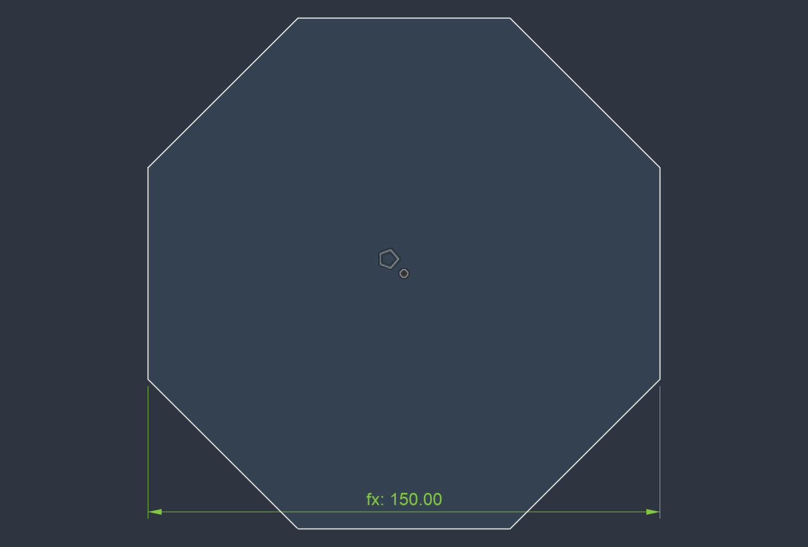

A **constraint** records a relationship: two points meet, two edges stay parallel, or a center stays on the origin. A remaining **degree of freedom** is something the sketch can still change—position, orientation or size. Those are more useful questions than “which line is still blue?”

Try gently dragging a vertex, then undo any movement. If the whole octagon slides, check its center-to-origin Coincident constraint. If it rotates, check the horizontal edge. If it grows, check the size dimension. A fully constrained sketch shows a lock indicator in the Browser; its curves normally appear black, or white in a dark display environment. [Fully constrained sketches](https://help.autodesk.com/cloudhelp/ENU/Fusion-Sketch/files/SKT-FULLY-DEFINE-CONSTRAIN-SKETCH.htm)

**Why not Fix everything?** Fix/Unfix can freeze the current shape, but it does not explain why the center, sides and width belong together. We want the octagon to change when `bodyWidth` changes while keeping those relationships. Fix is useful for deliberately immovable reference geometry; it is not our substitute for design intent.

If this is your first fully constrained sketch, pause for Autodesk's [six-minute sketch-constraint lesson](https://www.youtube.com/watch?v=iyc7urh8jhQ). Watch for how the instructor identifies what can still move, then return to your octagon and name its size, center and orientation controls.

Rename the sketch **01 Master Octagon** and click **Finish Sketch**. Expect one centered, fully constrained octagon with eight sides. If your tool displays a construction circle, keep it as construction geometry so only the octagon becomes the solid profile.

Keep eight sides for this lesson. Changing the side count changes the faces that later member layouts, grips and fixtures depend on; it calls for another geometry review. We will use a small temporary across-flats edit to check this early layout before adding the frame features.

## 9 Extrude a centered blank

1. Finish the sketch, then choose **Solid > Create > Extrude**.
2. Click the octagon's **shaded interior**, not one of its edges. This closed region is a **profile**.
3. Set **Direction: Symmetric**, **Measurement: Whole Length**, **Distance: bodyLength**, and **Operation: New Body**.
4. Check that the preview extends equally to both sides of the sketch, then accept. Rename the Timeline feature **02 Symmetric Master Blank**.

Extrude gives a flat profile depth. **New Body** is appropriate here because there is no earlier solid to add to. Later, the same tool will use **Join** to add ribs and **Cut** to make openings; the operation is part of the design decision, not a setting to leave on autopilot.

The result should measure **150 mm across flats and 260 mm long**, extending 130 mm to each side of the sketch. Its axis-aligned bounding box is 260 × 150 × 150 mm in global X, Y and Z; its diagonal corner-to-corner measurement is larger. Whole Length matters: Half Length would put the entered distance on both sides. Centering the blank keeps the future joint at the origin when the overall length changes. [Extrude settings](https://help.autodesk.com/cloudhelp/ENU/Fusion-Model/files/SLD-REF-EXTRUDE.htm)

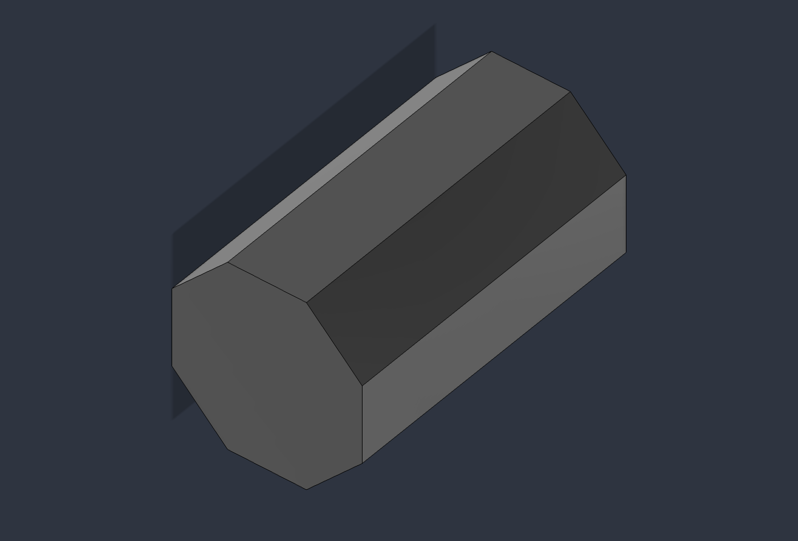

**Predict, then test:** change `bodyWidth` to 155 mm. The across-flats distance should become 155 mm while the length remains 260 mm. All eight facets should remain equal and the orientation should stay fixed. Restore 150 mm. If only one edge moves, check the polygon relationships and driving dimension. This early edit tests the model's intended behavior before there are many features to inspect.

## 10 Establish the 45 degree plane and its direction

The pivot needs a reference that survives changes to the housing. We will create it from an origin axis rather than from an edge that a later chamfer might replace. A **datum** is this kind of deliberately chosen reference.

1. Expand the root **Origin** folder and show its axes.
2. Choose **Construct > Plane At Angle** and select the root **Z axis**. The selected axis will lie *in* the new plane; it is not the plane's perpendicular direction.
3. Set **Extent Type: Angle**, enter `splitAngle`, and leave **Offset: 0 mm**. Keep the dialog open while checking the preview. [Plane At Angle](https://help.autodesk.com/cloudhelp/ENU/Fusion-Model/files/SLD-CONSTRUCT-PLANE-AT-ANGLE.htm)

View the **XY plane straight on**, looking along global Z. With Fusion's Y-up orientation this is the ViewCube's **Front** face; with Z-up it is **Top**. Check the colored axes: red +X points right and green +Y points up. The plane's trace must slope from upper left to lower right through the origin. If its slope is opposite, enter `-splitAngle`. Accept it and name it **Joint plane 45 degrees**. Keep `splitAngle` at 45° for this build.

A **construction plane** is a reference, not a cut. It can position a sketch or another feature. Its perpendicular direction, called its **normal**, will become the pivot axis.

Check its normal before building anything on it:

1. Choose **Construct > Offset Plane**, select **Joint plane 45 degrees**, and preview `faceGap/2`.
2. The preview must move toward the **positive-X end**, which will become A Housing. Cancel this temporary offset; it is only a direction check.
3. If it moved toward negative X, edit the angled-plane feature and add `180 deg` to its angle expression. This keeps the plane in the same place but reverses its normal. Preview the positive offset again, then cancel it.

We call this checked normal direction **q**. Imagine a ruler laid along the future metal shaft: its zero is at the original joint plane, positive numbers point into A, and negative numbers point into B. A 10 mm move along that ruler is not a 10 mm move along the tube. Keeping the two directions distinct will make the bearing stack much easier to understand.

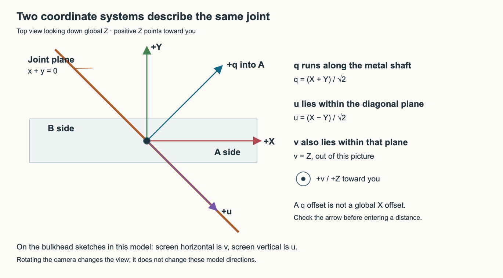

## 11 Split the blank and separate the components

1. Choose **Solid > Modify > Split Body**.
2. For **Body to Split**, select the octagonal blank.
3. For **Splitting Tool(s)**, select **Joint plane 45 degrees** in the Browser. Leave **Extend Splitting Tool(s)** enabled.
4. Accept and name the feature **Diagonal Split**. Expand the root **Bodies** folder: there should now be **two solids**. [Split Body](https://help.autodesk.com/view/fusion360/ENU/?contextId=MODEL-SPLIT-BODY-CMD)

Split Body divides material without moving either half. We will remove a thin amount from both faces next, so the physical halves can turn without scraping together.

The diagonal faces currently touch. Create their working gap:

1. Hide one body. Choose **Solid > Modify > Offset Face**, select the exposed diagonal face, and enter `-faceGap/2`.
2. Confirm that the preview removes material from the half, then accept.
3. Show the other body, hide the first, and repeat on its diagonal face.
4. Show both bodies and hide the construction plane.

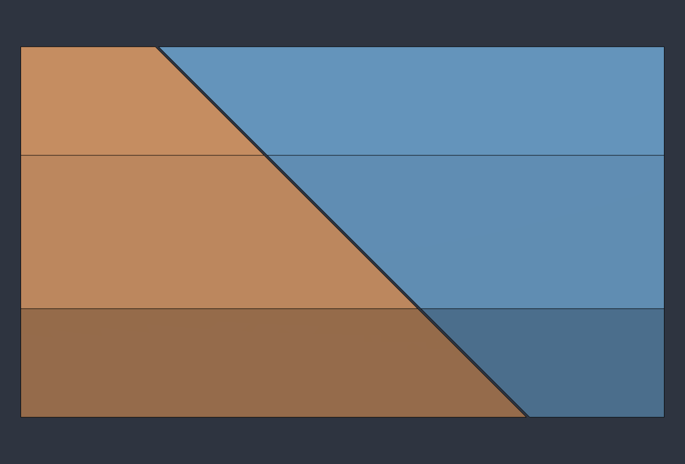

Each face moves inward 0.5 mm, making a 1 mm gap along the plane normal. The origin remains midway between them. **Predict:** offsetting each face by `-faceGap` would double the intended gap to 2 mm. [Offset Face](https://help.autodesk.com/view/fusion360/ENU/?contextId=SLD-OFFSET-FACES)

Select both solids in the Browser, right-click, and choose **Create Components from Bodies**. Name the half containing the positive-X end **A Housing**, and the half containing the negative-X end **B Moving Body**.

A **body** is solid geometry. A **component** is a part container that owns geometry and can have an assembly relationship to another component. Two bodies alone are not yet our two moving parts.

We used a shared blank because both halves need the same envelope. Its sketch, extrusion and split therefore remain at the root. From this point on, right-click the intended component and choose **Activate** before creating its sketches and features. Expand that component afterward and check that the new sketch appears inside it. This is the Fusion equivalent of putting the tool back in the right drawer: it makes the next edit much less mysterious. [Bodies and components](https://help.autodesk.com/cloudhelp/ENU/Fusion-Assemble/files/GUID-C1AB4941-D7AD-4D27-A035-2FA9208635B6.htm), [component creation and history](https://help.autodesk.com/view/fusion360/ENU/?contextId=ASM-NEW-COMPONENT)

## 12 Shell both ends to make an open tube

1. Activate **A Housing**. Turn off B's visibility using its Browser visibility control.
2. Choose **Solid > Modify > Shell**. Select **two faces**: A's distant positive-X octagonal end face and its diagonal joint face. Orbit as needed without changing the selection.
3. Set **Direction: Inside** and thickness `wall`, which is 4.5 mm. Inspect the preview, then name the feature **A Shell Open Both Ends**.
4. Hide A, show and activate **B Moving Body**, and repeat. For B, select its distant **negative-X** end face and its diagonal face. Name the feature **B Shell Open Both Ends**.

Shell removes the selected faces and hollows the remaining solid. **Inside** preserves the outside envelope we dimensioned; an outside shell would grow it. Selecting both end faces is what turns each half into a tube rather than a cup.

The result is a tube open at both ends. The inside distance across opposite flats is `bodyWidth-2*wall`, or **141 mm** at the reference dimensions. The integrated bearing bulkhead will be built as its own ribs and carrier, so no thin diagonal diaphragm is left here to obscure that structure.

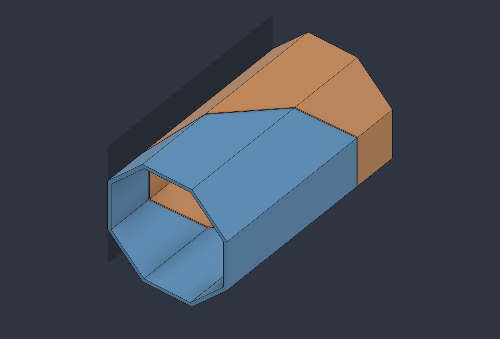

Orbit around each part and check both openings. If the slanted end remains closed, edit the Shell face selection. If a long side is missing, remove that side face from the selection. Confirm that each component still contains one body.

The wall thickness is measured perpendicular to a broad facet. Later edge chamfers remove material locally; they do not replace this thickness parameter. Keep the outer corner rails and end-ring lands intact while we cut the triangular openings.

**Checkpoint:** show both halves, then explain their location without using the camera's “left” and “right”: A reaches +X, B reaches −X, and q is perpendicular to the slanted joint. You should be able to identify one sketch, one shared extrusion, a split, two face retreats and two shells in the Timeline. If that story is clear, you have the references needed for the more detailed work.

[Open the shared-layout and open-tubes checkpoint](checkpoints/01-shared-layout-and-tubes.f3d). It preserves the constrained master sketch, centered extrusion, split, gap and two shell features. The shell-only state is a modeling checkpoint, not the finished print.

# Part 3 Turn the tube walls into connected triangulated frames

The empty tube gives us a reliable outer shape. Now we will decide which material to keep. Rather than scattering triangle-shaped holes wherever they look attractive, we will draw the intended member centerlines first, then derive the openings from them.

This part involves repetition. Build the first facet slowly enough to understand its sketch, offset and cut; the remaining facets reuse that method. Save after a completed face. If one later face is troublesome, compare it with a known-good face instead of changing several dimensions at once.

## 13 Lay out members before removing material

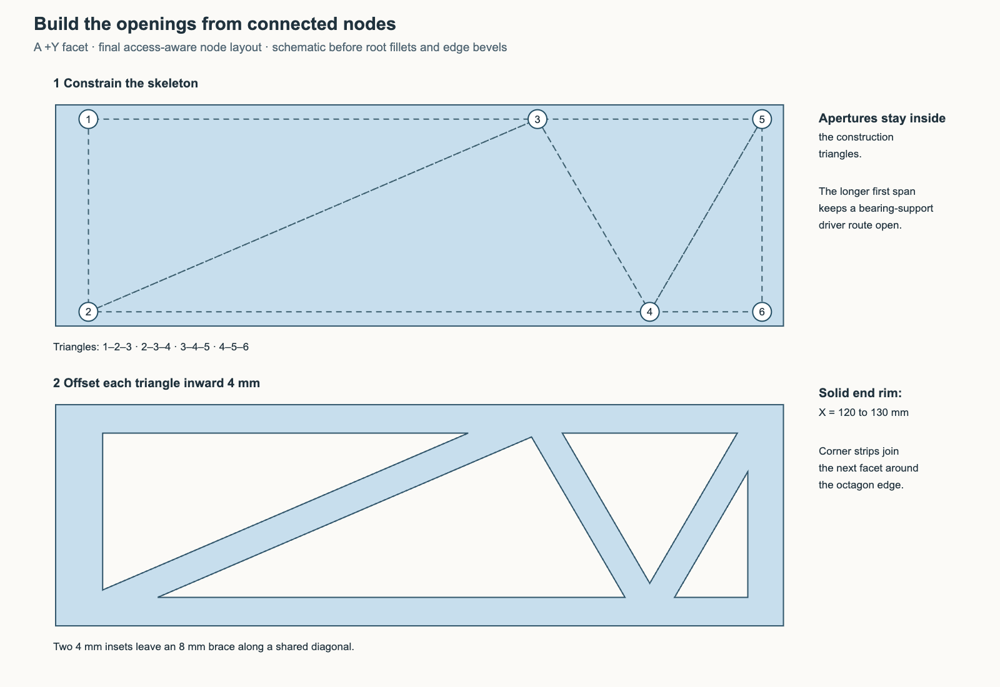

Look at the shared diagonal in the diagram. One triangle's opening stops 4 mm before that line, and its neighbor's opening stops 4 mm on the other side. The **8 mm strip left between them is the brace**. Where those diagonals meet the side rails, the common construction point defines a **node**—a deliberate connection location.

This is the difference between designing the frame and decorating a wall with holes. We control the remaining material through the skeleton, rather than hoping several independently drawn openings leave useful connections.

Add these parameters in **Change Parameters**:

| Name | Expression | Purpose |
| --- | --- | --- |
| `memberWidth` | `8 mm` | Nominal width of a brace or corner chord within a facet |
| `nodeHalfWidth` | `faceHalfWidth-memberWidth/2` | Distance from a facet center to its two chord centerlines |
| `jointNodeQ` | `7 mm` | Skeleton's first row, measured along the joint axis |
| `endRim` | `10 mm` | Uncut length beside each distant tube end |
| `endNodeX` | `bodyLength/2-endRim+memberWidth/2` | Last skeleton row before the opening is inset |
| `apertureRadius` | `1.5 mm` | Radius at the inside corners of the openings |

At the reference size, a broad facet is 62.132 mm wide. Its two chord centerlines sit at ±27.066 mm. Each line lies 4 mm inside the facet's outer corner; the 4 mm inward offset of the neighboring opening leaves an 8 mm strip on that face. Strips from adjacent facets join around each octagonal corner to form a continuous rail.

The last skeleton row is at X = 124 mm. Insetting the last transverse edge by 4 mm places the opening boundary at X = 120 mm, leaving the intended 10 mm end rim to X = 130 mm. The `jointNodeQ` value likewise locates a construction row, not the finished opening edge: the inward offset and the cut through the wall both affect the final boundary.

Use the current parameters while completing this lesson. The number of diagonals on each facet is a design choice based on its length; adding 50 mm to the housing will not automatically add another brace. Named dimensions control an existing topology. Deciding when that topology should change remains part of the design work.

## 14 Establish the first facet's plane and sketch axes

We will call the eight broad sides **facets** and number their directions around the tube. Facet 0 faces **global +Y**. Its plane needs to follow `bodyWidth` when the tube grows.

1. Activate **A Housing**, hide B, and expand A's **Origin** folder.
2. Choose **Construct > Plane At Angle** and select A's **X axis**. Make an orientation plane parallel to XZ, through the origin. In the reference history, this is **−90° from XY**.
3. Choose **Construct > Offset Plane**, select that orientation plane, and enter `bodyWidth/2`.
4. Confirm that it lands at **Y = +75 mm**, coincident with the outside of the broad +Y face. Name it **A Facet 0 Plane**.

We could sketch directly on the broad face, but that would make the sketch depend on a face later cuts and chamfers may divide. A named datum plane keeps the intended location explicit.

Check the plane in the preview. It must coincide with A's broad +Y face, not a diagonal face or the opposite −Y face. A plane's displayed angle can depend on the reference orientation Fusion chooses; confirm the global direction instead of accepting a number without looking. In the reference native history this orientation is −90° from XY, with a positive 75 mm offset. If your offset travels toward −Y, reverse the offset or rotate the orientation plane by 180° before proceeding.

5. Create a sketch on **A Facet 0 Plane**. Use **Look At** to face it squarely.
6. Identify the sketch's two directions before drawing. In the reference sketch, horizontal **local x = global X**, while vertical **local y = −global Z**. A point above the sketch origin is on the housing's negative-Z side.

The word **local** means “on this particular sketch.” Each plane carries its own flat coordinate system. Orbiting the camera changes your view, not that coordinate system. This can feel unfamiliar on the first angled plane; checking one known direction is more reliable than trying to make every view look like a familiar Top view.

The [facet coordinate table](facet-coordinates.csv) gives two descriptions of each point: its position on the housing (**global X, s**) and the coordinates to enter on the reference sketch (**local x, local y**). Here `s` means distance across a facet. On the +Y face, `s` points along global Z, so **local y = −s**.

For example, global **X = −65.101, s = −27.066 mm** becomes local **x = −65.101, y = +27.066 mm**: left and above the sketch origin. If your sketch's axes are flipped, do not copy those screen positions blindly. Either correct the datum orientation to match this lesson or translate the global coordinates into your actual local directions.

## 15 Constrain the first construction triangle

The first +Y triangle reaches farther along A than the equally spaced layout on most other faces. This leaves the straight approach to the rear bearing-support screw clear. Tool access determines a node's position here; moving that node later without rechecking the driver path can put a brace across the tool.

Use these six points for the entire first facet. Only points 1–3 belong to the first triangle. The expressions are driving dimensions; the decimal values help you place each point on the correct side of the origin.

| Point | Local sketch x expression | Local sketch y expression | Approximate x, y, mm |
| --- | --- | --- | --- |
| 1 | `jointNodeQ*sqrt(2)-bodyWidth/2` | `nodeHalfWidth` | −65.101, +27.066 |
| 2 | `jointNodeQ*sqrt(2)-bodyWidth/2` | `-nodeHalfWidth` | −65.101, −27.066 |
| 3 | `(jointNodeQ*sqrt(2)-bodyWidth/2)+(2/3)*(endNodeX-(jointNodeQ*sqrt(2)-bodyWidth/2))` | `nodeHalfWidth` | +60.966, +27.066 |
| 4 | `(jointNodeQ*sqrt(2)-bodyWidth/2)+(5/6)*(endNodeX-(jointNodeQ*sqrt(2)-bodyWidth/2))` | `-nodeHalfWidth` | +92.483, −27.066 |
| 5 | `endNodeX` | `nodeHalfWidth` | +124.000, +27.066 |
| 6 | `endNodeX` | `-nodeHalfWidth` | +124.000, −27.066 |

1. Choose **Line** and draw a triangle through points **1 → 2 → 3 → 1**. Place each point roughly in the correct quadrant; the dimensions will make it exact.
2. Snap each segment to the preceding endpoint and close the last segment on the first point. These Coincident relationships prevent gaps.
3. Select the three lines and turn **Construction** on in the Sketch Palette, or press **X**.

Construction lines are scaffolding for the design. They can carry dimensions and constrain other geometry, but they do not define material for an extrusion. We will leave this larger triangle as scaffolding and create a smaller ordinary triangle inside it.

4. Press **D**, select the **origin** and **point 1**, then right-click before placing the dimension and choose **Horizontal**. Place the dimension and enter `abs(jointNodeQ*sqrt(2)-bodyWidth/2)`.
5. Select the origin and point 1 again. Choose **Vertical** and enter `nodeHalfWidth`.
6. Repeat horizontal and vertical dimensions for points 2 and 3, using their table expressions. Use `abs(...)` around any expression whose current coordinate is negative.

Here is the first point worked through: `7*sqrt(2)-150/2` evaluates to **−65.101 mm**. Place the point **left** of the origin, then give its horizontal distance the positive magnitude **65.101 mm** through the expression. Its y coordinate is **+27.066 mm**, so it belongs **above** the origin. Point 2 has the same x and a negative y, so it is left and below. Together, those two points create the first vertical edge of the triangle.

The dimension controls the distance; the point's side of the origin supplies the sign in this method. A fully constrained triangle on the wrong side is still wrong. Also check the dimension preview: a slanted line between the origin and point would measure their diagonal distance, not the horizontal or vertical component. [Dimension alignment](https://files.upskill-dev.autodesk.com/public/fusion360-intro-cad-cam-milling-turning-associate/210804_SbS_L2-01_Sketching-basics.pdf)

Six coordinate dimensions locate three vertices. Fusion can also add Horizontal/Vertical constraints while you draw. A horizontal edge, for example, becomes redundant when both endpoint y coordinates are already driven to the same value. If Fusion reports overconstraint while you add a dimension, use this recovery:

1. Cancel the rejected dimension and press **Esc** to leave the dimension tool. Keep the sketch open.
2. In the **Sketch Palette**, enable **Show Constraints**. Select the relevant edge or point if its constraint badges are not visible.
3. Hover over the **Horizontal/Vertical badge** associated with that edge to identify the geometry it controls. Select the badge and press **Delete**, or right-click the badge and choose **Delete**. Preserve the endpoint **Coincident** constraints and the deliberate coordinate dimensions. If the edge itself disappears, undo immediately and select its constraint badge instead.
4. Add the missing horizontal or vertical coordinate dimension, then compare all three points with the table. The finished construction triangle should be fully constrained and should not move when dragged.

This removes the duplicate relationship while retaining the intended coordinates and closed loop. [Sketch Palette constraint visibility](https://help.autodesk.com/cloudhelp/ENU/Fusion-Sketch/files/GUID-4183A4B7-E002-4396-AD5A-7FF3C8B2F33A.htm), [Delete a sketch constraint](https://help.autodesk.com/view/fusion360/ENU/?caas=caas/sfdcarticles/sfdcarticles/How-to-delete-sketch-constraints-in-Fusion-360.html)

Name the sketch **A Facet 0 Triangle 1**. This is a coordinate-based layout because the slanted split and unequal facet lengths make the point positions more useful than a collection of loosely related side lengths.

## 16 Offset the triangle to set the brace width

1. Keep **A Facet 0 Triangle 1** open. Choose **Sketch > Modify > Offset**.
2. Select the three connected construction edges. If needed, use chain selection so all three are included.
3. Choose **One Side**, move the preview **inside** the triangle and enter `memberWidth/2`, or 4 mm.
4. Keep **Match Topology** enabled where that option is shown, then accept. Each source side should have a corresponding offset side.

Do not copy a minus sign without checking the picture: the sign in the Offset dialog depends on the direction of the loop. The desired result is the **smaller triangle inside the construction triangle**. The offset relationship keeps that opening linked to `memberWidth`. [Offset a sketch](https://help.autodesk.com/cloudhelp/ENU/Fusion-Sketch/files/SKT-OFFSET.htm)

The new inner triangle must be ordinary sketch geometry. If it inherited Construction, select only those three child edges and toggle Construction off. Leave the larger original triangle as construction. Keep the Offset relationship and its dimension; exploding or redrawing the offset would lose the connection between member width and aperture size.

Expect **one shaded closed inner profile** and a fully constrained sketch. If the original large triangle is also shaded, its lines are no longer construction. If the small triangle lies outside the large one, edit the offset direction before cutting. [Sketch modification tools](https://help.autodesk.com/cloudhelp/ENU/Fusion-Sketch/files/SKT-SKETCH-MODIFY-TOOLS.htm)

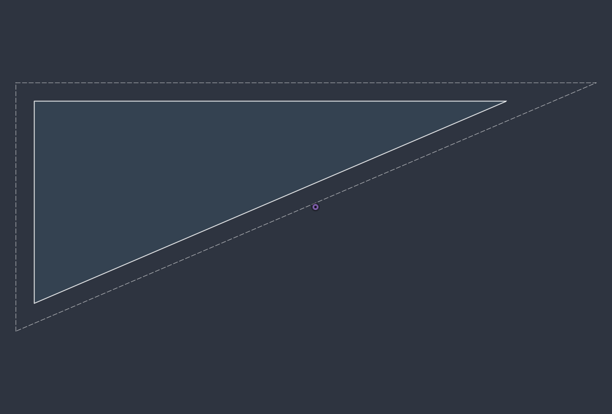

**Predict:** if you offset both neighboring triangles inward by 8 mm, their common brace becomes approximately 16 mm wide. An 8 mm member needs 4 mm from each side. This relationship is why the opening is derived from the skeleton rather than drawn to an arbitrary visual size.

5. Finish Sketch. Hide B and any other solid bodies so **only A participates** in the cut.
6. Choose **Extrude**, select the small inner profile, and set **Operation: Cut**.
7. Enter `wall+0.2 mm`, or **4.7 mm**, and point the preview **inward through A's wall**. If it goes into empty space outside the tube, reverse the extrusion direction.
8. Accept and name the feature **A Facet 0 Opening 1**. Orbit to the inside and confirm that the hole passes through the wall.

The extra 0.2 mm takes the cutter past the 4.5 mm wall. We use a short, known distance rather than **All**, because a through-all cut could reach another wall or a later internal part. On current Fusion builds, visibility determines the initial Cut participants. To inspect or correct them afterward, edit the extrusion in the Timeline and check **Objects To Cut**. [Extrude settings](https://help.autodesk.com/cloudhelp/ENU/Fusion-Model/files/SLD-REF-EXTRUDE.htm)

## 17 Complete the alternating chain and round the aperture roots

Create three more sketches on **A Facet 0 Plane**, repeating the construction triangle, inward 4 mm offset and 4.7 mm inward cut. Use consecutive triples from the six-point table:

| Sketch | Construction vertices |
| --- | --- |
| `A Facet 0 Triangle 1` | 1, 2, 3 |
| `A Facet 0 Triangle 2` | 2, 3, 4 |
| `A Facet 0 Triangle 3` | 3, 4, 5 |
| `A Facet 0 Triangle 4` | 4, 5, 6 |

Adjacent triangles share a diagonal. Their two offsets leave a brace centered on that diagonal, and consecutive braces meet at the same rail node. There are no separate transverse middle rings in this layout. Keeping each opening in its own named sketch makes it easier to identify a failed offset or adjust one node for access.

After all four cuts, soften the sharp inside corners of the openings:

1. Orbit to an oblique view so you can see the wall's thickness at an opening corner.
2. Choose **Solid > Modify > Fillet** and turn **Tangent Chain off**.
3. Select the **short edge running through the wall** at each corner of the four openings. These edges are perpendicular to the broad facet. Do not select the long triangular outline on its front or back face.
4. Set radius `apertureRadius`, **1.5 mm**. Look squarely at the facet in the preview: the sharp triangle corners should become small arcs.
5. Accept and name the feature **A Facet 0 Aperture Root Radii**.

If selecting one tiny edge is difficult, zoom in and hide sketches or construction planes that overlap it. A small, correct selection is preferable to accepting a much larger automatic chain.

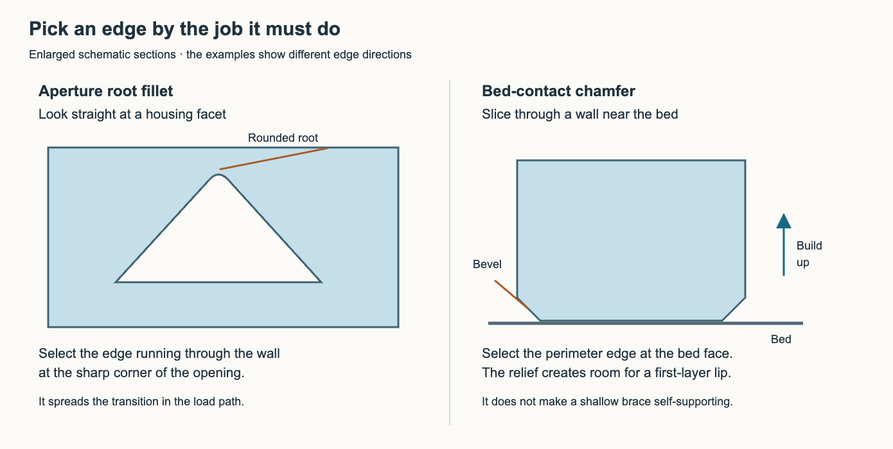

This selection rounds each aperture corner in the facet plane, adding a curved transition where members meet. It preserves the long edges that define the nominal member width. Selecting the long perimeter edges instead would round the front or back face and change a different part of the cross-section. Radius is not a strength rating: the transition still needs enough material and the printed part still needs testing.

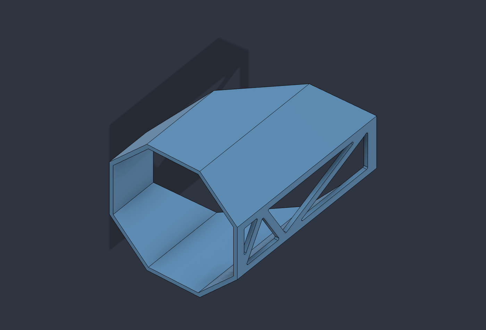

Inspect **A Housing > Bodies**. It should still contain one solid body. Orbit to the inside and confirm the cuts pass through the wall and the fillets round the intended corners. A brace that only touches another member at an edge is not a useful connection; here the offset leaves finite material around the shared skeleton node.

## 18 Repeat the layout on the remaining seven faces

The next face looks similar, but its beginning is different: the diagonal joint meets it at another position. This is where a tempting shortcut fails. A **Circular Pattern** would repeat the finished openings at equal angles, including their old axial limits, and could cut into a region we mean to preserve.

Instead, reuse the **method** on each datum plane and take the dimensions from [facet-coordinates.csv](facet-coordinates.csv). Later we will use a feature pattern for equally spaced bolt holes, where the geometry really does repeat. Choosing what is shared and what must vary is part of parametric design.

Make the next facet a focused practice session before committing to all 48 openings. You have completed **A0, the +Y face**. Use the procedure below next on **A180, the −Y face**, which has two openings and reverses both sketch directions relative to A0. For one node, say its global position aloud, translate it to the local coordinates, then check the constrained sketch against the CSV. Finish that face's cuts and root fillets, inspect the inside, and save. You should be able to explain why an axial point that appeared to the right on A0 can belong to the left on A180.

At that session break, choose how much repetition you want:

- **Continue your own model:** complete A's six remaining facets with the full instructions below, then build B in Step 19. Do not recut A0 or A180. This gives you the most practice with datum orientation and constraint recovery.
- **Continue with B's manual work:** open [checkpoint 04, A's completed frame](checkpoints/04-A-triangulated-shell.f3d), verify the earlier shared layout, A0 and A180 against your work, and save a separately named working copy. Confirm A has 24 openings and one body while B is still an open tube; then resume at **Step 19**.
- **Continue with the joint core:** open [checkpoint 06, both completed frames](checkpoints/06-two-triangulated-shells.f3d), save a separately named copy, and perform **Step 19's final connectivity and Timeline checks** before starting **Step 20**. Confirm 24 openings in each housing, the special A0 span and B90 reversal, and that the central carriers have not yet been added.

A **comparison** means opening a checkpoint beside your own document, finding a difference and returning to your work. A **resume** means deliberately adopting a saved copy of its completed state and starting at the stated next step. Checkpoint 01 contains only the shared layout and tubes; checkpoint 02 adds the first A0 facet. Neither is a complete frame state from which to jump straight to Step 20. Do not insert a checkpoint into your existing assembly or repeat features it already contains. Keep your practice document and fit log whichever route you choose; the supplied checkpoint does not carry your measured fit choices.

| Facet angle θ | Outward direction | Reference orientation from XY | A openings | B openings |
| --- | --- | --- | --- | --- |
| 0° | +Y | −90° | 4 | 2 |
| 45° | +Y, +Z diagonal | −45° | 4 | 2 |
| 90° | +Z | 0° | 3 | 3 |
| 135° | −Y, +Z diagonal | 45° | 2 | 4 |
| 180° | −Y | 90° | 2 | 4 |
| 225° | −Y, −Z diagonal | 135° | 2 | 4 |
| 270° | −Z | 180° | 3 | 3 |
| 315° | +Y, −Z diagonal | 225° | 4 | 2 |

For each face, make the orientation plane through the X axis, then offset it **outward by `bodyWidth/2` (75 mm at the reference size)** to the intended facet. Enter the expression so this plane follows a later width change. Verify the preview against the direction column. If the angle field's zero reference differs in your Fusion UI, use the geometry preview to select the equivalent plane. For the +Z face the XY origin plane already supplies the orientation; a separate zero-angle plane is optional. Name the final offset plane by housing and angle.

Work one face at a time:

1. Open the CSV as a table in a spreadsheet application. Filter **`housing` to A**, **`facet_angle_deg` to the required angle**, and **`triangle` to 1**. For your next practice face, use **180** for the angle. Keep all three vertex rows.
2. Check the local-axis mapping against your sketch. Use **`local_x_mm`**, **`local_y_mm`** and **`quadrant`** to place the points approximately on the correct sides of the origin.
3. Draw and constrain the construction triangle. For each vertex, copy **`horizontal_dimension_expression`** into its horizontal distance dimension and **`vertical_dimension_expression`** into its vertical distance dimension. These columns already include `abs(...)`; copy the complete cell without adding another sign or absolute-value wrapper. Offset inward by `memberWidth/2`, then cut inward by `wall+0.2 mm`.
4. Repeat for that facet's remaining triangles. The count is in the table above; it includes the first triangle.
5. Add the `apertureRadius` root fillets, inspect the inside of the wall, and save before moving to the next face.

For the native datum orientations in the table, facets **0°, 45°, 90°, 135°, 225° and 315°** use `local x = global X` and `local y = -s`. Facets **180° and 270°**—the −Y and −Z faces—use `local x = -global X` and `local y = s`. These mappings apply to both housings. The CSV's local-coordinate expressions already include the signs; do not reverse them a second time. Check your sketch's axes against this mapping before copying its coordinates. If a point has a zero coordinate, constrain it to the appropriate axis instead of adding a zero-length distance dimension.

**Work through the first A180 vertex:** its global X is **+84.899 mm** and its facet coordinate s is **−27.066 mm**. On this face, local x = −global X and local y = s, so the point belongs **left and below the sketch origin**, at approximately **(−84.899, −27.066) mm**. The horizontal distance expression simplifies to `jointNodeQ*sqrt(2)+bodyWidth/2`; the vertical one simplifies to `nodeHalfWidth`. At the reference size they evaluate to **84.899 mm** and **27.066 mm**. The longer prepared CSV expressions give the same values and preserve the parameter relationships. Place the other two vertices using their own rows; their signs are not all the same.

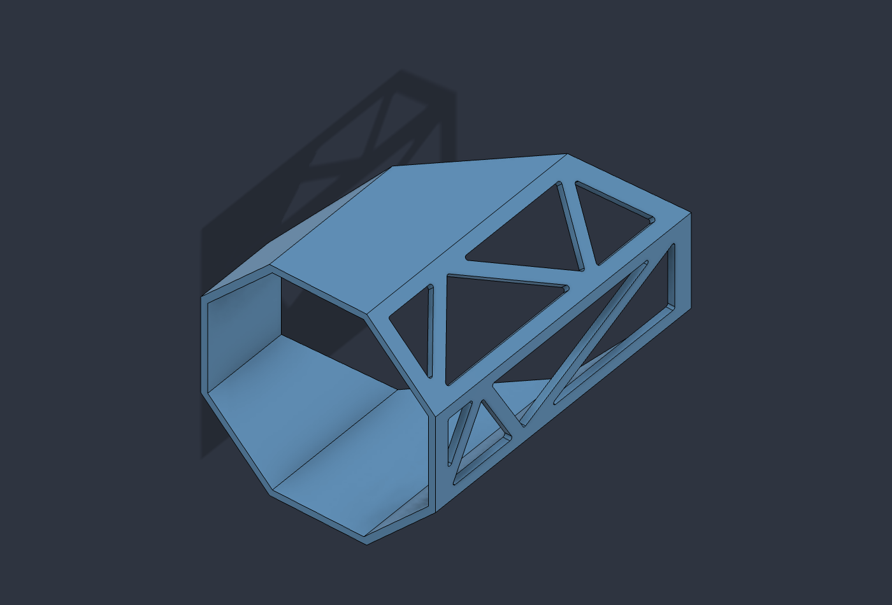

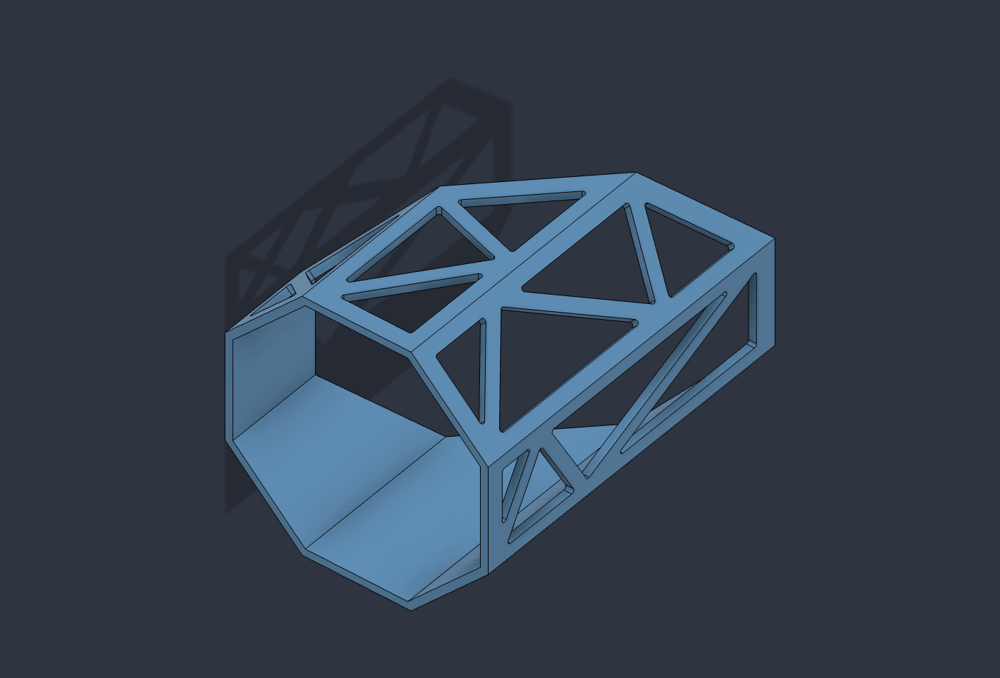

The coordinate table is a reproducible dimension list, not a script you must run. Each row identifies a housing, face, triangle and vertex. Use the prepared **horizontal and vertical dimension-expression columns** for entry and the signed local coordinates to check placement. The global and local expression columns explain the coordinate conversion; you do not need to edit those long formulas. Keep the numeric columns as checks rather than rounded replacements for the expressions.

You can use the table without deriving every expression, but the placement rule is worth understanding. Choose one of the two rails, find where its first node belongs beside the joint, then move a chosen fraction of the way toward the distal end. **Interpolation** means that last step: a point halfway along uses `start+(1/2)*(end-start)`.

For A's first +Y facet, `start = −65.101 mm` and `end = 124 mm`. Its special first long span uses two-thirds of that distance: `−65.101+(2/3)*(124−(−65.101)) = 60.966 mm`. That is point 3 in our first triangle. The formula explains the coordinate and preserves the spacing relationship when the envelope changes.

For a general facet angle θ, let `s` be ±`nodeHalfWidth`. The first node's global X is `jointNodeQ*sqrt(2)-bodyWidth/2*cos(θ)+s*sin(θ)` for A. The workbook then interpolates from that start to `endNodeX`. These expressions follow the slanted boundary rather than approximating it by eye. They do not decide how many braces are enough; that remains a geometry and load-path decision.

## 19 Build B's integrated frame and check continuity

Activate **B Moving Body**, hide A, and repeat the eight-facet method with the **B** rows of the coordinate workbook. B's first skeleton row is at q = −7 mm and its distal skeleton row is X = −124 mm. The first-row formula therefore uses `-jointNodeQ*sqrt(2)` and the last row uses `-endNodeX`.

B uses the evenly spaced node fractions, with one deliberate orientation change: its +Z face (90°) reverses the chain to +s start, −s start, +s midpoint, −s end, +s end. This keeps a diagonal out of the hub pinch-screw driver route. The B90 rows in the CSV table already include that reversal. Do not copy A0's longer first span to B; each access refinement follows its own hardware approach. You should finish with **24 triangular openings on each housing**, distributed across all eight facets, and one connected solid body in each component.

1. Show both housings, then choose **Inspect > Section Analysis** and select the **YZ plane**.
2. Move the section toward each end with the offset control. Look for continuous corner rails and the unbroken distal rim.
3. Hide the analysis using its Browser visibility control. The solid should reappear intact: Section Analysis is a viewing tool, not a manufacturing cut.
4. Inspect the Timeline for warnings. If a face has failed, repair that face before adding the bearing support; later features can make an early mistake harder to see.

When a Timeline feature fails, work from the **earliest warning toward the end**. Right-click the responsible sketch or feature and use **Edit Sketch** or **Edit Feature**. A later cut is a child of its sketch profile; if that profile is open or missing, changing the cut's depth cannot repair it. This is what a parent/child dependency means in practice. Preserve the good downstream work and repair the first broken instruction in its recipe.

**Checkpoint:** identify one brace and trace its material into a rail at both ends. Then count the openings—**24 in A and 24 in B**—and confirm one body per housing. A cut that leaves an isolated sliver is not merely untidy: that sliver cannot carry load into the rest of the frame.

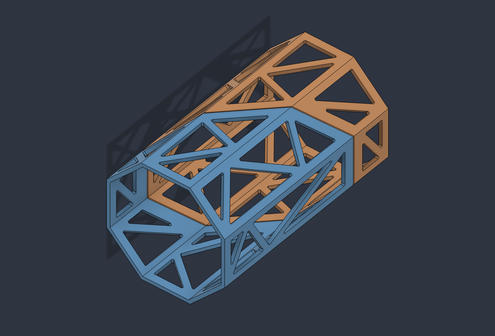

The [first-facet checkpoint](checkpoints/02-first-triangulated-facet.f3d) contains the final access-aware A0 pattern. The [A frame checkpoint](checkpoints/04-A-triangulated-shell.f3d) and [both-frame checkpoint](checkpoints/06-two-triangulated-shells.f3d) let you inspect the repeated sketches before the carriers are added.

# Part 4 Build the bearing support and learn to control fits

You now have two connected frames. This part turns their open centers into a joint: A carries two bearings, while B connects to the shaft through a purchased metal hub. We will build the printed supports around those metal parts, then leave routes for the tools that assemble them.

There are more numbers here, but only a few new modeling moves. A plane chooses **where** a feature begins; a constrained sketch chooses **what shape** it has; an extrusion chooses **how far and in which direction** it goes. We will repeat that sequence for pockets, shoulders, caps and an adapter.

## 20 Name the bearing fits and axial positions

Imagine a ruler laid along the metal shaft, with zero at the middle of the split between the housings. We call a position on that ruler **q**. Positive q goes into A; negative q goes into B. The two bearings need known positions on this ruler so their supports line up.

Every q offset below starts from **Joint plane 45 degrees**, perpendicular to that plane. It is not a distance along the long tube's global X direction. For example, a plane at q = 10 mm is 10 mm from the joint plane along the shaft, even though its global X and Y coordinates each change by only about 7.071 mm.

In **Modify > Change Parameters**, add the following mm parameters. A quantity called an allowance is an intentional difference between nominal dimensions; its final value comes from your fit samples.

The table preserves the **reference model's values**. Bring your [fit log](fit-log.csv) into this document before creating the seats. Use the successful coupon's **labeled CAD pocket diameter**, not a caliper reading of the printed hole, as the new modeled diameter. If the same size worked for A's mouth-down seat and D's mouth-up seat, set `seatAllowance` to **chosen pocket diameter − 22 mm**. For example, the 22.1 mm coupon gives `seatAllowance = 0.1 mm`; `seatDiameter = bearingOD+seatAllowance` then evaluates to 22.1 mm.

If the orientations need different sizes, add two mm user parameters: **`frontSeatDiameter`** for the selected mouth-down coupon and **`rearSeatDiameter`** for the selected mouth-up coupon. Use the first in A's **Front Bearing Seat circle in Step 22**, and the second in D's **bearing-pocket circle in Step 29**, replacing `seatDiameter` in those two sketches. Keep the nominal bearing dimensions, relief opening, seat depths and shoulders separate from that diameter choice. If you are still learning against the reference geometry, retain the table values in that copy and put your selected fits in a clearly named build copy.

A changed fit dimension makes a new geometry version. Recheck its sketches, contacts and clearances, then export and slice the affected parts again. The supplied validation reports and ready-made meshes describe the reference dimensions; they do not automatically validate or contain your selected fits.

| Name | Expression | What it controls |
| --- | --- | --- |
| `bearingOD` | `22 mm` | Nominal bearing outside diameter |
| `bearingID` | `8 mm` | Nominal bearing bore |
| `bearingWidth` | `7 mm` | Nominal bearing width |
| `seatAllowance` | `0.2 mm` | Trial addition to the printed pocket diameter |
| `seatDiameter` | `bearingOD+seatAllowance` | Example pocket diameter of 22.2 mm |
| `coreOD` | `44 mm` | Outside diameter of D and the caps; A uses the larger carrier below |
| `raceRelief` | `19.5 mm` | Opening that clears the inner ring and seal region |
| `frontSeatDepth` | `7.1 mm` | Front bearing pocket, including 0.1 mm axial allowance |
| `rearSeatDepth` | `7.2 mm` | Rear pocket, including 0.2 mm axial allowance |
| `shoulder` | `3 mm` | Material behind each bearing pocket |
| `supportSpacer` | `12 mm` | Purchased metal post length |
| `supportCircle` | `34 mm` | Diameter through the three support-bolt centers |
| `supportSpacerOD` | `6 mm` | Purchased post outside diameter |
| `capThickness` | `3 mm` | Thickness of each outer-ring cap |
| `m3Clearance` | `3.3 mm` | Printed clearance for the M3 support bolts |
| `rootRadius` | `1 mm` | Blend where each deep spoke meets the central carrier |
| `entryChamfer` | `0.4 mm` | Lead-in at a bearing pocket or pilot |
| `bedRelief` | `0.3 mm` | Small bevel at selected bed-contact edges |

Next add the position parameters. Enter the **Expression** column, then use **Current value** to check your typing. The expressions form a small chain: the front support ends, the purchased 12 mm post begins, and the rear support starts at the far end of that post. A later change to the post length can therefore move the rear station without a manual search for every affected plane.

| Name | Expression | Current value |
| --- | --- | --- |
| `qFront` | `faceGap/2` | 0.5 mm |
| `qFrontBack` | `qFront+frontSeatDepth+shoulder` | 10.6 mm |
| `qRearBase` | `qFrontBack+supportSpacer` | 22.6 mm |
| `qRearBearing` | `qRearBase+shoulder` | 25.6 mm |
| `qRearEnd` | `qRearBearing+rearSeatDepth` | 32.8 mm |
| `bearingSpacing` | `qRearBearing-qFront` | 25.1 mm |

The `q` prefix labels distance along the joint axis. Because both bearings have the same width, the distance between their nominal starting faces also equals the distance between their centers. The front pocket's small allowance means the real bearing can settle within that allowance; the nominal layout does not eliminate real end play.

`bearingSpacing` is a **calculated check**, not the driving dimension in this model. The purchased post length drives `qRearBase` and the rear bearing position. A different post length would require rechecking the shaft length, support screws, alignment, and housing envelope. Do not overwrite the calculated spacing expression and expect the support geometry to move with it.

The front bearing is retained axially by its outer-ring pocket/cap and the shaft's two collars and inner-ring spacers. The rear bearing adds radial support and has axial allowance. There is no long spacer forcing the two inner rings to match an arbitrary printed distance. That distinction avoids using the support bolts as an accidental bearing-preload adjustment. [SKF bearing arrangements](https://cdn.skfmediahub.skf.com/api/public/0901d196802809de/pdf_preview_medium/0901d196802809de_pdf_preview_medium.pdf)

Use the axial-section diagram to trace the two separate contact paths: the printed pockets/caps retain the outer rings, while metal spacers and collars locate the shaft at the front inner ring. Keep those jobs separate as you build the features.

**Predict before continuing:** if the post grew from 12 to 15 mm, which bearing would move? The rear station would move 3 mm farther into A and `bearingSpacing` would become 28.1 mm. The front seat would stay put. You do not need to make that edit now; keep the baseline at 12 mm. Being able to answer from the expressions is the useful skill.

## 21 Join the frame to a deep central carrier

The frame now needs to carry forces into the bearing and hub. A thin diaphragm would place most of that work in a shallow sheet. Instead, eight deep spokes join the corner rails to a central carrier. Their depth lies along q, so the support has material behind its joint-facing surface.

Add these housing-support parameters alongside the bearing parameters:

| Name | Expression | Purpose |
| --- | --- | --- |
| `spokeWidth` | `10 mm` | Width of each spoke in the joint plane |
| `spokeDepth` | `18 mm` | Depth along q, behind the joint face |
| `carrierOD` | `52 mm` | Outside of A's integrated bearing carrier |
| `rearCarrierClearance` | `46 mm` | Opening behind A's bearing shoulder |

1. Activate **A Housing** in the Browser and hide B. Expand the root Construction folder so you can select **Joint plane 45 degrees** by name.
2. Choose **Construct > Offset Plane**, select that joint plane, and enter `qFront`. Check that the preview lies 0.5 mm into A, then name it **A Central Carrier plane**.
3. Create a sketch on the new plane. Choose **Center Diameter Circle**, click the sketch origin, and dimension the diameter `carrierOD`.
4. Finish Sketch. Select the circle's interior for **Extrude**. Use **One Side**, distance `spokeDepth`, toward **positive q**, and **Operation: New Body**.
5. Accept only after the preview starts at q = 0.5 and extends into A. Rename the feature so its purpose is recognizable in the Timeline.

The cylinder is floating inside the open frame for now. That is expected: the spokes will connect it to the corner rails. Using Join before any material touches would fail because there is nothing to join to yet.

Create another offset plane from **Joint plane 45 degrees**, again at `qFront`, named **Bulkhead Rib Base**. Start the first spoke sketch on it and look straight at the sketch.

On this plane, the reference model's sketch **horizontal direction is v = global Z**. Its **vertical direction is u = (X−Y)/√2**, the diagonal direction across the joint face. q points through the sketch, along the shaft. Verify the axes against the origin triad before using the coordinate workbook. A pair of coordinates is only meaningful after you know which way its two rulers point.

Each spoke begins at the center and reaches beyond one octagon corner. The slanted section stretches the Y direction by √2, so the eight spokes are **not** at equal 45° intervals in this plane. A circular pattern with equal angles would miss the corner rails. Use the directions below instead.

| Spoke | Corner's global Y sign and magnitude | Corner's global Z sign and magnitude | Angle α in the joint sketch |
| --- | --- | --- | --- |
| 1 | `bodyWidth/2` | `faceHalfWidth` | `atan(-sqrt(2)*(bodyWidth/2)/faceHalfWidth)` |
| 2 | `faceHalfWidth` | `bodyWidth/2` | `atan(-sqrt(2)*faceHalfWidth/(bodyWidth/2))` |
| 3 | `-faceHalfWidth` | `bodyWidth/2` | Opposite sign to spoke 2 |
| 4 | `-bodyWidth/2` | `faceHalfWidth` | Opposite sign to spoke 1 |
| 5 | `-bodyWidth/2` | `-faceHalfWidth` | `180 deg` plus spoke 1's angle |
| 6 | `-faceHalfWidth` | `-bodyWidth/2` | `180 deg` plus spoke 2's angle |
| 7 | `faceHalfWidth` | `-bodyWidth/2` | `180 deg` plus spoke 3's angle |
| 8 | `bodyWidth/2` | `-faceHalfWidth` | `180 deg` plus spoke 4's angle |

The [spoke coordinate table](spoke-coordinates.csv) gives the exact driving angle used in the native model and the four vertex expressions for every spoke. Use that table for entry; the relationship above explains why the directions follow the octagon corners. At this fixed regular-octagon shape, increasing `bodyWidth` scales the geometry without changing these angles.

Model the first spoke slowly; the other seven repeat this procedure.

1. In the workbook, find the four rows where **spoke = 1**. Use **Line** to draw an approximate closed loop through vertices 1 → 2 → 3 → 4 → 1 in that order. Keep the points in the quadrants shown by their signed coordinates.
2. For vertex 1, the check coordinates are about **−4.798, −1.405 mm**: slightly left and below the origin. Use **Sketch Dimension**, selecting the origin and vertex, to add its horizontal distance with the workbook's `horizontal_dimension_expression`. Repeat for its vertical distance with `vertical_dimension_expression`.
3. For vertex 2, the check coordinates are about **+37.364, −145.358 mm**: right of the origin and much farther below it. Add its two dimensions using that row's expressions. Continue for vertices 3 and 4.
4. Keep the dimension expressions from the workbook, rather than typing these rounded check values. The dimensions are positive magnitudes; the side of the origin on which you placed the point supplies the sign.
5. Check that the loop is closed and fully constrained, then name the sketch **A Spoke 1 Profile**.

The result is a 150 mm long, 10 mm wide rectangle at an angle. Do not add Horizontal or Vertical to its side edges. If an automatic sketch constraint tries to make one horizontal, use the constraint-badge recovery in Step 15 to remove that conflicting constraint while preserving the coincident endpoints. We have deliberately located the four vertices; adding another independent size or angle instruction can overconstrain the same shape.

Finish Sketch and extrude the spoke profile by `spokeDepth` toward **+q**, with **Operation: Join**. Its inner end overlaps the central cylinder and its outer end crosses the frame's corner rail. Inspect both overlaps before accepting.

Repeat for spokes 2–8, each in its own sketch on **Bulkhead Rib Base**, named **A Spoke 2 Profile** through **A Spoke 8 Profile**. Keep A active. If Join reports no target, first inspect the extrusion direction, coordinate quadrants and active component. Switching to New Body would hide the missed connection rather than repair it.

The 18 mm depth describes the initial spokes. Bearing reliefs and collar/hub service cuts reduce some local sections later, so inspect the final Section Analysis before interpreting the load path.

The spokes intentionally extend beyond the outer walls. Trim those overhanging ends with one feature:

1. With A active, create a sketch on **A > Origin > YZ Plane**. Draw another centered, fully constrained regular octagon, `bodyWidth` across flats, in the same orientation as the master sketch. Name it **Spoke Outer Envelope**.
2. Finish Sketch. Hide every solid except A's body or bodies so the operation cannot include B or later hardware.
3. Extrude the octagon's full interior with **Direction: Symmetric**, **Measurement: Whole Length**, **Distance: bodyLength**, **Operation: Intersect**.
4. Inspect the preview before accepting. A's frame and carrier must remain; only the tips outside the octagon should disappear. If the preview affects another part, cancel, hide that part and restart the operation.

**Intersect** retains the volume common to the existing bodies and the extruded octagon. The outer cage is already inside that envelope, while the protruding spoke tips are outside it. Inspect the preview: the cage and carrier should remain, and only the overhanging tips should disappear. Do not use Cut, which would remove the volume you intended to keep. [Extrude operations](https://help.autodesk.com/cloudhelp/ENU/Fusion-Model/files/SLD-REF-EXTRUDE.htm)

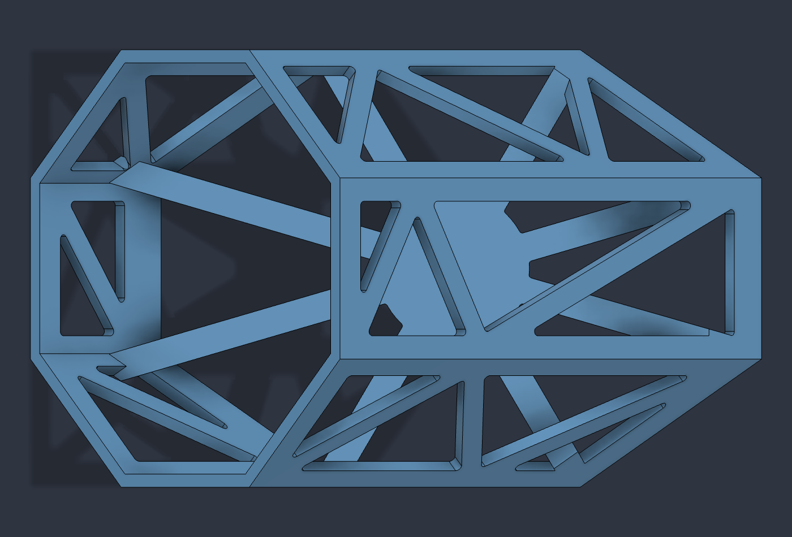

Expand **A > Bodies**: expect one connected body after all the joins and the trim. Now soften the sharp roots where each spoke enters the carrier.

1. Orbit to see the carrier's side, rather than looking straight at the joint face.
2. Choose **Modify > Fillet** and turn **Tangent Chain off**.
3. Select the **16 concave edges parallel to q** at the carrier: two roots for each of eight spokes. These edges run into the depth of the support. They are not the circular rim or the long edges along the front of a spoke.
4. Enter `rootRadius`, **1 mm**, and inspect the preview. Accept and name the feature **A Central Spoke Root Blends**.

If the preview rounds an entire front outline, cancel and reselect the depth edges. Leave the more complex outer spoke-to-rail junction contours intact in this version. A small, well-identified edge set is easier to repair after an edit than a selection of every edge that looks sharp.

## 22 Cut A's bearing pocket and clear the rear support

The 52 mm carrier gives the spokes a broad connection. The removable holder and caps remain 44 mm outside diameter; the bearing seat uses its independent fit parameter, **22.2 mm in the reference model**.

For each of the following cuts, keep **A active and the only visible solid**. Make the named offset plane from the root joint plane, create a centered circle sketch on it, dimension the diameter, finish the sketch, then Extrude its shaded interior with **One Side** and **Operation: Cut**. Watch the direction arrow: these three cuts go toward **+q**. This repeated sequence avoids accidentally starting a pocket on a face left over from another feature.

1. At `qFrontBack`, 10.6 mm, sketch a centered `rearCarrierClearance` circle and extrude-cut **18 mm toward +q**. Name it **A Rear Carrier Clearance**. The cut opens the back of the deep carrier; it must not remove the front bearing shoulder below that plane.
2. At `qFront`, sketch a centered `raceRelief` circle, 19.5 mm, and cut toward +q by `frontSeatDepth+shoulder`, 10.1 mm. Name it **A Seal Relief**.
3. On the same starting plane, sketch a centered circle driven by `seatDiameter`, or **`frontSeatDiameter`** if you separated A and D's fits. Cut toward +q by `frontSeatDepth`, 7.1 mm. Name it **A Front Bearing Seat**. The wider pocket stops before the smaller relief ends, leaving a 3 mm shoulder.

The shoulder supports the bearing's **outer ring**. Its 19.5 mm opening must clear the rotating inner ring and seals on your actual bearing. Keep the contact face flat; rounding that face changes where the ring seats.

The support bolts sit on an imaginary circle around the bearing. We need one accurately placed hole before we can repeat it.

1. Create a sketch on the `qFront` plane. Draw a line from the origin toward the **positive horizontal sketch axis**. Make the line **Construction**, constrain it Horizontal, and dimension its length `supportCircle/2`, **17 mm**.
2. Draw a circle at the line's far endpoint. Confirm its center is Coincident with that endpoint, then dimension its diameter `m3Clearance`, **3.3 mm**.
3. Finish Sketch and cut the circle toward **+q** by `frontSeatDepth+shoulder`, **10.1 mm**.

The dashed construction line locates the hole without adding another cuttable profile. Its 17 mm length is the radius of the bolt circle; the hole itself is only 3.3 mm across.

4. Choose **Solid > Create > Pattern > Circular Pattern**. Set **Object Type: Features**, then select the hole-cut feature in the **Timeline**.
5. For the axis, select a circular edge of the centered bearing opening. It supplies the shaft's **q axis**, rather than the document's global Z axis.
6. Set **Quantity: 3**, and **Full**—or 360° where an angle field is shown. Quantity includes the original: the preview should have **three holes total**, 120° apart. Accept and name the feature **A Support Bolt pattern**. [Circular Pattern](https://help.autodesk.com/cloudhelp/ENU/Fusion-Model/files/GUID-195A1C75-1C94-47AE-A10F-DBCC17C2A212.htm)

Why pattern a **feature**? We want another instance of this hole-making operation in the same body. A body pattern would copy solid material, and a component pattern would repeat an assembly part. Neither describes this task.

**Quick edit-and-restore:** edit the pattern quantity to 4 and inspect the preview. You should see four evenly spaced holes while the carrier stays the same size. Cancel the dialog so the actual design stays at **3**. One parameter changed a repeated relationship, without redrawing three circles.

Add **Chamfer**, **Equal Distance: entryChamfer**, 0.4 mm, to the bearing mouth at `qFront`. Keep Tangent Chain off and leave the annular shoulder untouched. This lead-in helps the bearing enter the straight seat. It does not correct a pocket that is too tight along its full depth.

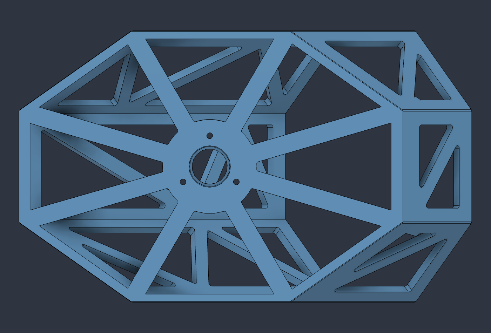

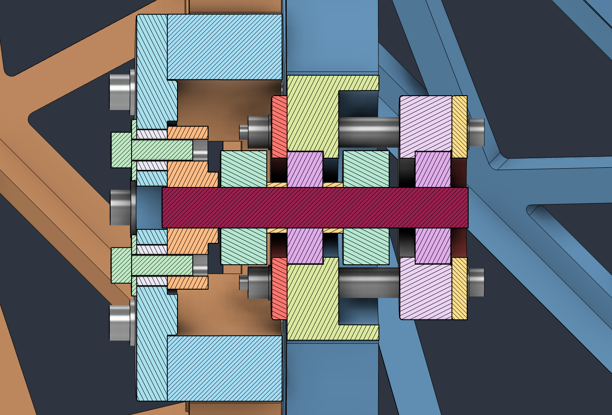

## 23 Give the rear collar a straight driver route

The rear collar sits inside A. Its two clamping screws are clocked toward +Z. A line drawn to their centers is not enough: the tool needs a clear cylinder through every spoke and rail it meets.

1. Activate A and keep unrelated solids hidden.
2. Choose **Construct > Offset Plane**, select **A > Origin > XY Plane**, and offset `bodyWidth/2`, **75 mm toward +Z**. Name it **A Collar Driver Plane**.
3. Create a sketch there. Its horizontal and vertical rulers are global X and Y. Draw two circles, dimension each **6 mm diameter**, and locate their centers with the following expressions:

| Driver | X expression | Y expression |
| --- | --- | --- |
| First | `(16 mm-6.5 mm)/sqrt(2)` | `(16 mm+6.5 mm)/sqrt(2)` |
| Second | `(16 mm+6.5 mm)/sqrt(2)` | `(16 mm-6.5 mm)/sqrt(2)` |

4. Dimension each center horizontally and vertically from the origin. Both coordinates are positive; the two centers trade X and Y values.
5. Finish Sketch, select **both circular profiles**, and extrude-cut **75 mm toward −Z** through A only. Name it **A Collar Service Channels**.
6. Check that the cut starts at Z = +75 mm and ends at Z = 0. It must stop at the collar plane, without continuing through the opposite wall.

An initial preview may seem to cut only a few disconnected patches. That is reasonable: the straight tool passes through empty space between the spokes, and the Cut removes whichever pieces of A cross its route.

Later we will insert a full tool envelope in the digital assembly and check these channels. Keep this access geometry visible in your design decisions: an added brace, fillet or motor mount must not silently close the route.

## 24 Build B's central mount and deep spokes

Add the hub-mount parameters in **Change Parameters**:

| Name | Expression | Purpose |
| --- | --- | --- |
| `mountOD` | `76 mm` | Outside of B's carrier and F's flange |
| `mountCircle` | `64 mm` | Circle through the four housing-attachment screws |
| `mountOpening` | `50.3 mm` | B's opening around F's pilot |
| `hubFace` | `-23 mm` | Metal hub's mounting plane |
| `m4Clearance` | `4.3 mm` | Printed M4 through holes |
| `nutAF` | `7.2 mm` | Trial across-flats size for a plain M4 nut |
| `nutDepth` | `4 mm` | Pocket depth measured from B's joint face |

1. Activate **B Moving Body** and hide A.
2. Make an Offset Plane from the root joint plane at `-qFront`, **−0.5 mm**.
3. Sketch a circle centered on its origin and dimension the diameter `mountOD`, **76 mm**.
4. Finish Sketch and extrude **toward −q**, distance `-qFront-hubFace`, **22.5 mm**, with **Operation: New Body**. Name it **B Central Carrier**.

Read that expression as a distance between two positions: the start is −0.5 and the end is −23 mm, so the travel is 22.5 mm into B. Enter a positive length and set the direction from the preview; do not inadvertently reverse both the number and the arrow.

Repeat the eight-spoke procedure on a plane at `-qFront`. Use the same joint-plane coordinate table, widths and outer-envelope intersection. Extrude each spoke **18 mm toward −q** with **Join**. The carrier extends to q = −23 mm, while the spokes stop at q = −18.5 mm. That extension provides the rear mounting face for F. Finish with the 16 central spoke-root fillets, 1 mm radius, and check that B contains one body.

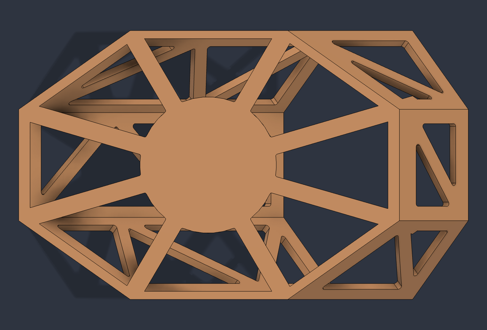

5. On the `-qFront` plane, sketch a centered `mountOpening` circle, **50.3 mm**, and cut toward **−q** by `-qFront-hubFace`, through the full **22.5 mm** carrier.
6. Start a second sketch on that same plane. Draw four circles, one in each quadrant. Dimension each diameter `m4Clearance`, **4.3 mm**.
7. Locate every center at local coordinates **±`mountCircle/(2*sqrt(2))`, ±`mountCircle/(2*sqrt(2))`**, approximately **±22.627 mm**. Use the same positive horizontal and vertical dimension expressions for all four, with the circle centers in their respective quadrants.
8. Finish Sketch, select all four circle profiles, and cut them through the carrier **22.5 mm toward −q**. Keep B the only visible solid.

These positions lie on a 64 mm circle but form a square rotated 45° relative to the sketch axes. Keep the expression so the hole centers follow `mountCircle` exactly; rounding them to 22.6 mm would make the model internally inconsistent.

## 25 Constrain the nut pockets and open the hub's sides

The four nuts need hexagonal pockets that stop them turning while you tighten screws from the other side. Here is the first pocket; repeat it for the other three holes.

Before drawing, replace Step 24's reference `nutAF = 7.2 mm` with the **selected coupon's labeled nut-pocket across-flats value** from the fit log. If the 7.1 mm pocket accepted the real nut and prevented free spinning, use `nutAF = 7.1 mm`. This is a direct pocket-size parameter, not an allowance to add to 7 mm. Choose it independently of the sleeve result even though the two trial features shared a block.

1. Keep B active and create a sketch on its `-qFront` plane. Place a circle at the first M4 hole's center coordinates. Make it **Construction**.
2. Locate its center with horizontal and vertical dimensions from the origin, using the same quadrant expressions as the hole.
3. Dimension the construction circle's **diameter** `2*nutAF/sqrt(3)`. It is the circle through the hexagon's corners, so it is larger than the selected across-flats opening—**7.2 mm at the reference setting**.

4. Draw a closed six-line hexagon with each vertex on the construction circle. Apply Coincident between every vertex and the circle, make all six edges Equal, then constrain one upper or lower flat Horizontal.
5. Check the fully constrained indicator. The center dimensions locate the pocket; the circle and Equal constraints establish its size and regularity; the horizontal flat stops it rotating.

This is the construction method in the native checkpoint. The **Circumscribed Polygon** tool with radius `nutAF/2` is an equivalent shortcut to the same regular hexagon, **7.2 mm across flats at the reference setting**, as long as its center and orientation are constrained too. Use one method, not both sets of driving dimensions.

6. Finish Sketch. Select the hexagonal region around the existing circular hole and cut **4 mm toward −q**. Repeat for all four positions, keeping the same horizontal-flat orientation.

Look from B's diagonal face: you should see four shallow hex pockets, each with a smaller round passage continuing behind it. The nuts enter from this face before the housings are joined. They cannot pass through the long 4.3 mm screw holes.

The hub's pinch screws also need side access. Create a sketch on B's **XY origin plane** and draw a closed quadrilateral with these global XY vertices in order:

| Vertex | X expression | Y expression | Approximate X, Y, mm |
| --- | --- | --- | --- |
| 1 | `(-8 mm-13 mm)/sqrt(2)` | `(-8 mm+13 mm)/sqrt(2)` | −14.849, +3.536 |
| 2 | `(-30 mm-13 mm)/sqrt(2)` | `(-30 mm+13 mm)/sqrt(2)` | −30.406, −12.021 |
| 3 | `(-30 mm+13 mm)/sqrt(2)` | `(-30 mm-13 mm)/sqrt(2)` | −12.021, −30.406 |
| 4 | `(-8 mm+13 mm)/sqrt(2)` | `(-8 mm-13 mm)/sqrt(2)` | +3.536, −14.849 |

Use ordinary Line geometry for this closed quadrilateral, connecting vertices **1 → 2 → 3 → 4 → 1**. Dimension each vertex's horizontal and vertical distance from the origin with the positive magnitude of its expression, placing it in the signed quadrant shown. Here the sketch is the **XY origin plane**, so these are global X/Y coordinates, not the v/u coordinates of the slanted joint face.

Finish Sketch and select the enclosed profile. Extrude-cut **Direction: Symmetric**, **Measurement: Whole Length**, **Distance: mountOD**, **76 mm**, through B only. Name it **B Hub Side Access**.

The cut reaches 38 mm in each Z direction. In the joint coordinates it spans q = −8 to −30 mm and u = −13 to +13 mm. It opens the central cup while preserving the four attachment locations. Choosing Half Length would extend the cutter twice as far and could remove outer frame material.

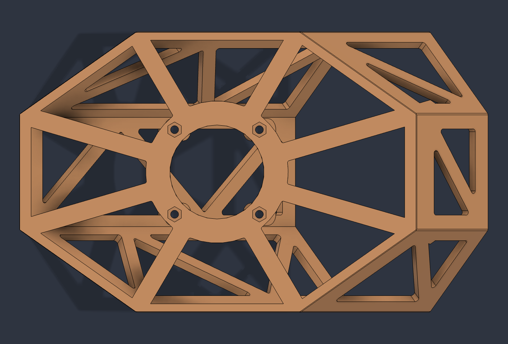

Check each attachment ear and spoke in Section Analysis. They must remain part of B's single body. The final digital tool check will include the outer integrated frame too; an open cup alone does not guarantee that a driver can reach it from outside.

## 26 Give each edge a specific job

An edge treatment should solve a particular problem. The opening-root fillets soften member junctions. A bearing-mouth chamfer guides assembly. A small bed-edge bevel provides room for a first-layer lip. The broad bearing shoulders and mounting lands must remain flat because they locate parts.

Add `tubeCornerChamfer = 0.5 mm`, `tubeRimChamfer = 0.3 mm`, and `cordStation = bodyLength/2-endRim/2`, which is 125 mm. Keep the previously defined `bedRelief = 0.3 mm`.

With A active, apply these **Equal Distance Chamfer** features in order, with **Tangent Chain off**:

1. Select only the **outer octagonal perimeter of the diagonal joint face** at q = +0.5 mm. Chamfer it by `bedRelief`. Leave the interior spoke edges, carrier contact and bearing shoulder out of this selection. Name it **A Outer Joint Bed Edge Relief**.
2. Select the eight long outside corner edges parallel to global X. Chamfer them by `tubeCornerChamfer`. Name it **A Outside Corner Bevels**.
3. Select the inner and outer perimeter edges of the distant open end at X = +130 mm, including the short segments created by the corner bevels. Chamfer them by `tubeRimChamfer`. Name it **A Open End Rim Relief**.

Repeat for B at q = −0.5 mm and X = −130 mm. Hide the other housing while selecting, and orbit after each feature to inspect the junctions.

For an outer rim selection, click an **edge**, not the adjacent planar face. Turn the model slightly so you can distinguish the outer perimeter from an aperture edge behind it. If the preview eats into a spoke root or bearing land, cancel and rebuild that selection with Tangent Chain off. Several small named features make this repair much easier than one blanket chamfer.

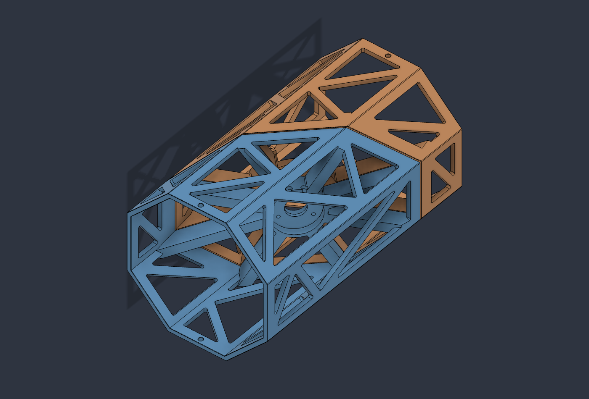

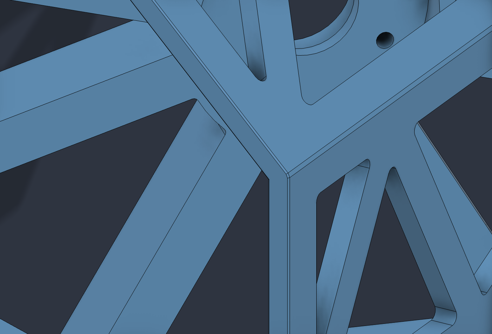

At this intermediate checkpoint, the internal spoke-opening contours are still square. The final print-edge pass below adds small bed-side relief to those large openings after all six parts and their contact surfaces are available to inspect. Keep those later features separate from the outside-corner and rim bevels taught here.

A rounded lower edge is not always the best print edge. As a fillet curves away from the build plate it can begin at a shallow angle; a chamfer has a constant slope. Use the print direction to decide which surface needs which treatment, and verify the sliced paths. These small reliefs do not eliminate support needs under the larger braces or end rim. [Modeling for 3D printing](https://help.prusa3d.com/article/modeling-with-3d-printing-in-mind_164135)

## 27 Add load ports without cutting the corner rails

1. Activate A and select its **+Z facet plane**, at Z = +75 mm, from the Browser. Create a sketch there.
2. Draw a construction line from the origin to global X = `cordStation`, **125 mm**, Y = 0. Constrain it to the appropriate sketch axis and dimension its length. A zero coordinate means “on this axis”; do not add a 0 mm distance dimension.
3. Put a circle center Coincident with the far endpoint and dimension its diameter **4.5 mm**.

4. Finish Sketch and cut **inward** through `wall`, **4.5 mm**. Check the preview travels from the outside facet toward the empty interior.
5. Chamfer both circular mouths by `bedRelief`, **0.3 mm**. Orbit inside to select the inner mouth; selecting one edge twice will not bevel both ends.
6. Repeat on A's −Z facet. Activate B and add its matching two ports at global X = `-cordStation`, Y = 0, Z = ±75 mm.

You should have **two load ports per housing**, one on each of the opposite Z faces.

Each port lies in the 10 mm solid end rim, halfway between its axial edges. The chamfer reduces sharp contact at the cord entry. The backer will support this end region internally during the test. Do not move the bridle into a nearby triangular opening: that would apply the load to a different part of the frame.

## 28 Reinforce B's long mounting-driver routes

B's four outer mounting screws point along q. Two diagonal-looking paths in a view can still hit the −Y side frame farther from the hub. The completed design gives each screw a straight driver passage and adds local material around its outer exit.

Add these parameters:

| Name | Expression | Purpose |
| --- | --- | --- |
| `driverPort` | `5 mm` | Passage for the bare 3 mm hex-key shaft |
| `accessPadWidth` | `12 mm` | Width of each capsule-shaped reinforcement |
| `accessPadExtra` | `2 mm` | Reinforcement extending inward beyond the nominal wall |

Activate B and create a sketch on its −Y facet plane at Y = −75 mm. This is **B Driver Reinforcement Plane**. In the native local basis, x = −global X and y = −global Z. Four capsules start at local coordinates **(43, ±22.627...)** and **(107, ±22.627...)** mm. Use the exact expressions below.

| Capsule starts | Local x expression | Local y expression |
| --- | --- | --- |
| Near pair | `bodyWidth/2-mountCircle/2` | `±mountCircle/(2*sqrt(2))` |
| Far pair | `bodyWidth/2+mountCircle/2` | `±mountCircle/(2*sqrt(2))` |

Create one pad before repeating the other three:

1. In the sketch on **B Driver Reinforcement Plane**, create a point at the listed starting coordinates. Use horizontal and vertical dimensions from the origin to locate it. For the first near pad, the check position is **43, +22.627… mm**.
2. Choose **Sketch > Create > Slot > Center-to-Center Slot**. Click that point for the first arc center.
3. Place the second arc center **6.5 mm to the left, along local −x**. Then set the slot width `accessPadWidth`, **12 mm**.
4. Constrain the centerline Horizontal and dimension its center-to-center length `wall+accessPadExtra`, **6.5 mm**. Keep the first center Coincident with the located point. The second center of the first pad is therefore at local x = **36.5 mm**.
5. Check the closed capsule-shaped profile. If its second center lies at x = 49.5 mm, it extends in the wrong direction; correct it before extruding.

The 6.5 mm value is the distance between the two arc centers, not the capsule's overall length. Its overall length is 18.5 mm after adding the two 6 mm end radii. [Create slots](https://help.autodesk.com/cloudhelp/ENU/Fusion-Sketch/files/SKT-CREATE-SLOTS.htm) Finish Sketch and extrude **inward**, toward global +Y, by `wall+accessPadExtra`, with **Join**. Repeat for all four pads. The resulting pad reaches 2 mm deeper into the housing than the original wall. Local −x is global +X on this plane, so the capsule follows the shift of the q-directed passage as it travels inward through the wall. Reversing this direction would reinforce the wrong side of the opening.

Now create an offset plane from the joint plane at **q = −35 mm**, named **B Mount Driver Start**. On it, sketch four `driverPort` circles at the same quadrant coordinates as B's M4 mount holes: ±`mountCircle/(2*sqrt(2))` in both local directions. Cut them **toward −q by bodyLength**, through B only. Name it **B Four Reinforced Driver Passages**.

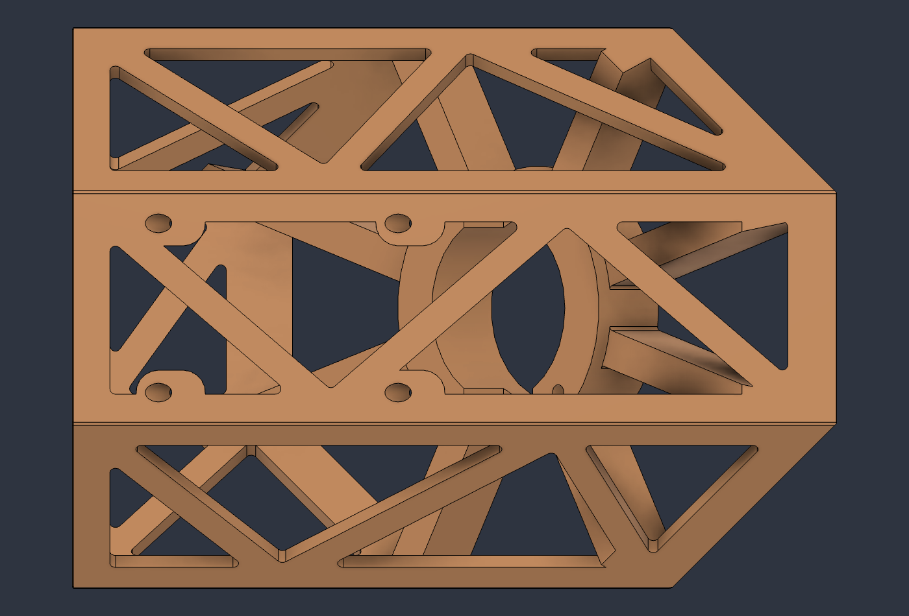

The passage is 5 mm, not the M4 screw's 4.3 mm clearance hole. It serves the tool approaching the head from outside the frame. Keep the mount holes, nut pockets and tool passages separate in the Timeline so changing a tool does not change the fastener fit.

**Checkpoint:** B remains one body after the pads and cuts. Inspect each exit from both sides. The tool path should pass through the added pad without leaving a detached crescent of material. The later insertion and driver checks test the complete access route, including the hub, screws and frame.

## 29 Make the removable rear bearing holder

D is a separate printed part, so it needs its own component rather than another body hidden inside A.

1. Activate the **root component** before choosing **New Component**. Name it **D Rear Bearing Holder**.
2. In the dialog, uncheck **External**, choose **Component Type: Standard**, and leave **Activate** enabled. Accept.
3. Check the Browser: D should sit at the same indentation level as A and B. If it appears nested inside one of them, undo its creation, activate the root, and create it again before adding geometry. [New Component settings](https://help.autodesk.com/cloudhelp/ENU/Fusion-Assemble/files/GUID-6670497A-3D7B-402F-AD83-AA2B60D22578.htm)

This is why we create and activate a component first. Its sketches, construction planes and features then stay together, and the part can be moved and exported independently.

4. With D active, hide the other solids. Make an Offset Plane from **Joint plane 45 degrees** at `qRearBase`, **22.6 mm**.
5. Sketch a circle centered on its origin, diameter `coreOD`, **44 mm**. Finish Sketch.
6. Extrude its interior toward **+q** by `shoulder+rearSeatDepth`, **10.2 mm**, using **New Body**. Name the feature **D Rear Holder Blank**. It should end at q = **32.8 mm**.

7. On that same starting plane, sketch a centered `raceRelief` circle, **19.5 mm**, and cut toward **+q** by `shoulder+rearSeatDepth`, through the blank.
8. Make another Offset Plane from the root joint plane at `qRearBearing`, **25.6 mm**. Sketch a centered circle driven by `seatDiameter`, or **`rearSeatDiameter`** if D has its own selected fit. The reference diameter is **22.2 mm**. Cut toward **+q** by `rearSeatDepth`, **7.2 mm**.
9. Use a section view to check the step between the two diameters. The **3 mm shoulder** stays on the lower-q side, and the wider bearing pocket opens on the upper-q side.

If the shoulder disappears, inspect the wider cut's starting plane and depth. Enlarging the whole through hole would produce a sleeve, not a bearing holder.

Repeat the support-hole method used in A: start on `qRearBase`, locate the seed center `supportCircle/2` from the origin, cut a `m3Clearance` hole through `shoulder+rearSeatDepth`, and pattern the feature three times about the pocket axis. Keep the seed on the same sketch side as A's seed so the holes align when assembled.

Finish D with `entryChamfer` at its bearing-pocket mouth, and `bedRelief` at the outside circular edge of its bottom face. Leave the internal bearing shoulder flat.

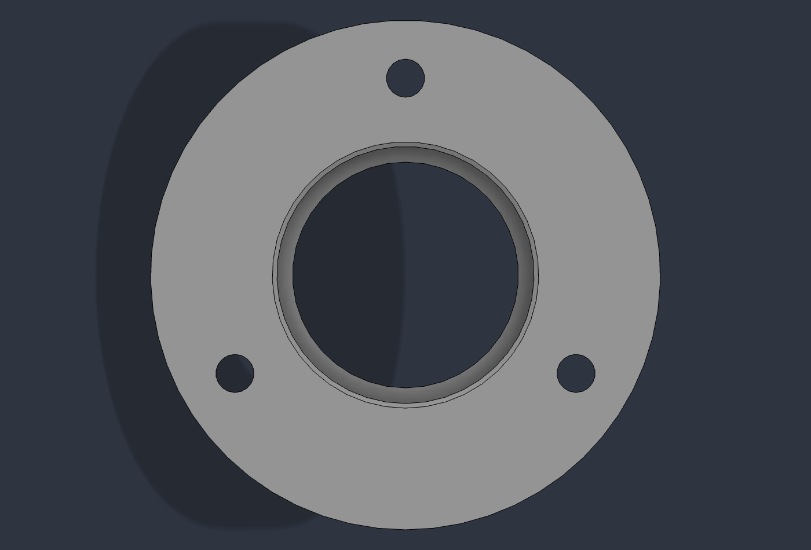

D's total height is **10.2 mm**. Its pocket opens away from the front bearing, which lets you insert the rear bearing before fitting its cap. This separate part avoids building a long enclosed bearing tunnel with inaccessible support material.

## 30 Model the two outer ring caps

1. Activate the root, create a new internal Standard component named **C Front Bearing Cap**, and leave it active. Hide the other solids.
2. Make an Offset Plane from the root joint plane at `qFront-capThickness`, **−2.5 mm**.
3. Sketch two circles centered on the origin, diameters `coreOD`, **44 mm**, and `raceRelief`, **19.5 mm**. Finish Sketch.
4. Extrude only the **annular profile between the circles**, toward **+q** by `capThickness`, **3 mm**, using **New Body**.

The preview should be a ring with an open center, ending at q = +0.5 mm. If it is a disk, clear the profile selection and click the region between the two circles rather than the smaller central region.

Make and pattern the three `m3Clearance` holes exactly as before, using `supportCircle/2` for the seed's distance. Cut through `capThickness`. Add `bedRelief` only to the outside edge of the cap's starting face.

Repeat in a new component named **E Rear Bearing Cap**, this time starting at `qRearEnd`. Extrude the same ring profile toward positive q by `capThickness` and use the same hole pattern and outside bed-edge bevel.

Both caps are **44 mm outside diameter, 19.5 mm inside diameter, and 3 mm thick**. They meet the printed holders around the pockets. Tightening their support bolts closes that plastic-to-plastic stack; it is not a method for squeezing the bearing rings together until wobble disappears.

## 31 Make the metal hub adapter

The purchased hub clamps to the metal shaft. **F Metal Hub Adapter** bolts that hub to B. Its central hole is a clearance hole, so it must not act as a third bearing that competes with the two actual bearings.

Add these mm parameters:

| Name | Expression | Purpose |
| --- | --- | --- |
| `adapterThickness` | `6 mm` | Flange thickness, matched to metal sleeve length |
| `pilotDiameter` | `50 mm` | Outside diameter of F's short centering ring |
| `pilotInside` | `34 mm` | Opening around the metal hub |
| `pilotHeight` | `2 mm` | Centering-ring height |
| `hubHoleSpacing` | `16 mm` | Square mounting-hole spacing on the purchased hub |
| `sleeveOD` | `8 mm` | Metal compression-sleeve outside diameter |
| `sleeveAllowance` | `0.2 mm` | Trial addition to the sleeve-hole diameter |
| `shaftClearance` | `8.5 mm` | Central clearance hole through F |

Carry over the sleeve result before cutting F's four sleeve seats: **`sleeveAllowance = selected coupon's labeled hole diameter − 8 mm`**. For example, a successful 8.1 mm trial means `sleeveAllowance = 0.1 mm`, making `sleeveOD+sleeveAllowance` evaluate to 8.1 mm. Use the CAD value printed in the coupon's name, not the measured diameter of the resulting plastic hole. Keep this choice independent of `nutAF`. This diameter adjustment does not establish axial flushness: the 6 mm sleeves must still match F's actual flange thickness during assembly. Export and slice the revised F; the supplied 8.2 mm reference mesh does not change when you edit this parameter.

1. Activate the root and create the internal Standard component **F Metal Hub Adapter**. Keep F active and hide the other solids.
2. Create an Offset Plane from the root joint plane at `hubFace-adapterThickness`, **−29 mm**.
3. Sketch a centered `mountOD` circle, **76 mm**, and finish the sketch.
4. Extrude the circle toward **+q** by `adapterThickness`, **6 mm**, using **New Body**. Name it **F Adapter Flange**. Its front face should reach q = −23 mm.

5. Create another Offset Plane from the root joint plane at `hubFace`, **−23 mm**. Sketch centered circles with diameters `pilotDiameter`, **50 mm**, and `pilotInside`, **34 mm**.
6. Finish Sketch and extrude the ring between them toward **+q** by `pilotHeight`, **2 mm**, using **Join**. Name it **F Centering Pilot**.

This short ring locates F inside B's 50.3 mm opening. The 0.3 mm nominal diameter difference is a trial fit, while the four outer screws provide retention. We use the root datum for the plane rather than a face produced by a later bevel, so the pilot's location does not depend on that finishing detail.

7. Return to the back plane at `hubFace-adapterThickness`. Sketch a centered `shaftClearance` circle, **8.5 mm**, and cut **6 mm toward +q**, through the flange.
8. Make a second sketch on that back plane for four `m4Clearance` circles. Locate them in the four quadrants using `mountCircle/(2*sqrt(2))` horizontally and vertically, exactly as on B. Cut all four **6 mm toward +q**.

These are the four **outer attachment holes**, on the 64 mm circle. Keep their sketch separate from the smaller hub mounting pattern that follows; the two patterns serve different parts.

Create a second four-circle sketch on the same back plane for the compression sleeves. Put their centers on the right, top, left and bottom axes at distance `hubHoleSpacing/sqrt(2)` from the origin, approximately 11.314 mm. Locate each center with a horizontal or vertical construction line of that length, and make the circle center coincident with its endpoint. Dimension each circle `sleeveOD+sleeveAllowance`. Cut all four circular profiles through `adapterThickness`.

The native model uses this direct four-circle sketch. A feature Circular Pattern would also express the rotational relationship, but choose one method. Patterning a sketch that already cuts all four holes would try to make the same holes again.

You may wonder why we keep re-entering named center expressions instead of tracing the visible holes in B. **Project** can bring existing edges or points into a sketch as reference geometry; with its link retained, an edit to the source updates the projected reference. That is useful when a new feature truly belongs to an existing edge. Here both parts use the same named layout parameters and root datums, which makes their common intent explicit without depending on the edge identity of a hole in another component. If you explore Project in a practice copy, do not add both projected positions and duplicate driving coordinates to the same circles. [Project geometry into a sketch](https://help.autodesk.com/cloudhelp/ENU/Fusion-Sketch/files/SKT-SKETCH-CREATE-PROJECT-INCLUDE.htm)

The four **hole centers** lie on an imaginary **bolt circle** of diameter `hubHoleSpacing*sqrt(2)`, approximately 22.627 mm. Each sleeve hole itself remains `sleeveOD+sleeveAllowance`, **8.2 mm** at the trial setting. This is the purchased hub's 16 mm square pattern rotated 45°, not the outer 64 mm attachment circle. We will rotate the metal hub the same way during assembly so its angled pinch-bolt tool paths align with B's service openings. Tool access has changed the mounting orientation without changing the purchased part.

Chamfer the pilot's top outside edge by `entryChamfer` and the flange's back outside edge by `bedRelief`. Keep the large hub mounting face flat.

The sleeves provide a metal compression path for the four hub screws. Their ends must fit the flange thickness correctly: sleeves that stand proud can leave the printed plate loose, while sleeves that are too short let the screw compress plastic before reaching the metal stop. The nominal drawing gives both 6 mm; measure the parts and inspect the assembled faces rather than assuming the nominal values guarantee a flush result. [Compression-limiters and bolted plastic joints](https://www.spirol.com/product/compression-limiters/)

**Part 4 checkpoint:** show A through F together, then hide each in turn. A and B should each contain one integrated body; C, D, E and F should each be separate root-level components. In a section view, identify the two bearing shoulders, the open centers of both caps and the adapter's 8.5 mm shaft clearance. Explain which surfaces locate a part, which retain it and which provide clearance. If those jobs are hard to distinguish, revisit the relevant feature before adding hardware.

# Part 5 Make the digital joint move, then check how it goes together

A convincing assembled view can hide a part that cannot be inserted or a screw that no tool can reach. We will first represent the purchased hardware, then add the intended motion, and finally inspect the assembly routes. This is a geometry check; the printed load test comes later.

## 32 Represent the purchased hardware and assemble the center

Create the purchased parts as **separate root-level components** with names beginning `REF`. These bodies let us check occupied space and assembly. They must not be exported as printed parts. We use simplified solid envelopes instead of drawing every bearing ball, thread and drive recess.

If you want to focus on the printed-part modeling first, inspect these groups in [checkpoint 15, the final reference assembly](checkpoints/15-print-edge-refinements.f3d), then return here to build your own. This is a comparison copy: it already contains the later joints, driver reinforcement and finishing features, so do not add those features a second time. The groups use the same centered-circle, ring and pattern tools you already know. Their careful placement matters more to this exercise than visual realism.

1. Activate the root, create **REF Steel Shaft 8 x 60**, and leave that component active.
2. Create an Offset Plane **−24 mm** from the joint plane. Sketch a centered **8 mm** circle.
3. Finish Sketch and extrude **60 mm toward +q**, with **New Body**. The far end should reach q = **+36 mm**.
4. Apply a metal appearance if it helps you distinguish purchased hardware from printed components. Appearance changes the display, not the model's mechanical behavior.

For each ring in the following table, activate its root-level REF component, make the listed starting plane from the joint plane, and sketch two concentric circles centered on its origin. Dimension the outside and inside diameters separately. Finish Sketch, select the annular region, and extrude the listed length **toward +q**. For two rings in one component, keep that component active and create the second ring on its own starting plane.

As a worked check, the front bearing begins at q = 0.5 mm and is 7 mm wide, so its end is at q = 7.5 mm. Its smaller opening remains 8 mm; do not accidentally extrude the central disk.

| Component | Ring or body | Starting q | Outside / inside diameter | Length |
| --- | --- | --- | --- | --- |
| `REF Two 608 Bearings` | Front bearing | `qFront` | `bearingOD` / `bearingID` | `bearingWidth` |
| `REF Two 608 Bearings` | Rear bearing | `qRearBearing` | `bearingOD` / `bearingID` | `bearingWidth` |
| `REF Inner Ring Spacers` | Front spacer | `qFront-4 mm` | 10 / 8 mm | 4 mm |
| `REF Inner Ring Spacers` | Rear spacer | `qFront+bearingWidth` | 10 / 8 mm | 4 mm |
| `REF Split Collar Envelopes` | Front collar | `qFront-13 mm` | 22.4 / 8 mm | 9 mm |
| `REF Split Collar Envelopes` | Inner collar | `qFront+bearingWidth+4 mm` | 22.4 / 8 mm | 9 mm |
| `REF Sonic Hub Envelope` | Hub body | `hubFace` | 32 / 8 mm | 8 mm |
| `REF Sonic Hub Envelope` | Hub pilot | `hubFace+8 mm` | 14 / 8 mm | 2 mm |

Use **New Body** when a component contains two separate rings. Use **Join** for the hub's pilot so it connects to the hub body. The collar's 22.4 mm outside diameter is the manufacturer's maximum rotating hardware envelope, including its screw heads; its actual round body is 18 mm. A conservative envelope is useful for clearance, even though it is not a visual replica.

Make **REF Metal Support Spacers** on the plane `qFrontBack`. Use the same construction-line seed as the M3 holes, place concentric 6 mm and 3.2 mm circles at its endpoint, extrude their annulus by `supportSpacer`, and circular-pattern the feature three times. Their centers must line up with A and D's support holes.

For the pattern axis, show A and select a circular edge of its **centered bearing opening**, or a named construction axis through that opening. The axis must run along q through the shaft center; selecting the off-center spacer's own circular edge would repeat it around the wrong axis. **Quantity 3 includes the seed.** Use this same central q axis for the M3 fastener sets below. With the seed at local `(17, 0)`, the other centers should be `(-8.5, +17*sqrt(3)/2)` and `(-8.5, -17*sqrt(3)/2)` mm.

Make **REF Hub Compression Sleeves** on the plane `hubFace-adapterThickness`. Use the cardinal hub-hole positions from the adapter lesson, with 8 mm outside and 4.3 mm inside circles, and extrude 6 mm toward positive q. Cut nominal 4.3 mm passages through the hub body at those same four positions. These passages represent threaded-hole space; the purchased hub has real M4 threads.

The complete checkpoint also includes separate `REF M4 Hub Screws`, `REF M4 Adapter Fasteners`, and `REF M3 Support Fasteners` groups. Model a screw envelope with a cylindrical shank and a second cylinder for its head. Use Join where the head meets the shank; create the washer as a separate ring body.

For the socket-head screws used here, the purchased length is measured **under the head to the tip**. It does not include the head. The table's starting planes account for the direction in which each fastener is inserted. For example, the M4 hub screw's head runs from q = −34 to −30 mm, and its 12 mm shank runs from −30 to −18 mm. That makes the under-head plane q = −30 mm.

Use the following nominal layout. Every extrusion starts at the listed q and runs toward positive q. Make one round M3 set and circular-pattern its features three times. Place the four M4 sets at their matching hole coordinates, keeping all four hex nuts in the same flat orientation as B's pockets. A 90° pattern would rotate alternate hex nuts out of alignment; a six-sided nut does not share the square hole pattern's rotational symmetry.

| Hardware group | Shape | Starting q in mm | Diameter or OD / ID in mm | Length in mm |
| --- | --- | ---: | --- | ---: |
| M3 support, three sets on 34 mm circle | Shank | −8.7 | 3 | 45 |
| M3 support | Head | 36.3 | 5.5 | 3 |
| M3 support | Rear washer | 35.8 | 7 / 3.3 | 0.5 |
| M3 support | Front washer | −3.0 | 7 / 3.3 | 0.5 |
| M3 support | Locknut envelope | −7.0 | 6.36 / 3.3 | 4 |
| M4 hub, four sets at the cardinal sleeve positions | Shank | −30 | 4 | 12 |
| M4 hub | Head | −34 | 7 | 4 |
| M4 hub | Wide washer | −30 | 12 / 4.3 | 1 |
| M4 outer attachment, four sets on 64 mm circle | Shank | −30 | 4 | 30 |
| M4 outer attachment | Head | −34 | 7 | 4 |
| M4 outer attachment | Washer | −30 | 9 / 4.3 | 1 |
| M4 outer attachment | True hexagonal plain nut | −4.5 | 7 mm across flats / 4.3 mm bore | 3.2 |

For the four M4 plain nuts, use the earlier fully constrained hexagon method with **7 mm across flats**, extrude **3.2 mm** from q = −4.5, and cut a **4.3 mm** bore. This matches the true hexagonal outer shape used in the supplied model. A cylinder large enough to enclose the hex corners would intrude into the flats of B's 7.2 mm pocket and create a false interference result. The M3 locknut cylinders in this table are free-space envelopes; they do not check a matching hex pocket. These solids omit threads and drive recesses. The [manufacturer's Sonic hub STEP archive](https://www.gobilda.com/content/step_files/1309-0016-0008.zip) provides the real hub and pinch-bolt geometry if you want to inspect those features. A plain cylinder cannot reveal a screwdriver path by itself.

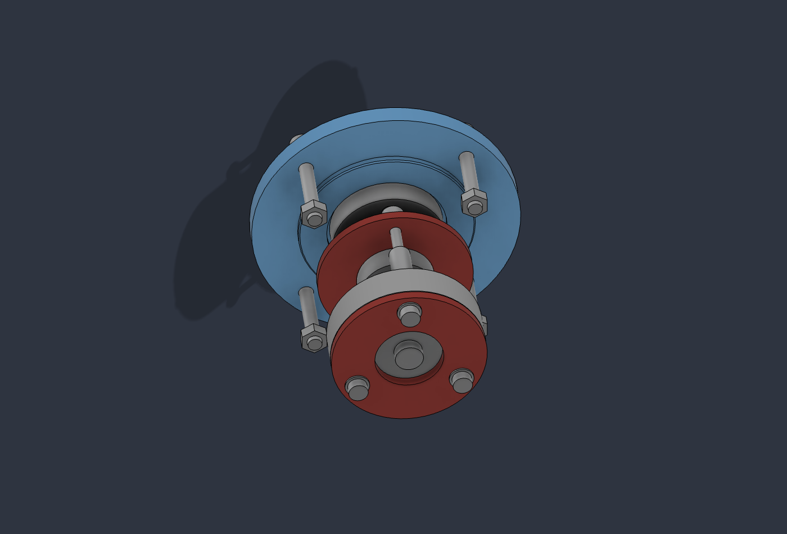

## 33 Give the assembly one intended rotation

The parts are already in their correct assembled positions. An **As-Built Joint** defines how they may move from those positions. A regular Joint can also reposition components while connecting them, which is unnecessary here.

1. Activate the root and show all components.
2. Right-click **A Housing** and choose **Pin**. It is our stationary reference in the document. If **Ground To Parent** is also enabled, release it.
3. Turn Ground To Parent off for B and the other components, and make sure none of those moving components is pinned. Our explicit joints will control their relationships.

Pin fixes a component in the design's coordinate system; Ground To Parent makes it move rigidly with its parent. Either can prevent motion if left on the wrong component. If the later joint refuses to move, inspect these relationships before rebuilding its geometry. [Grounding behavior](https://help.autodesk.com/cloudhelp/ENU/Fusion-Assemble/files/ASM-GROUND-TO-PARENT.htm)

4. Hide C, D, E, F and the REF groups temporarily so the bearing opening is easy to select.
5. Choose **Solid > Assemble > As-Built Joint** and select **B**, then **A**, in the Browser. In the Motion section set **Joint Type: Revolute**.
6. Use **Simple** positioning and select the center snap point of a circular edge on A's bearing opening. On a Mac, hovering over the opening and holding **Command** can help keep the available snap points visible.
7. In **Rotate**, choose the axis perpendicular to the diagonal joint plane. Inspect the line shown in the canvas: it must pass along the shaft. The joint's local Z choice does not necessarily mean the document's global Z.

If that axis is difficult to select, cancel the joint command and create **Construct > Axis Through Cylinder/Cone/Torus** from the bearing opening's cylindrical surface. Name it **Pivot Axis**, then restart the joint and use that axis for **Custom Axis**.

8. Use **Preview Motion**. B should rotate around the slanted shaft while A stays fixed. If the whole assembly swings around a global axis, stop and correct the selected axis.
9. Set the rotation limits to **Minimum: 0°** and **Maximum: 180°**, then accept and name the joint **SWIVEL**. These CAD limits define the demonstration range; the printed parts do not have matching physical stops. [As-Built Joint](https://help.autodesk.com/view/fusion360/ENU/?contextId=ASM-CREATE-AS-BUILT-JOINT)

Show the remaining components. For each component in the table, create another **As-Built Joint**, select that component and its listed housing, and set **Joint Type: Rigid**. Accept before moving to the next component. A rigid joint removes all relative movement between those two components; it does not turn their geometry into one body.

| Side | Components that move with it |
| --- | --- |
| A Housing | C Front Bearing Cap, D Rear Bearing Holder, E Rear Bearing Cap, REF Two 608 Bearings, REF Metal Support Spacers, REF M3 Support Fasteners |
| B Moving Body | F Metal Hub Adapter, REF Steel Shaft 8 x 60, REF Inner Ring Spacers, REF Split Collar Envelopes, REF Hub Compression Sleeves, REF Sonic Hub Envelope, REF M4 Hub Screws, REF M4 Adapter Fasteners |

The complete bearing envelopes are fixed to A for this clearance model. Their inner rings are not separate animated parts; the revolute joint supplies ideal relative motion. This is a motion and space check, not a simulation of rolling contact, friction, bearing clearance, or stiffness.

Expand **Relationships > Joints**, right-click **SWIVEL**, and choose **Drive Joint**. Before entering a value, predict what a half-turn around the diagonal shaft will do.

Try **0°**, **90°**, then **180°**. At 0° the housings are straight. At 180° they form a **90° elbow**. Halfway through, at 90° swivel rotation, the change in body direction is **60°**, with twist. The angle around the shaft and the bend between the long bodies are different measurements. Watch a single flat face as the joint moves; it makes the twist easier to see.

Run **Inspect > Interference** at 0°, 30°, 60°, 90°, 120°, 150°, and 180°, including the reference hardware. Sampling those poses checks the modeled shapes at those positions; it does not prove clearance between samples or tool engagement with actual hardware. Return to 0° afterward.

Choose **Inspect > Section Analysis**, select the root XY plane, and use zero offset. This plane passes through the shaft axis. Inspect the bearing shoulders, cap contacts, collar spacers, and clearance between F and the surrounding wall. Hide the analysis afterward; it changes the view, not the solid.

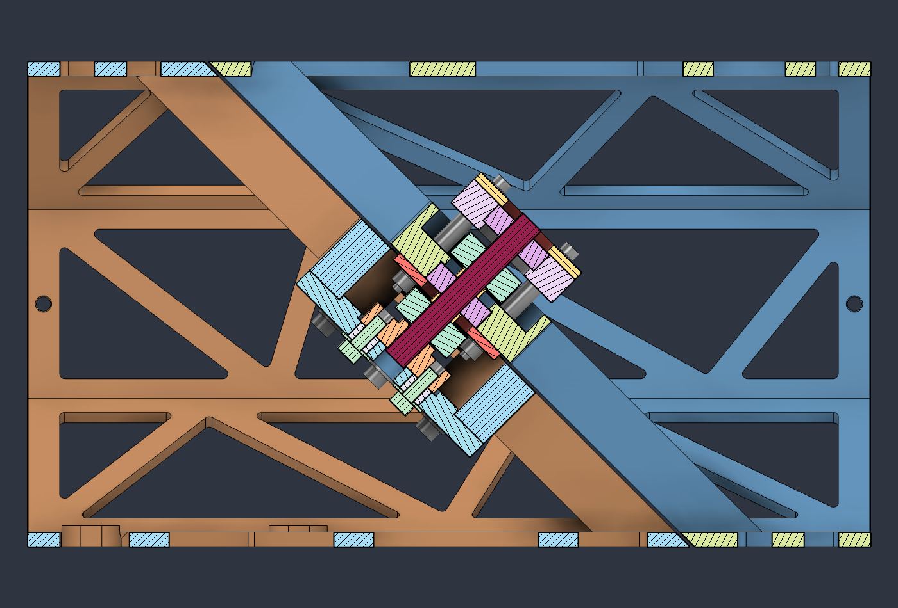

The [baseline native mechanics report](review/mechanical/native-mechanics-validation.json) records no interference at those seven sampled poses. It also checks eleven required straight driver routes, the two-stage insertion envelopes for D, E and the F/hub assembly, and nominal backer/shoe seating. The later [V4.1 finishing check](review/edge-refinement/mechanical-validation.json) verifies that the refinements only remove material and preserve the component positions, so they cannot introduce a new rigid-body collision along those previously clear routes at the same poses. These checks use rigid geometry and simplified hardware envelopes. They do not model fingers, socket engagement, friction, flexible parts or physical tolerances.

## 34 Check access before closing the assembly

The open tube ends provide the assembly routes. Confirm both a part's final space and the path by which it reaches that space. D and E enter through A's +X end, with their bearing axes parallel to q, then translate along −q onto the shaft. The F/hub subassembly enters B through the −X end with its four outer attachment screws and washers already loaded loosely in F, then moves along +q onto its mounting face. Trying to slide either assembly along the infinite q axis from outside the housing would send it through a side wall.

### Trace the rear holder's insertion

For a hands-on translation exercise, explore **D's printed holder alone** in a **separate saved study copy**. This gives you one part to follow without accidentally moving unrelated hardware. The supplied REF groups are organized for clearance modeling: both bearings share one component, and the outer screws and nuts share another. They are not ready-made insertion subassemblies.

1. Set SWIVEL to **0°**. Show only **A Housing** and **D Rear Bearing Holder**; hide B, C, E, F and every REF component. In Relationships > Joints, suppress the rigid relationship attaching D to A, named **Fixed - D Rear Bearing Holder** in the supplied checkpoint. Keep A pinned. Make sure D is neither pinned nor Ground To Parent.
2. Select D in the Browser. Open **Move/Copy**, set **Move Object: Components**, **Move Type: Translate**, **Direction: Design XYZ**, and leave Create Copy off. Keep the holder's orientation unchanged.
3. Begin with **extraction**, because D is already seated. Withdraw it **32.3 mm toward +q**: enter `32.3 mm/sqrt(2)` for both the X and Y changes, and **0 mm** for Z. Confirm the move. Its nominal center has moved from q = **27.7 mm** to q = **60 mm**, where X and Y are both about **42.426 mm**.
4. Open Move/Copy again with the same choices. Move toward the open **+X end** by entering `230 mm-60 mm/sqrt(2)` for the X change, with **0 mm** Y/Z changes. This is about **187.574 mm** farther along X; D's center now lies at X = **230 mm**. These values are **changes from the current position**, not absolute destination coordinates.
5. Reverse the sequence to demonstrate insertion: first translate by `-(230 mm-60 mm/sqrt(2))` in X with Y/Z unchanged; then translate by `-32.3 mm/sqrt(2)` in both X and Y, with Z unchanged. D returns to its nominal seat. The route is **X first, then −q when entering**, and the reverse when extracting.
6. Repeat slowly, using Section Analysis to inspect several stops. For **Inspect > Interference**, explicitly select **only A and D**. After the exercise, close the study copy and reopen your untouched assembly. Do not capture these temporary placements as your production assembly state.

A q move of length L has equal global-X and global-Y changes `L/sqrt(2)`. For example, a **10 mm move toward +q** changes each by **+7.071… mm**, with Z unchanged. That example teaches the coordinate conversion; it is not the full withdrawal distance used above.

You have explored D's printed shape through A. Because the bearing, shaft, collars and fasteners are excluded, **this exercise does not check their insertion**. Sampled views also cannot prove a continuous clear path. The supplied report separately checks conservative swept envelopes for D with its rear bearing, E, and the F/hub/fastener assembly in their documented assembly stages. The physical sequence in Steps 42–43 includes those parts and their contact checks. [Move/Copy](https://help.autodesk.com/cloudhelp/ENU/Fusion-Model/files/GUID-FFD25CD3-0707-429E-B0E6-B7F9984CDC4C.htm)

### Check one bare-driver route yourself

Now use the collar service channel from Step 23. Model a simple **tool envelope**: a solid cylinder representing the space a bare driver shaft needs along its approach. We will check one route through your own assembly, so a misplaced channel or an added brace can become an observable result.

Start from a **fresh saved study copy of the assembly at SWIVEL = 0°**, with D back in its seat and its rigid joint restored. Keep your production document separate. The coordinates below use the original design's global X, Y and Z directions; the temporary component must stay at the root origin with no Move/Copy applied.

1. Activate the **root**, create an internal component named **STUDY Collar Driver Envelope**, and activate it. Choose **Construct > Offset Plane**, select this new component's **Origin > XY Plane**, and offset it **100 mm toward +Z**. Name the plane **Driver start Z100**. This gives the driver a start beyond the +Z wall.
2. Create a sketch on that plane and use **Look At**. Draw a center-diameter circle approximately **6.7 mm right and 15.9 mm above the sketch origin**. Set its diameter to **4 mm**. This 4 mm circle is the clearance envelope used by the reference check, rather than the across-flats size printed on the hex key.
3. Press **D**, select the sketch origin and the circle's center point, then choose **Horizontal** from the right-click dimension menu before placing the dimension. Enter **`(16 mm-6.5 mm)/sqrt(2)`**. Repeat with **Vertical**, entering **`(16 mm+6.5 mm)/sqrt(2)`**. The circle should now be fully constrained at approximately **X = 6.718 mm, Y = 15.910 mm**. Use the exact expressions; the displayed decimals are checks. Name the sketch **Driver diameter and location**.

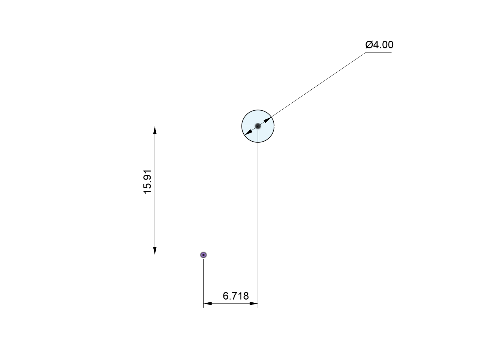

The two expressions convert **q = 16 mm, u = −6.5 mm** into global X/Y. Here `X = (q+u)/sqrt(2)` and `Y = (q-u)/sqrt(2)`. We use one side of the paired channel; exchanging the X/Y expressions gives the other side.

4. **Finish Sketch**. Extrude the disk **88.8 mm toward −Z**, with **Operation: New Body** inside the study component. Name the feature **Driver envelope toward minus Z**. The cylinder must run from **Z = 100 down to Z = 11.2 mm**. Inspect the preview before accepting: it approaches the collar area from outside A and stops near the inner collar's screw approach. If it grows away from the housing, reverse the extrusion direction.
5. Activate the root. Show only **A Housing**, **D Rear Bearing Holder**, **REF Metal Support Spacers**, **REF M3 Support Fasteners**, and **STUDY Collar Driver Envelope**. Hide the other components, sketch and construction plane. These five are the complete selection for this particular check.
6. Choose **Inspect > Interference**. Select those **five components** in the Browser, using **Command-click** on the Mac to add selections. Leave **Include Coincident Faces** off, then click **Compute**. Do not stop after selecting the components: Compute performs the check. [Interference instructions](https://help.autodesk.com/view/fusion360/ENU/?guid=SLD-INTERFERENCE)
7. Expect **no interference** for the reference geometry. If Fusion reports an overlap, inspect the highlighted pair before changing anything. Confirm the cylinder's X/Y location, its −Z direction and endpoints, D's seated position, and both service-channel cuts from Step 23. Check that the selected components match the list; an extra reference envelope changes the question being tested. Record the result before closing the dialog.

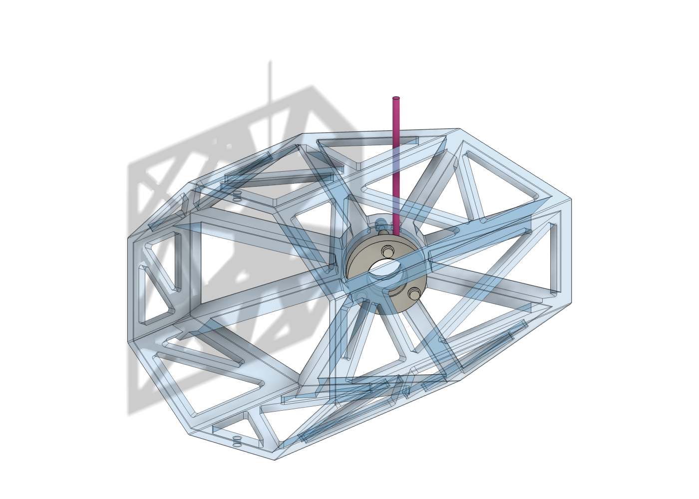

The supplied native Fusion study has a fully constrained sketch, cylinder ends at Z = 11.2 and 100 mm, and zero interference for the five selected components. The [recorded result](review/polish-4.2/tool-exercise-validation.json) identifies the geometry and selection used. Compare your own result with that reference.

**Checkpoint:** point to the cylinder's outside start, its inner end and the opening it passes through. Explain why an overlap would matter even if the real screw remained visible through the frame. This tests a straight driver-shaft envelope against the selected obstacles; handles, fingers, actual socket engagement and physical tolerances still need the real-tool checks during assembly. Close the study copy after the exercise and return to the untouched production document. **Do not include the STUDY component in any print export.**

### Keep the assembly order and parameter relationships

The checked required tools comprise three rear M3 drivers, four outer M4 bare hex-key shafts, two inner-collar drivers and two hub-pinch drivers. B's 5 mm mount passages are intended for a bare 3 mm hex key, represented by a 4 mm round clearance envelope. A bulky interchangeable-bit holder will not fit merely because its bit is the correct size.

Tighten the front collar and the four inner hub-to-F screws **before final mating**. Two optional in-place approaches to those inner hub screws intersect the integrated frame, so do not plan to assemble that stack after B is closed. The finished assembly can be serviced in the documented order by reversing those operations; visibility through an opening is not the same as full tool access.

**Predict, then test in a saved copy:** change `bodyWidth` from 150 to 155 mm and `bodyLength` from 260 to 270 mm. The frame envelope should grow while the purchased hardware, 22.2 mm trial seats and 25.1 mm bearing spacing stay the same. Inspect the Timeline, body connectivity and access before restoring 150/260. The [native edit check](parameter-edit-validation.json) records healthy active features and one body in each housing through that edit-and-restore sequence. It does not certify printing, tool clearance or loading at the larger dimensions; those require their own checks and correctly resized fixtures.

Make this change through the named parameters in Fusion. Scaling a finished STL would also scale its bearing pockets, screw holes and assembly gaps; an 8 mm purchased shaft would stay 8 mm. Independent parameters let the frame grow while its hardware interfaces keep their intended sizes.

**Part 5 checkpoint:** drive the joint and watch which hardware follows each housing. A, both bearing envelopes and their outer-ring retainers should stay still; B, the hub and shaft should move together. Return to 0°, then point out the routes for inserting D, E and the F/hub assembly. Finally, identify one screw you must tighten before closing the joint. If you can show those three things—motion, insertion and tool access—you have checked more than an attractive final pose. Save this baseline before moving on to print preparation.

# Part 6 Print local trials and inspect the housing layers

The next result is a set of parts you can inspect and fit, with a record of how you printed them. Keep the CAD model, slicer project and bench notes together: a hole allowance only has meaning alongside its material, orientation and process. The supplied parts have been checked digitally; they have not yet been physically printed, assembled or load-tested. The trial prints below are where you begin finding out how your X1 Carbon and purchased hardware behave.

## 35 Finish the edges from the print direction

A tube benefits from different edge treatments in different places. A **chamfer** replaces an edge with a flat bevel; a **fillet** rounds it. At a bed-facing entrance, a small chamfer can clear a first-layer lip and guide a nut or sleeve. At a structural inside corner, a fillet makes the transition less abrupt. Neither is a reason to round every contact face: a bearing shoulder still needs a definite, flat seat.

A downward-facing round can create a difficult overhang near the bed. That is why these entrances use chamfers while the triangle aperture roots keep their **1.5 mm fillets**. Prusa illustrates this distinction in its [design-for-printing guide](https://help.prusa3d.com/article/modeling-with-3d-printing-in-mind_164135). Here, the fillets are a design choice whose printed strength still needs testing.

The reference process already uses **0.15 mm elephant-foot compensation**. Elephant foot is the slight outward spread of the first layers; inside a hole, that spread can make an inward lip. The selected CAD relief moves the entrance boundary away from the deeper fit surface. It does not enlarge the whole hole, flatten a shoulder or remove support material.

1. Open **Solid > Modify > Change Parameters**. Confirm `bedRelief = 0.3 mm` and add `printEntryRelief = 0.3 mm` if it is not already present. Use millimeters for both.
2. Keep the two names separate even though their values match. Later, you can change an assembly entrance without changing all the free bed contours.
3. Find each face in the table before selecting edges. “Bed side” means the face used during printing, which is not always the underside in the assembly view.

| Component and print-up direction | Selected edges | Relief | Keep unchanged |
| --- | --- | --- | --- |
| A, +q | Eight large spoke-opening contours on the bed face at q = +0.5 mm | 0.3 mm equal distance | Bearing pocket and shoulder, three M3 bores, support-post lands |
| B, −q | Eight large spoke-opening contours on the bed face at q = −0.5 mm | 0.3 mm equal distance | Central mounting geometry, bolt bores and mounting lands |
| B, −q | Six entrance edges of each of the four hex nut pockets, at q = −0.5 mm | 0.3 mm equal distance | Deeper fit flats, pocket floors and screw passages |
| F, +q | Four sleeve-hole mouths and the central 8.5 mm clearance-hole mouth on the bed face at q = −29 mm | 0.3 mm equal distance | Top sleeve mouths at q = −23 mm, flange thickness, pilot, outer bolt bores and remaining washer lands |
| C, D and E, +q | No additional edges in this pass | None | Bearing-contact edges, retaining lands, post lands and small bolt bores |

Start with A's large openings:

1. In the Browser, activate **A**, right-click it and choose **Isolate**. Turn the diagonal joint face toward you. Confirm that it is **q = +0.5 mm** and A prints away from it toward +q.
2. Choose **Solid > Modify > Chamfer**. Set **Type: Equal Distance** and turn **Tangent Chain off**. This prevents one selected edge from silently collecting neighbors you meant to protect.
3. Select every segment around the **eight large spoke openings** on this face, including their short curved corner segments. The reference model has **48 selected edges**. Do not select the outside octagon, which already has relief, the bearing mouth or the three small M3 bores.
4. Enter `bedRelief`. Orbit the preview: a narrow band should follow the eight opening contours. The central bearing contact geometry must stay unchanged. Confirm and rename the feature **A Internal Spoke Opening Bed Relief**.
5. If the preview reaches a bearing seat or disappears, cancel and inspect the edge selection. A missing curved segment is a selection problem; increasing the distance will not fix it.

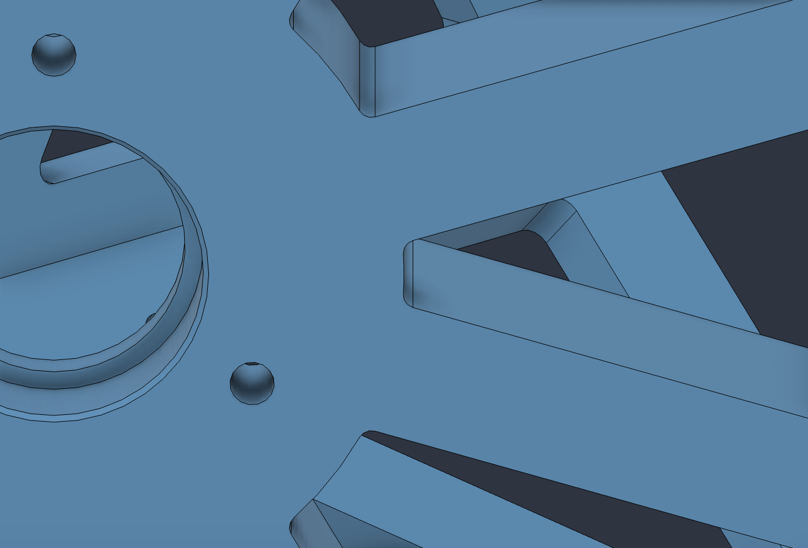

Now use the same tool on B, taking care with its reversed print direction:

1. Activate and isolate **B**. Face **q = −0.5 mm** toward you. B prints toward **−q**, so this is the opposite-facing diagonal surface from A's.
2. Chamfer the eight large spoke-opening contours, again **48 edges**, with `bedRelief`. Name the feature **B Internal Spoke Opening Bed Relief**. Check that the central mounting geometry, small bores and mounting lands remain unchanged.
3. Start a **separate Chamfer feature**. Select only the six entrance segments of each of the four hex nut pockets: **24 edges total**, all at q = −0.5 mm.
4. Apply `printEntryRelief` and name it **B Nut Pocket Entry Lead Ins**. Leave the floor edges and the **4.3 mm screw passages** out of the selection. The mouth should widen while the deeper hex flats stay at `nutAF`.

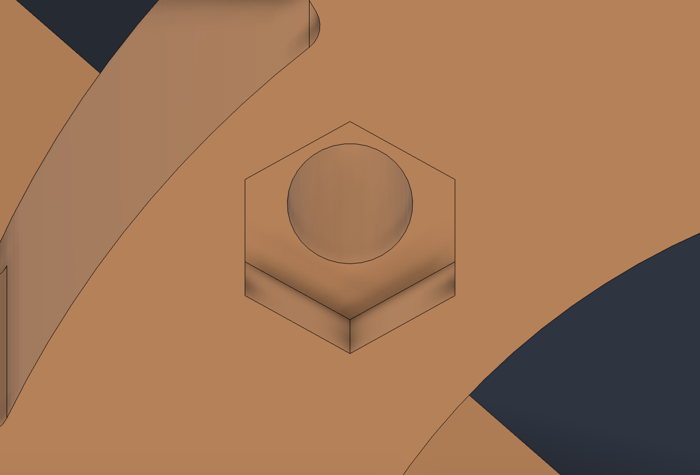

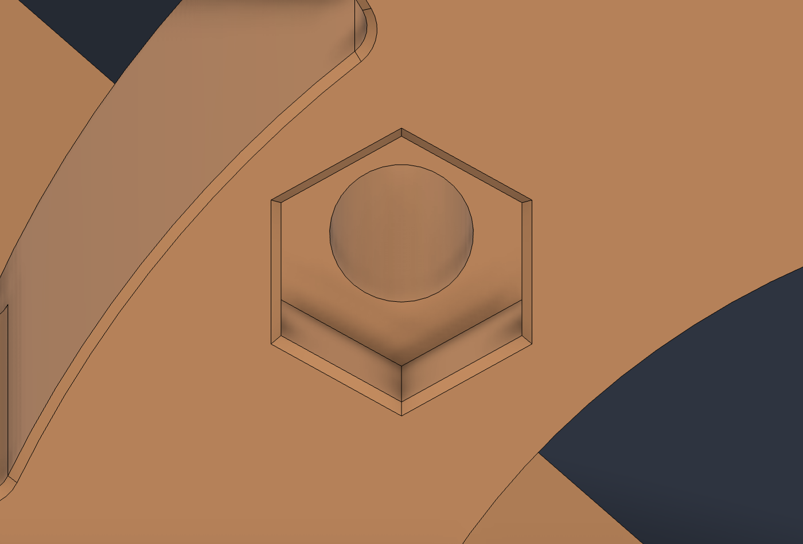

Finish the bed-side entrances on F:

1. Activate **F** and face its broad back at **q = −29 mm** toward you. Select the **four sleeve-hole entrance circles**, chamfer them with `printEntryRelief`, and name the feature **F Sleeve Bed Entry Lead Ins**.
2. Start another Chamfer feature. Select only the **central 8.5 mm shaft-clearance entrance circle**, use the same expression, and name it **F Shaft Clearance Bed Entry**. The four smaller outer attachment bores stay unchanged.
3. Orbit to the opposite face at **q = −23 mm**. Its sleeve mouths should still be square. Keep the flange and metal sleeves **6 mm thick/long**: the bevel removes a narrow annulus of printed material at the entrance, not sleeve length or the sleeve end-contact plane. The remaining washer seating surface must stay flat.

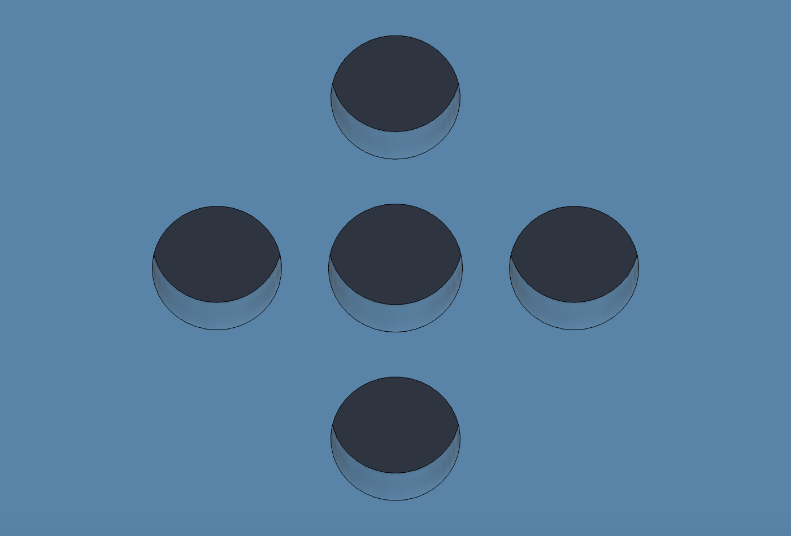

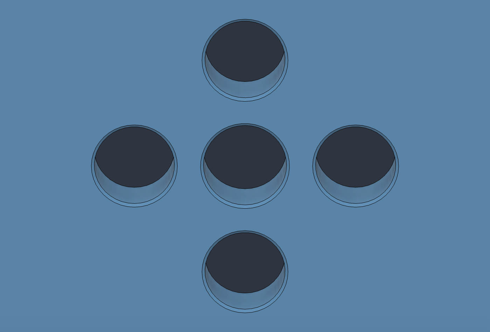

Check your prediction: if a nut fits through the new mouth but still jams deeper in the pocket, should you enlarge the chamfer? No. The chamfer only treats the entrance. First clear support, then check the deeper fit with the selected coupon allowance. This separates an entry problem from a size problem.

1. Isolate F. Choose **Inspect > Section Analysis** and select the **root XY plane**, with zero offset. This plane contains q and crosses the two sleeve centers at global Z = 0. Inspect the **0.3 mm** entry treatment followed by the straight sleeve seat; hide the analysis afterward.
2. Isolate B. Create an **Offset Plane** from root XY at `mountCircle/(2*sqrt(2))`, about **22.627 mm toward +Z**. Use that plane for another Section Analysis. It passes through the two nut pockets on that side. Confirm their entry bevels, unchanged deeper flats and original floors, then hide the analysis. These are viewing sections; they do not cut the part.
3. Check the Timeline for warnings, then expand each component's **Bodies** folder. A, B and F must each remain one body.
4. Leave **C, D and E unchanged** in this pass. In particular, keep E's bearing-contact opening and D's post-contact lands intact. A small bore beside a loaded contact is not automatically a good place for more relief.

The [final print-edge checkpoint](checkpoints/15-print-edge-refinements.f3d) is the editable starting point for the V4.1 print files; checkpoints 01–13 retain the preceding teaching stages.

The [native feature record](review/edge-refinement/native-refinement.json) lists the five finishing features. The [focused geometry check](review/edge-refinement/mechanical-validation.json) confirms that the removed material stays within the intended 0.3 mm bed-side layers, that the named protected contacts remain unchanged, and that C, D and E are unchanged solids. This is a geometry and clearance check, not a measurement of joint strength or print quality.

Do not bevel both sides of every triangular opening. A cosmetic bevel cannot put supporting material beneath a long shallow brace. Also, **Equal Distance** specifies the setbacks from the selected edge; on an inclined housing wall it does not mean the bevel is 45° to the bed. Step 38 checks the actual layers, and the exact brace trials test whether their supports can be removed.

## 36 Export individual parts and preserve their units

Export one printed part at a time so the slicer can assign it the right orientation and process. Keep the editable design as well: an STL is a surface made of triangles, with no sketch constraints, parameter expressions or Timeline. A STEP file exchanges solid geometry but does not preserve this tutorial's parametric history.

1. Save the Fusion document with the swivel at **0°**. Activate the root component so the Browser shows the full assembly.
2. Right-click a **printed component**, choose **Save As Mesh**, and confirm that only that component is selected. Choose **STL, Binary**, **Unit: Millimeter**, and **Refinement: High**.
3. Export A through F individually. Exclude purchased `REF` components, construction geometry and test fixtures. Name each file for the part so a future re-export cannot be confused with its neighbor.
4. Keep the F3D document beside these exports. If a fit changes, edit its named parameter there and make a fresh mesh.

The supplied `print-orientation.stl` files are already rotated and seated. Import them at **100% scale** and preserve that orientation. **Disable rotation in Arrange** if you use it: turning off Auto Orient alone does not stop Arrange from changing their 45° bed yaw. Do not apply the rotation recipe again to these provided files.

| Part | Face against the bed | Print-up direction in assembly coordinates | In-plane bed rotation | Quantity |
| --- | --- | --- | --- | --- |
| [A Housing](print-files/A-housing-print-orientation.stl) | Diagonal joint face; bearing mouth downward | +q | 45° yaw | 1 |
| [B Moving Body](print-files/B-moving-body-print-orientation.stl) | Diagonal joint face; nut-pocket entrances downward | −q | 45° yaw | 1 |
| [C Front Bearing Cap](print-files/C-front-cap-print-orientation.stl) | Outer face at q = −2.5 | +q | 0° | 1 |
| [D Rear Bearing Holder](print-files/D-rear-holder-print-orientation.stl) | Shoulder side at q = 22.6; pocket upward | +q | 0° | 1 |
| [E Rear Bearing Cap](print-files/E-rear-cap-print-orientation.stl) | Face at q = 32.8 | +q | 0° | 1 |
| [F Metal Hub Adapter](print-files/F-hub-adapter-print-orientation.stl) | Broad flat back at q = −29; pilot upward | +q | 0° | 1 |

For your own exports in assembly coordinates, use the table as a placement recipe:

1. In Bambu Studio's **Prepare** view, select a part and choose **Lay on Face**. Click the named bed face, not a nearby chamfer. The broad face should become horizontal and rest on the plate.
2. Use **Rotate** about the plate's vertical axis for the listed yaw. A and B's long tilted bodies should run diagonally across the plate. This yaw changes their footprint; it does not change their downward-facing undersides.
3. Check scale and overall dimensions. If a part is unexpectedly tiny or enormous, return to the export/import units instead of guessing a scale factor.
4. Slice once the process is set, then inspect the complete support and brim footprint. A model that fits can still generate a brim beyond the plate.

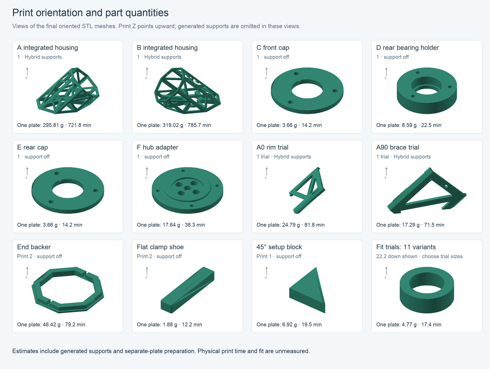

The final slices retain those orientations. Their model, support and brim extrusion centerlines fit the selected X1C profile's 256 × 256 mm bed, remain outside its 18 × 28 mm corner exclusion, and stay below its 250 mm height limit. A and B have minimum bed-edge centerline clearances of **6.73 and 8.73 mm**. A separate 0.5 mm clearance screen also passes. These checks exclude extrusion width and the printer's custom startup, purge and calibration paths; review the plate again after changing placement or process settings.

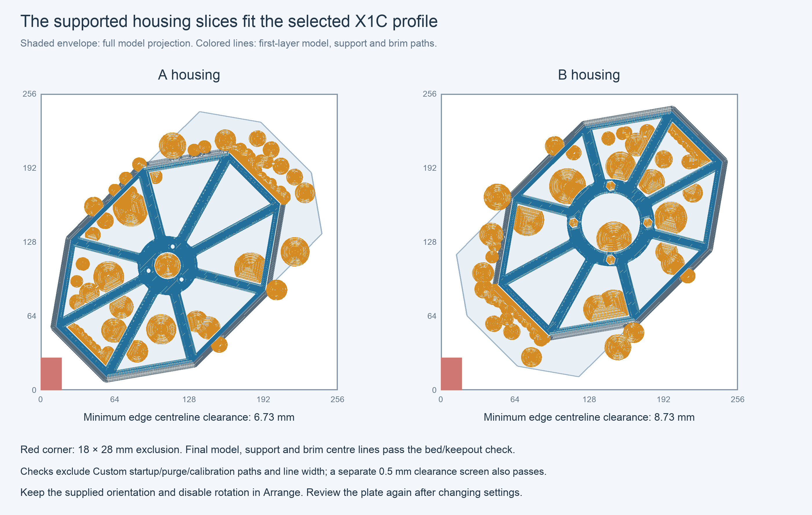

Predict before changing orientation: would rotating A by another 45° **around the bed's vertical axis** improve a shallow brace's overhang? It changes bed placement, but the brace keeps the same angle to the bed. Tilting the part would change that angle and its layer direction; it would also invalidate the documented support and fit comparison. Preserve this orientation for the first trials.

## 37 Crop two exact brace trials from A

Two regions of A ask different questions of the printer. Near the distal +Y end, shallow members lead into the end rim. On the +Z facet, one long brace lies only about **7.5° above the bed**. A small decorative test tower would not reproduce either span. These trials are **exact local crops**, with the original brace lengths and nodes.

Use **File > Save As** to make a separate copy of the finished design for each trial. Keep A in its assembly coordinates, activate A, and hide the other components. Each crop uses two **Intersect** features. Intersect keeps material common to the extrusion and A; unlike Cut, it keeps the region inside your trimming shape.

| Trial | Retained global X range | Retained global Y range | Retained global Z range | Final bed plane |
| --- | --- | --- | --- | --- |
| A0 distal rim | 55 to 130 mm | 66.5 to 75 mm | −35 to +35 mm | q = 90.1 mm |
| A90 long brace | 48 to 130 mm | −35 to +35 mm | 66.5 to 75 mm | q = 50.1 mm |

Make the A0 distal-rim crop first:

1. Choose **Construct > Offset Plane**, select the origin **XY** plane, and enter **−35 mm**. Create a sketch on that plane.
2. Draw a rectangle in local XY with corners **(55, 66.5), (130, 66.5), (130, 75), (55, 75)**. Use dimensions to set both its position and size. Do not leave it free to slide because it happens to look correct.
3. Finish Sketch and choose **Solid > Create > Extrude**. Select the rectangle profile, set **70 mm toward +Z**, and choose **Operation: Intersect** with A as the participating body. Inspect the preview before confirming. It should keep a **75 mm** long piece of the +Y facet with short returns around adjacent corners.
4. Make an offset plane **90.1 mm along +q** from the joint plane. Confirm the direction arrow; this offset is along the joint axis, not global Z.
5. Sketch a centered **400 × 400 mm rectangle** on it. Constrain the center to the plane origin and dimension both sides. Finish Sketch.
6. Extrude this profile **300 mm toward +q**, again with **Intersect**. The large rectangle is only a trimming boundary. The result should have a flat base at **q = 90.1 mm**, with the retained brace material on its print-up side.
7. If the result is empty or the wrong end remains, edit the latest Intersect and inspect its arrow and participant. Do not move the source body to compensate for a backwards cut.

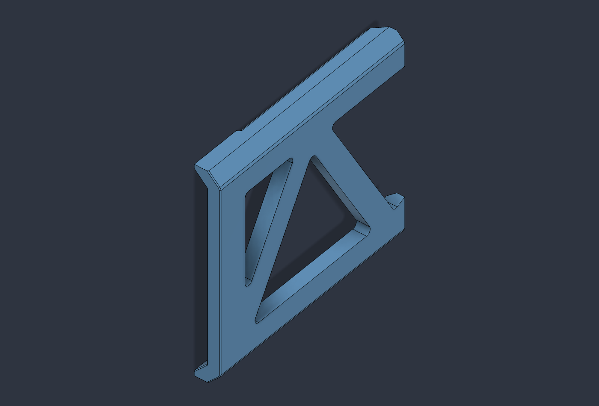

Make A90 from another untouched copy of the full A:

1. Offset a plane from XY to **Z = 66.5 mm**. Sketch a rectangle covering **X = 48…130 mm** and **Y = −35…+35 mm**; fully dimension it.
2. Extrude **8.5 mm toward +Z** with **Intersect** and A as participant. This keeps the +Z facet band.
3. Create the second plane at **q = 50.1 mm**, sketch the centered **400 × 400 mm rectangle**, and Intersect **300 mm toward +q**.
4. Expand **Bodies** and isolate the result. The native crop removes one tiny incidental cut-off fragment with **Remove**, which records that removal in the Timeline. Retain the main connected brace-and-node body. Do not shorten the full-span brace to make the trial easier to print.
5. Export at the original scale and use the same q print-up direction as A. The print-oriented downloads below already include the required placement.

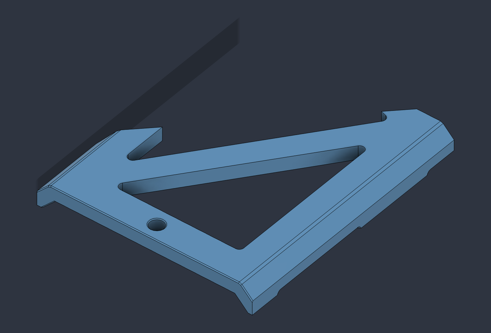

The final trial base stations share the full A's 0.2 mm layer phase: `(90.1−0.5)/0.2 = 448` and `(50.1−0.5)/0.2 = 248`. This helps corresponding sliced layers meet the same geometry. It does not make the processes identical. The trial's shorter support columns, lower thermal mass and different layer times still differ from the complete housing.

Predict: would a half-scale crop that prints beautifully prove this long brace will print? No. It has a shorter span and different member thickness, so it asks a different question. Even the exact crops differ from the housing in support height, thermal mass and layer time; their results are useful local evidence rather than a guarantee for the full part.

Open the editable [A0 crop](checkpoints/PRINT-FIRST-A0-rim.f3d) and [A90 crop](checkpoints/PRINT-FIRST-A90-brace.f3d), or download the already oriented [A0 print trial](print-files/PRINT-FIRST-A0-rim-print-orientation.stl) and [A90 print trial](print-files/PRINT-FIRST-A90-brace-print-orientation.stl). The [native crop report](brace-trial-validation.json) records their retained bounds. To restore a full housing in a trial document, suppress both Intersect features and any crop-fragment Remove feature, then check that A is whole again.

## 38 Read the layers before selecting supports

The solid model says where material should exist. The slicer says how the printer plans to put it there. Learn to move between those views before trusting the rendered shape.

Start a Bambu Studio project using the **X1 Carbon with a 0.4 mm nozzle** and your selected PLA. In **Process > Quality > Layer height**, set both **Layer height** and **Initial layer height** to **0.20 mm**. In **Quality > Precision**, set **Elephant foot compensation** to **0.15 mm**; enable Advanced settings if it is hidden. The first-layer height is a separate setting, so changing ordinary layer height alone is not enough. These names and groups follow Bambu Studio's [setting definitions](https://github.com/bambulab/BambuStudio/blob/master/src/libslic3r/PrintConfig.cpp) and [Quality panel](https://github.com/bambulab/BambuStudio/blob/master/src/slic3r/GUI/Tab.cpp).

Set **4 wall loops**, **4 top and bottom layers**, **0.8 mm minimum top/bottom shell thickness**, and **15% gyroid**. Keep the same first-layer height and compensation for the fit trials and their full parts. The crop layer-phase comparison and first-three-layer figures assume the documented **0.20 mm initial layer** as well as ordinary 0.20 mm layers. Save this project with the part name and process revision so you can return to it.

Wall loops follow each cross-section's boundary. Infill occupies the space left between those loops. A narrow diagonal can be mostly walls already, so increasing infill may add little to that member. Conversely, a broad node can contain substantial infill. The useful question is where the toolpaths put material in this specific part, not whether one percentage sounds stronger.

The stack of layers also matters. A force that tends to pull layers apart can behave differently from one carried mainly along their deposited paths; this direction dependence is called **anisotropy**. Temperature, cooling and extrusion affect how the printed structure forms, while shrinkage and warping affect fits. Preserve orientation and the filament profile when comparing coupons. Prusa discusses these [orientation and tolerance dependencies](https://help.prusa3d.com/article/modeling-with-3d-printing-in-mind_164135); a quoted clearance alone does not transfer a result between processes.

1. Use the base process with **support off** for **C, D, E, F, the mouth-up bearing trials and the fixtures**.
2. Use the support process below for **A, B, both brace trials, the mouth-down bearing trials and all sleeve/nut trials**. A fit trial must reproduce its support condition as well as its hole diameter.
3. Slice and open **Preview**. Set the coloring to **Line Type**. Use the vertical layer slider to expose one layer near a brace start, then step down one layer to see what supports it.
4. Repeat at an opening closure, end rim, bulkhead spoke and service-hole roof. Ask: is there material beneath this line, how much does it overlap the previous layer, and can any required support be removed later?
5. Look for a new isolated path or a long path across a gap. Its color is a description of the slicer's plan, not a print-quality verdict. An ordinary wall can still cross a gap; a bridge label does not establish how well your filament will span it.

Now inspect the first three layers at a spoke contour, nut mouth and sleeve mouth. Their entrance openings should begin larger and reach the full-depth fit region above the relief. Those paths also include the unchanged **0.15 mm elephant-foot compensation**. The housing's sloping walls move laterally between layers too, so keep the actual print orientation in view.

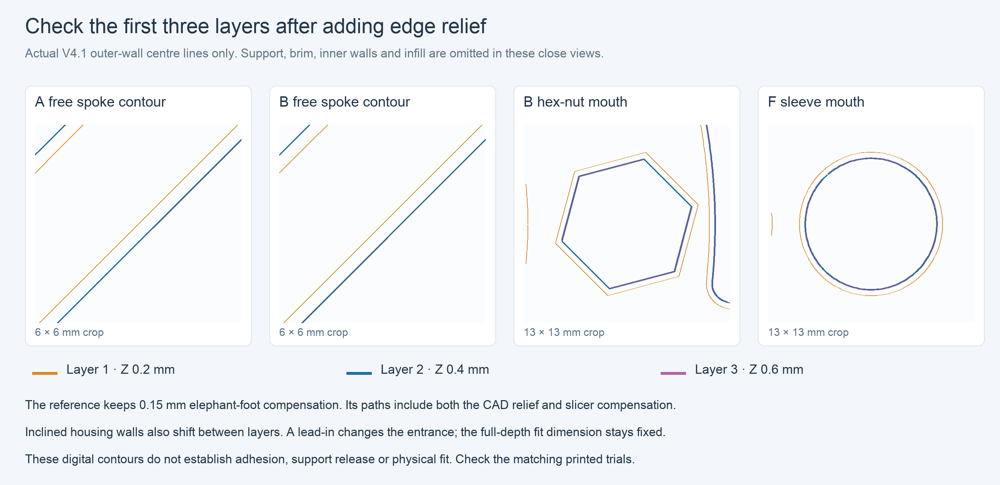

The [first-layer geometry screen](review/fdm/edge-first-layers.json) also checks the six changed meshes at 0.1, 0.3 and 0.5 mm above the bed, the mid-heights of the nominal first three layers. Each sampled section remains one connected material region with closed hole boundaries. That is a topology check; use the printed samples to judge adhesion, edge shape and fit.

Set the automatic **Tree Hybrid** support process. In **Prepare**, open the **Process > Support** settings and enable advanced settings if the style and interface controls are hidden. Enter the reference values, then re-slice; no manual support painting is needed for this reference process.

| Bambu Studio setting | Reference value |
| --- | --- |
| Enable support | On |
| Support type | Tree (auto) |
| Tree style | Tree Hybrid |
| Threshold angle | 45° |
| On build plate only | On |
| Top / bottom Z distance | 0.2 / 0.2 mm |
| Top / bottom interface layers | 2 / 2 |
| Support/object XY distance | 0.35 mm |
| Brim type and width | Outer only, 5 mm |
| Brim/object gap | 0.1 mm |

The **interface** is the material near the part that forms the support's contact surface. The Z gaps separate it vertically from the part; the XY gap sets lateral separation. Smaller separation can improve support but make removal harder, so do not tune a gap and a fit allowance together during the same experiment.

1. In Preview, locate support inside **A's front bearing pocket** and **B's four nut pockets** as well as under the shallow members. In the reviewed slice these cavities open toward the bed, making them accessible after the part cools and leaves the plate.
2. Trace a removal route from each supported pocket to the outside. “On build plate only” controls where supports begin; it is not a promise that every branch can be extracted.
3. Check the mouth-down seat and nut-pocket trials use the same contact settings. A fragment left on a pocket floor can imitate an undersized hole or prevent a nut sitting flat.
4. Clear all support and interface material before judging fit. If you change a support gap or interface density, record it beside the selected allowance and repeat that trial.

The effective settings snapshots preserve the reviewed [supported A process](review/fdm/A-housing-print-orientation/effective-process.json), [support-off D process](review/fdm/D-rear-holder-print-orientation/effective-process.json), [machine](review/fdm/machine.json) and [filament](review/fdm/filament.json). They are reference records, not one-click preset installers; use the table above to enter the settings and compare your resulting Preview. The [print manifest](review/fdm/print-manifest.json) identifies the process used for every file.

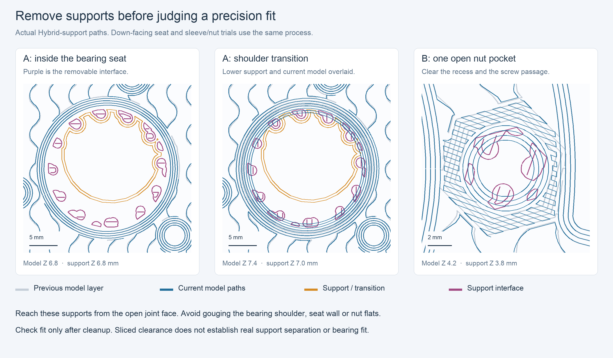

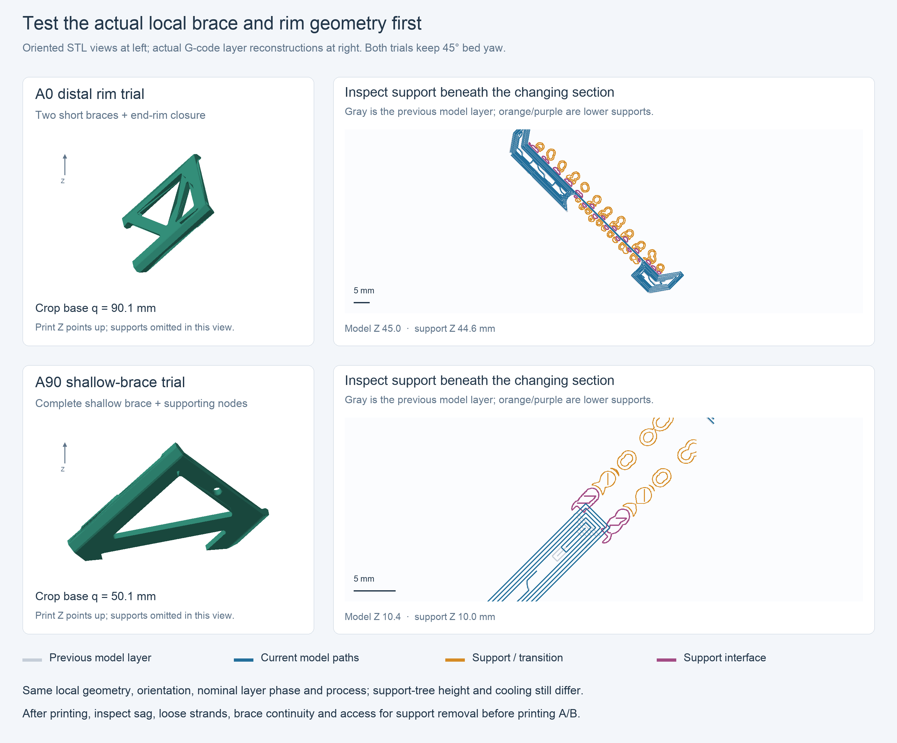

Try a **slice-only experiment** in a duplicate project: predict whether increasing infill will remove the unsupported span under the long brace, then change only the infill density and re-slice. Inspect the same layer. The underside geometry and its gap remain; extra interior fill does not create a support beneath it. Undo the edit and restore **15% gyroid** before printing the reference trials. Use the estimate change as evidence of cost, not evidence of measured strength.

The [figure provenance record](review/fdm/figure-sources.json) connects these diagrams to the final mesh, slice and layer data. The diagrams show generated support contacts; whether those contacts separate cleanly remains a physical trial.

## 39 Print and inspect the trials before the housings

The brace trial should teach you two things: whether the difficult region forms, and whether you can remove its support without damaging it. A print that finishes but cannot be cleaned is not yet a useful part.

1. Apply the documented support process to each exact brace trial. Preserve its **q print-up direction and 45° bed yaw**.
2. Compare its Preview with the full housing at the corresponding brace or rim layers. Note changed support origins or contact paths. The crop can change support height, cooling and layer time even when its geometry matches.
3. Print the local trials before committing to the long housings. Let both part and plate cool before release. Judge fit at a consistent cooled state rather than trying to install hardware in a warm, more compliant print.
4. Start at an accessible support foot or tab and separate support in small pieces. Hold the frame close to the area being cleaned, so its long diagonal is not your lever. Direct cutters into disposable support and away from the structural member.
5. Inspect the shallow underside, both nodes and the end-rim closure under good light. Look for hanging strands, torn layers, remaining interface material, damaged nodes or lost member thickness. Compare both faces; a clean upper face can hide a poor underside.
6. Enter the process and observations in the [brace-trial log](brace-trial-log.csv). Record whether you could reach the contact, how it separated and whether the brace bent during cleanup. Keep a photo of the critical region beside the entry.

Compare the cleaned member with its CAD cross-section and the corresponding sliced wall paths. Inspect the underside as well as the top: material should remain continuous through the full span and into both nodes. Where accessible, measure the cleaned thickness with light caliper contact and record it beside the intended section. Missing wall paths, a visibly thinned underside or a torn node are reasons to revise and repeat the trial even if the top looks intact. This check does not supply a passing strength threshold.

A rough support-contact surface and a structurally torn node are different findings. Record where the defect lies before choosing a remedy. If support is trapped, removal tears a member, or a required contact cannot be cleaned, revise one local process or geometry choice and repeat the small trial. Proceed to the full housing only when the trial gives acceptable geometry and removal access.

On fit coupons and the eventual full parts, preserve the **bearing shoulders, cap lands, sleeve ends and F's mounting face**. Sanding a contact until it looks attractive can change the assembled spacing. A completed brace trial is evidence about a local print feature; it is not a load test of the complete joint.

## 40 Read the print estimate as a process result

Use estimates to decide which experiment is affordable. The following values come from Bambu Studio **02.08.02.61**, the reviewed **X1 Carbon 0.4 mm** profile, **Generic PLA** and **Textured PEI** settings. They include generated supports and brims where enabled. Each unique part was sliced on its own plate; the quantities multiply that estimate. Combining small parts on a plate changes preparation overhead and travel.

| Print group | Printed quantity | Estimated filament | Estimated elapsed time |
| --- | ---: | ---: | ---: |
| A Housing | 1 | 295.81 g | 12 h 02 min |
| B Moving Body | 1 | 319.02 g | 13 h 06 min |
| C, D, E and F together | 4 | 33.56 g | 1 h 29 min |
| **Complete main joint, A–F** | **6** | **648.39 g** | **26 h 37 min** |
| A0 exact rim trial | 1 | 24.79 g | 81.75 min |
| A90 exact brace trial | 1 | 17.29 g | 71.50 min |
| All eleven fit variants | 11 | 48.87 g | 3 h 00 min |
| Two backers, two shoes and setup block | 5 | 103.52 g | 3 h 22 min |

1. Record the slicer's filament and total elapsed-time estimates before printing. Preserve the process and placement that produced them.
2. After printing, record actual elapsed printer time. Once support and brim are removed, weigh the cleaned part separately. If you weigh the waste too, you can distinguish useful part mass from printing overhead.
3. Label estimates and measurements separately in your notes. The slicer's **“model printing time” includes support printing**; it is a printing-phase estimate, not a support-free part time. The table above uses the total including preparation.

The [per-part estimate CSV](review/fdm/print-estimates.csv) preserves the unrounded values, quantities, support choices and separate-plate scope. The [print release summary](review/fdm/release-summary.json) reconciles the current 22 meshes and 22 slices; all have one connected shell and matching artifact hashes. A closed mesh and a completed slice are digital checks, not evidence that support will detach cleanly or that the printed joint carries a specified load.

Small geometry edits can regenerate the automatic support paths. The change in this revision's total estimate is therefore not the plastic removed by the chamfers: the two housing reliefs remove only about 0.17 g of solid PLA by volume, while the resliced support and path arrangement also changes. Keep the native geometry difference and the complete printing-process estimate separate when comparing revisions.

Check your interpretation: if one tiny chamfer revision appears to save much more than **0.17 g** across A and B, has the bevel removed that much structural material? No. The geometry comparison isolates the removed solid volume; the slicing estimate also includes changed support and travel decisions. Keep those two comparisons separate when deciding whether an edit was worthwhile.

**Prepare the next bench session:** once the fit and brace trials are satisfactory, print A–F from your fitted model and continue with Step 41's cooled dry fits. If you plan to measure the assembled joint in the same bench session, prepare the fixtures in Steps 44–45 first: **two [end backers](print-files/endbacker-print-orientation.stl), two [clamp shoes](print-files/clampshoe-print-orientation.stl) and one [setup block](print-files/setupblock-print-orientation.stl)**. You can work through their modeling lesson now, check their printed fits, then return to Step 41. Otherwise, assembly is a useful stopping point before the separate fixture-and-measurement phase.

# Part 7 Assemble and measure the printed joint

Assembly is a sequence of fit checks. Each time you add a part, you gain one new contact and one new opportunity to find a mismatch. Keep the next parts off the bench stack until the current stage moves as expected. The goal here is a freely moving prototype whose behavior you can measure; no physical strength or payload rating has been established for the supplied design.

## 41 Clean and dry-fit one connection at a time

A **dry fit** means trying the parts together without final tightening. It lets you find the troublesome interface while that interface is still visible.

1. Lay out the cooled A–F parts and identify their contact faces. Remove loose strands, brim, support remnants and obvious first-layer lips. Keep the **bearing shoulders, cap contacts, sleeve ends and F's flat mounting face intact**.
2. Try one hardware item in one printed feature at a time using the checks below. Note whether resistance begins at the entrance or only farther inside.
3. Remove that item again before trying the next connection. A bearing that seats alone but binds after other parts are added tells you something different from a bearing that never entered its pocket.

| Connection | What to check |
| --- | --- |
| Bearing into A and D | It seats flat by gentle hand pressure without a forceful press fit or noticeable rocking |
| Shaft through each bearing | It enters without hammering or transferring installation force through the balls |
| 4 mm inner-ring spacers | They slide over the shaft and contact the bearing's inner ring without rubbing its seal or shield |
| Collars and Sonic hub | Their clamps loosen enough to slide; the purchased hardware matches the modeled clearances |
| 6 mm compression sleeves in F | They fit their holes and finish flush with the actual printed flange faces |
| F pilot in B | It enters the opening and lets the flange sit flat on the cup's retained mounting ears |
| M4 nuts in B | Each enters its open pocket, seats on its floor, and does not spin freely |

A shoulder fixes how far a bearing enters; a cap retains it from the other side. Sanding either face changes that spacing. Likewise, filing a sleeve end changes the distance its fastener stack can close. Remove a loose burr locally, but do not turn an unknown fit error into an unrecorded geometry change.

If a bearing or nut stops at the mouth, check for a first-layer lip or remaining interface material. If it reaches full depth but rocks, the deeper fit may be loose. If it sits tilted, inspect the pocket floor before enlarging the diameter. These are observations to test, not diagnoses you can make from resistance alone.

Use the selected fit-coupon result to revise the corresponding Fusion parameter if necessary. Record the change, re-export the affected part and re-slice it. **Do not scale the STL to fix a hole**: that would also change hardware spacing, wall thickness and sleeve-seat geometry. Repeat the dry fit before assembling the stack.

## 42 Assemble the fixed bearing support and locate the shaft

A is the fixed support. Its two bearings support the shaft at separate stations, allowing them to react to a bending load through separated contacts. That does not make the shaft or printed frame rigid. Their spacing, fits, holders and surrounding structure all contribute to the movement you will later measure.

Keep B and its hub separate until this stack rotates freely and its front nuts are finished. The native stage views below show the earlier assembly checkpoint. The five V4.1 finishing features leave the assembly sequence and hardware positions unchanged; use **checkpoint 15 and the updated print files** for the final edge details. The images are digital assembly states, not photographs of a completed build.

### Seat the bearings while both pockets are accessible

1. Place A so its front bearing pocket is accessible and supported. Keep the shaft out. Start the front **608** square to the pocket rather than pushing one side down first.
2. Apply gentle, even seating pressure to the **outer ring**, which is the ring fitting the printed pocket. Do not push on the seal, shield or inner ring to drive the outer ring into place.
3. Fit the rear **608** into D in the same way. Each should sit flat with the intended hand fit. If either needs hammering or a forceful press, stop and revisit the dry fit.

During mounting, force should go directly into the ring being fitted. Pressing the opposite ring transfers the installation force through the rolling elements and can damage them. JTEKT's [bearing-mounting guide](https://www.jtekt.co.jp/products/bearing/en/support/bearing-knowledge/15-3000.html) illustrates the correct ring contact. The force involved in normal operation is a separate matter: bearings are meant to transfer service loads between their rings through the rolling elements.

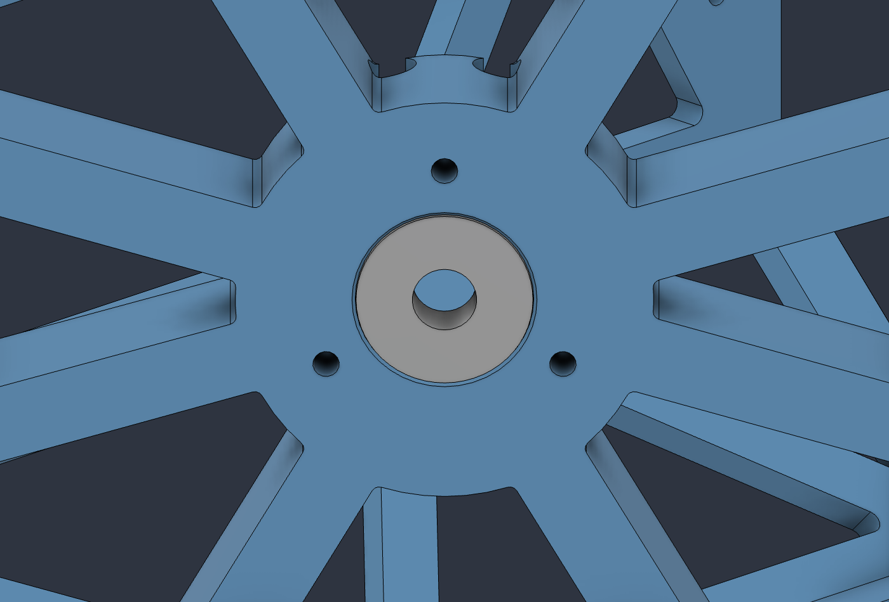

### Add the shaft contacts

1. Place **C** against A's mating face. Slide the shaft through the front bearing without driving it through the balls. Keep the collars loose enough to slide.
2. Build this order along the shaft: **front collar → 4 mm metal spacer → front bearing → 4 mm metal spacer → inner collar**. Both spacers are **4 mm long**.
3. Look closely at each spacer-to-bearing contact. It must touch the **inner ring only**, clearing the seal or shield. Turn the shaft gently to check for rubbing before narrowing access with D.

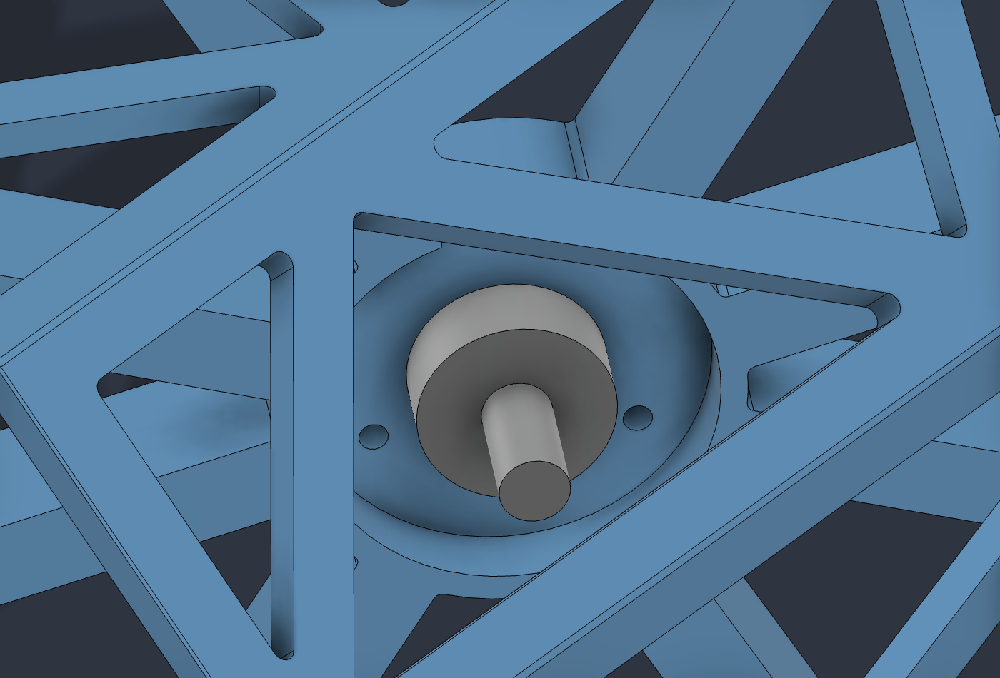

### Fit the rear holder and cap

1. Bring **D** through A's open **+X end**, keeping its bearing axis parallel to q. First move along the body's X direction into the region behind the shaft tip. Then align the bearing with the shaft and move **along −q** into place.
2. Place the three matched **12 mm metal posts** between A and D. Use the same two-stage entry route for **E**, then position it behind D.
3. Insert each **M3 × 45** screw from the rear through this stack: **rear washer → E → D → metal post → A → C → front washer → M3 nylon-insert locknut**. Start all three before bringing any one to firm contact.
4. Alternate among the screws, bringing them to light, even contact. Rotate the shaft after each small adjustment. The posts maintain the holder spacing; the washers spread head and nut contact. Extra torque is not a method for aligning the bearings.
5. If rotation becomes tighter, back off the last adjustment and inspect seating, post lengths, alignment and contact faces. A part trapped at an angle will not become a better fit because the screw is stronger than the plastic.

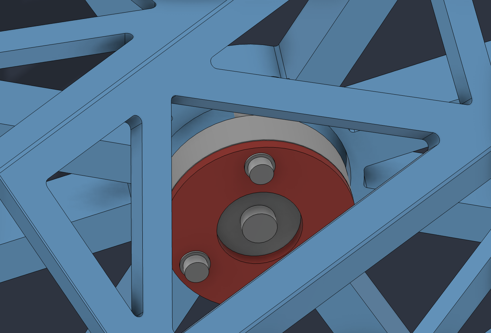

### Position and retain the shaft

1. Set the shaft's rear end approximately **0.2 mm beyond E's flat outside face**. Measure this as a small **step height**: use the caliper's rear step-measuring faces, with one contacting the flat cap land and the other contacting the shaft's flat end. Keep the beam parallel to q, avoid the cap's chamfer, and use light contact so the measurement does not push the shaft to another position. Repeat the reading after reseating the caliper. If the faces cannot reach both references squarely, reposition the assembly for access rather than estimating from a ruler or perspective view. Mitutoyo's [step-measurement lesson](https://cx.mitutoyo.com.sg/how-to-videos-21004-01_sg) shows which caliper faces perform this measurement.

   Nominally this places the **60 mm shaft from q = −24 to +36 mm**, leaving the required hub engagement at the other end. Check the measured shaft length and assembled stack too; a nominal 0.2 mm projection alone does not prove the hub engagement or end clearances.
2. Bring both collars gently against their metal spacers. Remove obvious loose separation without squeezing the bearing into an improvised preload. **Preload** means an intentional internal load before an external working load is applied; this tutorial does not establish a preload-setting procedure.
3. Find A's **two 6 mm collar-driver openings**. Rotate the still-loose inner collar until both screw heads face those openings. Pass the **2.5 mm hex key straight through each opening** and confirm full engagement in both heads before tightening. Mark this service face on the printed part if it helps you keep the orientation. In the model it is **global +Z**; the tool axes run parallel to global Z/local v at **u = ±6.5 mm**, through the positions at **q = 16 mm**.
4. Keep each collar's matched halves together and put its grooved work face toward its spacer. Tighten following the collar manufacturer's procedure. Finish the front collar before installing B. If the inner collar cannot be reached properly, remove D, make the adjustment, then refit and recheck D.

The **Ruland MSP-8-F uses a 2.5 mm hex key** and has its own specified installation procedure and seating torque. That torque applies to its supplied collar screws. Do not transfer that value to the **M3 screws clamping printed holders**, or infer a suitable plastic-joint torque from a metal screw's size alone. [Ruland collar installation](https://www.ruland.com/msp-8-f.html)

Trace the contacts in the section below. The two metal spacers locate the **front inner ring** through the collars and shaft. C and the front pocket retain its **outer ring** with nominal axial allowance. At the rear, a **7.2 mm pocket surrounds the 7 mm bearing width**. Do not add a long inner-ring spacer or tighten the support stack until this intended allowance disappears. Those clearances let the actual assembly differ slightly from the ideal CAD stack without making “more clamping” the default fix.

### Check retention and free rotation

The load path gives these checks a purpose. A transverse force on the shaft reaches the bearing inner rings, rolling elements and outer rings, then the printed pockets and A's supporting structure. Axial force is located through the appropriate collar/spacer and front-bearing contacts. When a spacer touches a shield instead of the inner ring, it creates an unintended rubbing contact in that path.

1. Check each support screw's tip and nylon-insert engagement. Nominal protrusion is **1.7 mm past the front locknut** with the listed washer and nut thicknesses. Actual tips must clear nearby hardware and each nylon insert must be engaged.
2. Rotate the shaft by hand through several positions, then gently check its axial movement. Feel for scraping, a tight spot or a change caused by the latest tightening step.
3. Add small witness marks across the shaft/collar positions. A later shift between marks identifies slip that a deflection reading alone could not explain.

Check your reasoning: if the shaft turned freely before D was tightened and then became stiff, should you tighten the collars harder? No. Return to the last changed contacts—D, the posts, caps and bearing alignment—before changing anything else. Some axial movement can come from the designed capture allowances and bearing internal clearance; collar force is not a general cure for it.

## 43 Attach the hub and moving housing

F connects B's printed mounting ears to the metal hub. Its inner fasteners pass through metal compression sleeves; the outer fasteners secure F to B. Keep these two screw groups separate on the bench so their washers and lengths do not get mixed.

### Match the sleeves to the printed flange

1. Label and measure the **four nominal 6 mm metal compression sleeves**. Measure F's local flange thickness beside each sleeve hole, using the broad flat faces rather than a chamfer. Remove loose burrs or residue and repeat the measurements before deciding there is a mismatch.
2. Select a closely matched sleeve set, fit it into F, and check both faces with a straightedge. A sleeve standing proud can leave the printed flange loose; a sleeve recessed below the flat faces lets the screw squeeze plastic before reaching the metal stop. Do not use tightening force to make either condition disappear.
3. If the printed thickness changes from hole to hole or the flange rocks against a flat reference, correct the print/cleanup problem and reprint F before trying to solve it with one new thickness value. If a suitable nominal 6 mm sleeve set fits the verified flange, keep the baseline dimensions and continue.

### If the matched sleeves require a different flange thickness

Use this branch only when the matched sleeves require a different thickness. If the nominal sleeves already fit the verified flange, continue to **Mount and clock the hub** below.

Save a **separate Fusion copy** and revise `adapterThickness` to the chosen measured sleeve length. Keep `hubFace` fixed, so the mounting face and pilot stay at their intended station while the rear face moves. Reprint F and measure its actual local thickness again; a CAD number is not proof that the print matches it.

That last route is a design revision. Update the REF sleeve lengths and screw/washer starting positions in the saved copy. Recheck **both M4 groups**: hub-thread engagement and bottoming, outer plain-nut engagement and screw-tip clearance, rearward head/washer clearance, F's insertion route, all driver routes and motion. The fixed numerical fastener positions in the original table do not update merely because you changed a flange parameter. Use the dimension-chain method below with the measured parts: the under-head position is `hubFace − flange thickness − washer thickness`, and the tip is that position plus the actual screw length. The later example's fixed **−29 mm** rear face applies only to the baseline 6 mm flange. If the sleeves and both flange faces still cannot seat together without deforming the plastic, keep this stack unassembled and resolve the recorded mismatch; this guide does not establish a universal allowable protrusion.

### Mount and clock the hub

1. Put the Sonic hub on F's flat mounting face with its small pilot pointing toward A. Align its four mounting holes with F's cardinal sleeve pattern. In the CAD layout this is **45° from the square-hole reference orientation**, but matching four holes alone does not identify the correct pinch-screw direction.
2. From F's back, start the four **M4 × 12 screws** by hand with the modeled **12 mm OD, 1 mm-thick wide washers**. These span the sleeve openings and contact surrounding plastic; the smaller outer-attachment washers do not give the same contact here. Leave the screws loose enough to correct the hub's clocking.
3. Before final bench tightening, dry-present the hub/F assembly through B's open end in its installed orientation and hold the pilot at its seat. Identify the **two hub pinch-screw heads**. Pass the bare **3 mm hex key** through each intended hub service opening and verify that it engages its head straight and fully. Test both routes, not just the easier one.
4. If a head faces a blocked route, withdraw the subassembly, reposition the hub among its mounting-hole alignments, and repeat the check of both tool routes. Mark the successful orientation on **the hub, F and B** so you can restore both the hub-to-F and F-to-B clocking. Withdraw the subassembly again and finish the four inner mounting screws on the bench; they will not all be accessible after final installation.
5. Seat the stack evenly. The modeled **1 mm washer + 6 mm sleeve** leaves **5 mm of screw engagement** in the hub. Check the measured screw length and stack so each screw engages sufficiently and does not bottom before the parts are held. Preserve the clocking marks during the remaining assembly steps.

Washer thickness is part of this calculation. The dimensions above describe the modeled stack, not every washer sold as “M4.” Measure the purchased washers and compare them with the hardware specification before relying on the nominal engagement or tip clearances. Do not silently substitute a different thickness.

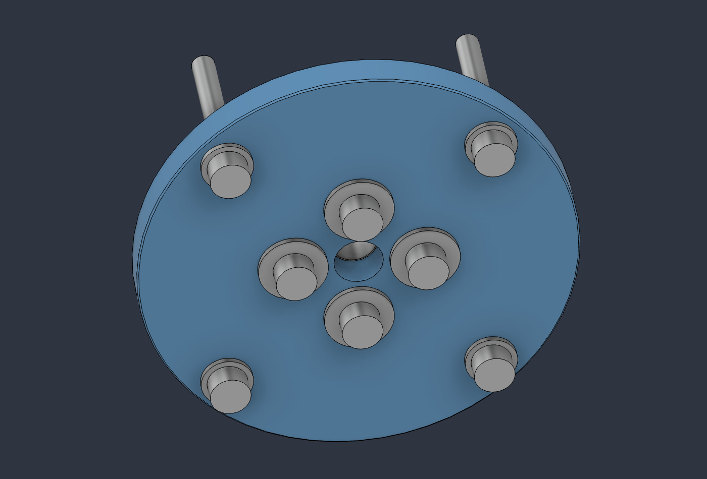

### Load B's nuts and F's outer screws

1. Seat the **four M4 plain nuts** in B's open pockets from the diagonal face. Each must reach its floor and resist spinning. Clean a resistant pocket rather than pulling its nut through support debris with a screw.
2. **Preload four M4 × 30 screws and their modeled 9 mm OD, 1 mm-thick washers into F's outer holes before inserting F.** Leave them free to slide backward. The **5 mm driver passages** admit a hex-key shaft, not a **7 mm screw head**; the heads must enter with F.
3. Hold the loose screws in place without locking their heads against the flange. The backward movement is needed during the next step.

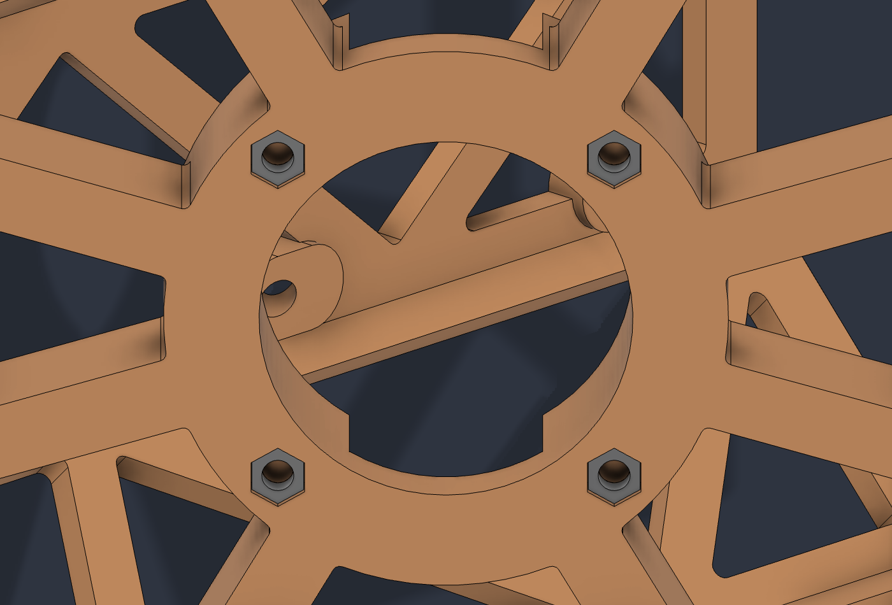

### Insert and fasten the hub/F subassembly

1. Bring it through B's open **−X end**, keeping its axis parallel to q and aligning the **F-to-B clocking marks** from the check of both tool routes. Move **along +X** into the interior first, then **along +q** toward its mounting face.
2. Guide the pilot into its opening. The outer screw tips reach the front-loaded nuts before the pilot fully seats, so let the screws slide back through F. If the flange stops, check the tips before applying more force.
3. Reach through each reinforced passage with the bare **3 mm hex key** and start all four threads gently. A screw should turn into its nut without using the flange as a lever. If one will not start, back it out and realign.
4. Once all four engage freely, seat them evenly while checking F against the **two retained mounting ears**. Watch the plastic contact faces; this outer stack does not gain the inner screws' compression sleeves merely because both use M4 hardware.
5. Inspect the tips from the joint face. Nominally they finish at the joint plane, leaving **0.5 mm before A's mating face**. Check the real washers, screws and tips before bringing A close.

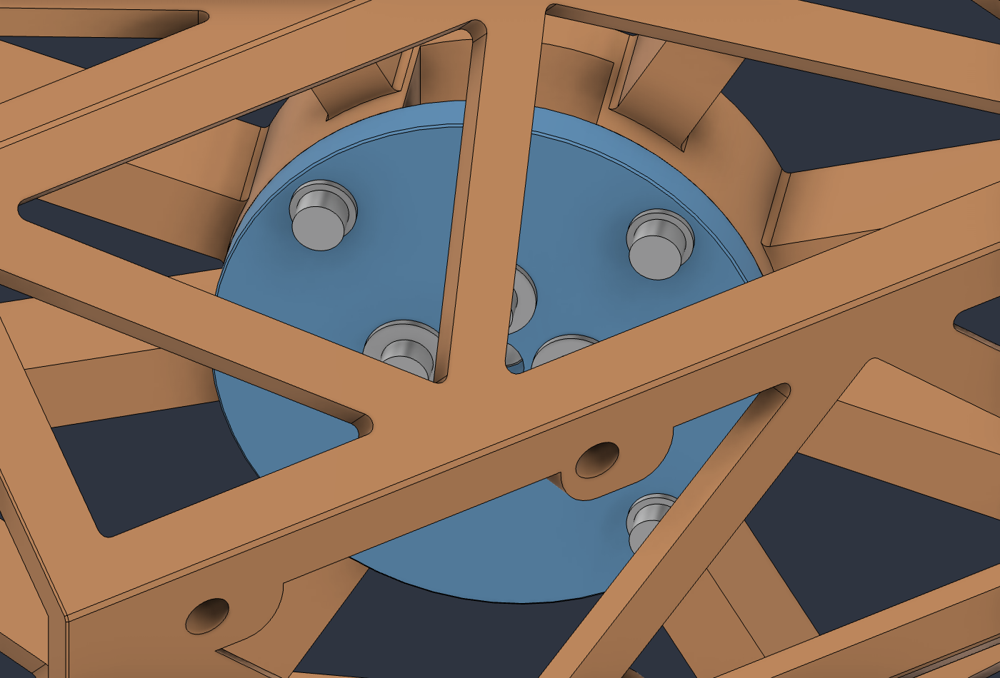

### Check washer thickness and screw-tip clearance

Make these measurements for every assembly, even when the purchased washers match their nominal sizes. If a washer differs, the same dimension chain lets you evaluate the substitution.

This is a useful place to practice a **dimension chain**: add the thicknesses that determine where a screw ends. Keep the two washer groups separate. This example concerns the **four outer M4 × 30 attachments**, not the inner M4 × 12 hub screws.

In the reference model, F's rear face is at **q = −29 mm**. A washer stack of thickness `t` places the screw's under-head face at `−29−t`. Adding the 30 mm screw length puts its tip at `q = 1−t`. A's nearby face is at **q = +0.5 mm**, so the nominal tip-to-face clearance is `t−0.5 mm` when all other dimensions stay unchanged.

| Outer washer stack | Screw-tip q | Nominal clearance to A |
| --- | --- | --- |
| Modeled 1.0 mm | 0.0 mm | 0.5 mm |
| A measured 0.8 mm washer | +0.2 mm | 0.3 mm |
| A measured 0.7 mm washer | +0.3 mm | 0.2 mm |

The calculation explains why “it is still an M4 washer” is not enough. It also leaves out screw-length variation, printed thickness, seating and deflection. **A positive nominal gap is not proof that the real assembly will clear under load.**

1. Measure the actual under-head screw length and total flat-washer thickness at each outer connection. Record them beside the printed F thickness.
2. Before mating A, inspect the seated screw tips relative to B's mating face. Use the measured housing gap to check the space that will remain to A. Check all four; do not assume one represents the set.
3. If a substitution reduces the reference **0.5 mm tip clearance**, resolve it before load testing. Select screw length and flat-washer or shim thickness together, preserving full plain-nut engagement and a flat supported head contact. Do not use a spring washer as a precision flat spacer.
4. Represent the measured combination in a **saved CAD copy**, using the screw-envelope method from Step 32. Recheck both the tips and the heads through the motion and tool approaches. Then repeat the unloaded physical clearance check. Keep the reference model intact so you can explain the difference.

For a calculation exercise, two measured 0.8 mm flat washers would give `t = 1.6 mm`, a tip at **q = −0.6 mm**, and **1.1 mm nominal clearance**. The reference plain nut ends at **q = −1.3 mm**, so that tip would project **0.7 mm beyond it**. However, the head also moves 0.6 mm farther into B, and both washer diameters and seating still matter. This is a combination to evaluate in the saved copy, **not a physically validated substitution**. The useful habit is checking both ends of the screw whenever you change the stack.

### Mate the housings and check free movement

1. Have **three rigid gap gauges**, each measured **1 mm thick**, ready before mating. Rigid flat shim strips are suitable; a printed strip must be measured rather than accepted from its nominal CAD thickness. With the housings in the **straight pose**, slide B and its metal hub onto the shaft. Put the gauges at three separated **broad, unchamfered lands of the diagonal outer frames**, clear of openings and bevels. All three should touch both faces without one end of a housing being forced sideways. They establish the face gap while the hub is still free to slide.
2. Reach the hub's **two pinch bolts** through their service openings with a **3 mm hex key**. Tighten according to the hub's instructions while maintaining the gap. The hub clamps to the shaft; the gauges should not become structural spacers left inside the joint.
3. Remove every key and **count all three gauges back onto the bench**. Turn slowly through the intended motion, watching the gap, caps and screw tips. The outer housing edges do not stay aligned throughout the turn.
4. Mark the hub/shaft position, then recheck collar and hub marks after the first movements and after the printed assembly has settled. If tightening changed the rotation, inspect that changed contact before proceeding to a load test.

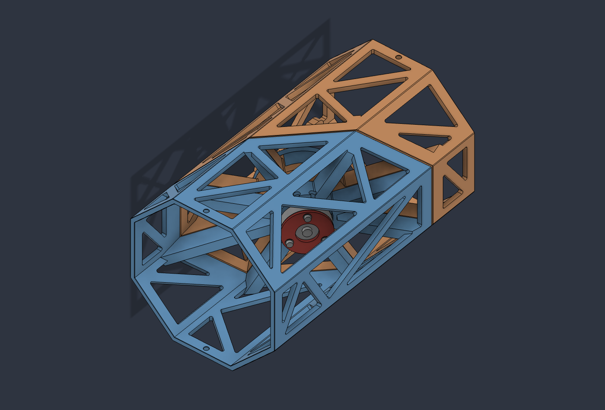

The [native mechanics report](review/mechanical/native-mechanics-validation.json) checks these approach routes in the rigid digital model. The **outer mount passages** serve the four attachment screws; the **opposed hub service routes** serve its pinch screws. Real tools, print surfaces and hardware still need the physical access check above.

You can now follow an external load from B's frame into its mounting ears, F, the metal hub and shaft, then through the bearing support into A. A joint may move because a frame bends, a pocket rocks, a clamped connection slips or the fixture moves. The next steps make those possibilities easier to tell apart instead of attributing every movement to the lattice.

**Session break:** keep the assembled joint with its fit notes and witness marks. Steps 44–45 return to Fusion to make the test fixtures. If you prepared them before assembly, inspect their fits and continue at Step 46; otherwise, model and print them before starting the load setup.

## 44 Model the end-rim backer

A measurement needs a deliberate place to hold the assembly. The housing ends at **X = ±130 mm**; its solid end rim is **10 mm long** around a nominal **141 mm across-flats bore**. The backer fills that rim locally so the vise and cord's inward forces do not squeeze an unsupported hollow end. Print two copies, one per housing.

Create a separate Fusion design and a component named **TEST Housing End Backer**. Use **local XY as its bed plane and local Z as print-up**. These axes describe the fixture while you model it; they are not the installed robot axes. In **Modify > Change Parameters**, enter:

| Parameter | Expression | Purpose |
| --- | --- | --- |
| `fixtureBackerLip` | `148 mm` | Stop lip, recessed from the 150 mm housing |
| `fixtureBackerLipThickness` | `4 mm` | Lip thickness |
| `fixtureBackerPilot` | `140.6 mm` | Trial fit in the 141 mm bore |
| `fixtureBackerDepth` | `10 mm` | Supports the complete solid end rim |
| `fixtureBackerOpening` | `116 mm` | Central access opening |
| `fixtureBackerHeight` | `fixtureBackerLipThickness+fixtureBackerDepth` | Total print height, 14 mm |
| `fixtureBackerCornerRadius` | `2 mm` | Lip and opening corner rounds |
| `fixtureBackerPilotRadius` | `2 mm` | Male pilot corner relief |
| `fixtureCordSlotWidth` | `6 mm` | Clearance for the cord |
| `fixtureCordSlotFloor` | `6.5 mm` | Closed slot floor above the bed |
| `fixtureCordSlotHeight` | `fixtureBackerHeight-fixtureCordSlotFloor+1 mm` | 8.5 mm, extending past the tip |
| `fixtureCordSlotCenter` | `(fixtureBackerHeight+1 mm+fixtureCordSlotFloor)/2` | Rectangle center at local Z = 10.75 mm |
| `fixtureCordSlotRadius` | `1 mm` | Slot-floor corner relief |
| `fixtureBackerEntry` | `0.6 mm` | Pilot and slot entry bevel |

Make the lip and pilot:

1. **Create Sketch** on XY. Use **Sketch > Create > Polygon** to make a centered regular octagon with eight sides, following the centered octagon method from the housing. Constrain its center to the origin, one flat horizontal and its size to `fixtureBackerLip` **across flats**. Check that the flats are parallel to X/Y; across flats is not the corner-to-corner diagonal.
2. Finish Sketch and **Extrude 4 mm**, **Operation: New Body**. This is the stop lip. Choose **Modify > Fillet**, select its **eight upright corner edges**, and enter **2 mm**. Keep the broad faces flat.
3. Choose **Construct > Offset Plane**, select XY and enter **4 mm**. Sketch another centered octagon on it in the same orientation, sized `fixtureBackerPilot` across flats.
4. **Extrude 10 mm**, **Operation: Join**. Fillet this pilot's eight upright corner edges **2 mm**. The pilot should be smaller than the lip, leaving a visible step all around.

The nominal clearance against the 141 mm bore is `(141−140.6)/2 = 0.2 mm per flat`. That is a trial allowance, not a guarantee of fit. The rounded pilot corners also need to clear the printed housing's inside corners; measuring only opposite flats misses that possible interference.

Open the center and make the cord slots:

1. Create a sketch on XY with the centered **116 mm across-flats octagon**. Finish and **Extrude > Cut** through the full **14 mm** height. Fillet its **eight inner upright corners 2 mm**. You should have one hollow octagonal ring with flat lip and pilot surfaces.
2. Create a sketch on **XZ**. Before drawing, identify which sketch direction corresponds to positive model Z; a native XZ sketch can display a reversed vertical sign.
3. Draw the slot rectangle from **local X = −3 to +3 mm** and **local Z = 6.5 to 15 mm**. Dimension its **6 mm width**, **8.5 mm height** and **Z = 10.75 mm center** using the listed parameters. Its top must extend **1 mm beyond the pilot tip**, not stop below it.
4. Finish Sketch. Choose **Extrude > Cut**, **Direction: Symmetric**, **Measurement: Whole Length**, and distance `fixtureBackerPilot+2 mm`, or **142.6 mm**. Whole Length is the total cut length, not 142.6 mm on each side. The cut should open two slots on opposed local **±Y faces**.
5. Fillet the **four radial edges where the slot side walls meet their closed floors**, **1 mm**.
6. Make a separate **Equal Distance Chamfer**, with Tangent Chain off, on **all perimeter edges lying entirely at local Z = 0**: the outside of the lip and the inside of the access opening, including their short rounded corner segments. Enter **0.3 mm**.
7. Make another Equal Distance Chamfer on **all edges lying entirely in the pilot-tip plane, local Z = 14 mm**. Include the outer pilot perimeter, the inner access-opening perimeter, their rounded segments, and the four radial edges across the open slot mouths. Enter **0.6 mm**. Do not select the vertical slot sides, the rounded slot-floor edges, or the broad lip seating step at Z = 4 mm. This matches the native feature's complete top-plane edge selection.
8. Expand Bodies and inspect from the side. Expect one connected solid, two slot mouths open to the tip and unbroken broad seating surfaces. If a slot has a roof, revisit the rectangle's Z direction and its 15 mm top before editing the extrusion.

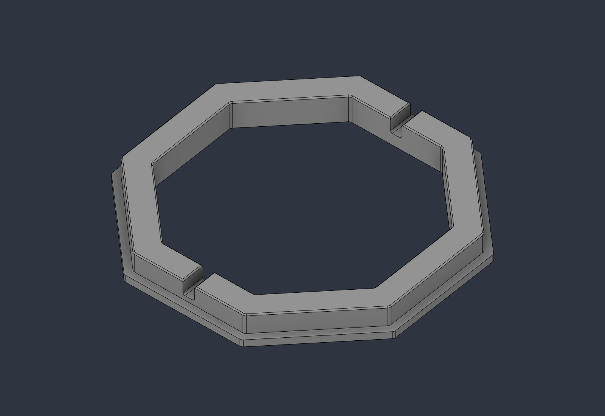

The installed cord axes are at **local Z = 9 mm**, not the slot rectangle's center. The lip occupies **Z = 0…4**; the pilot starts at the housing end, **X = ±130**. The ports are **5 mm inward**, at **X = ±125**, so the cord station is `4+5 = 9 mm`. The open slots let this backer slide over a cord already threaded through those ports.

Print with the lip on the bed and the pilot/slots upward. Inspect Preview for open slots. Try the cooled backer by hand in the end rim, checking both flat and corner clearance. If it binds, locate the contact rather than hammering it in or using the vise as a press. The fixture should support the test, not introduce an unknown assembly stress before it begins.

## 45 Make two flat clamp shoes and the setup block

The backer supports the rim from inside. Two short shoes now give the vise an outside contact that stays entirely on that solid rim.

1. Create **TEST Flat Clamp Shoe**. Add `fixtureShoeLength = 8 mm`, `fixtureShoeWidth = 40 mm` and `fixtureShoeThickness = 6 mm` as user parameters.
2. Create a sketch on XY and choose **Rectangle > Center Rectangle**. Put its center at the origin and dimension it **8 × 40 mm**. Finish Sketch and **Extrude 6 mm** as a new body.
3. Fillet the **four upright corners 1 mm**. Add **0.3 mm relief at the bed and contact-face edges**, leaving broad flat central contact areas.
4. Print **two copies**, each on a broad face. Add thin grippy lining only if the actual vise needs it, and record that lining because it becomes part of the test fixture.

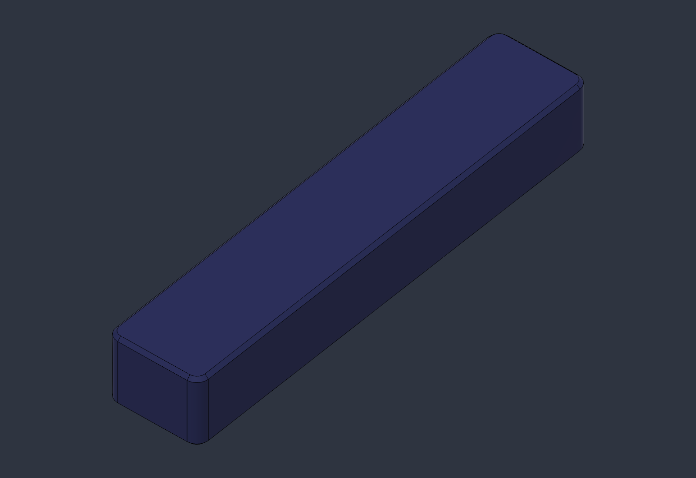

The setup block is a removable angle reference. It should help you establish the pose, then leave the load path completely.

1. Create **TEST 45 Degree Setup Block**. Add `fixtureSetupLeg = 45 mm` and `fixtureSetupWidth = 12 mm`.
2. Sketch on XY. Draw a triangle with horizontal and vertical legs meeting at the origin. Apply **Horizontal/Vertical** as needed and **Equal** to the two legs. Dimension one leg to **45 mm**. Equal keeps the other at the same length without a second independent dimension.
3. Finish Sketch and **Extrude 12 mm**. Add **0.3 mm bed-edge relief**. Print with the triangular face on the bed.
4. Confirm the equal-leg right triangle gives a **45° slope**. If it does not, inspect the sketch constraints; a shape that merely looked triangular in perspective is not enough.

The fixture archive contains three unique parts. Print quantities are **two backers, two shoes and one setup block**. Download the [end backer](print-files/endbacker-print-orientation.stl), [clamp shoe](print-files/clampshoe-print-orientation.stl) and [setup block](print-files/setupblock-print-orientation.stl). Open the [editable fixture archive](checkpoints/load-test-fixtures.f3d).

Predict: what would happen if you left the setup block under B during a load reading? Part of the applied load could go through the block into the bench. The measured joint would appear stiffer because the fixture added another support. Remove it before every measurement.

## 46 Support the rim and thread the bridle

Check the vise opening before printing the fixtures. The **150 mm housing plus two 6 mm shoes needs at least 162 mm**, with additional space for any lining and handling. The vise must hold the backed end rim without using a diagonal as a clamp pad.

1. Insert a backer into **A**. Place one shoe on each opposed **Z-normal end-rim face**, centered at **X = +125 mm**. “Z-normal” means the face points along +Z or −Z; these are the two faces the jaws will push toward each other.
2. Check the contact footprint. Each shoe spans **X = 121…129 mm**, wholly inside the solid **X = 120…130 mm rim**. Its **40 mm width** fits the **62.132 mm outer facet**. The contact must not cross into a triangular opening or sit on the recessed backer lip.
3. Bring the vise jaws into even contact with the shoes. Verify that the backer supports both gripped faces from inside. Use the contact, alignment and later witness checks to establish secure holding; more jaw force is not a substitute for a correctly seated backer.

Prepare B's load attachment:

1. Find its two **Ø4.5 mm ports at X = −125 mm, Y = 0, Z = ±75 mm**. Remove printing burrs from their entrances without changing their location or cutting into the rim.
2. Thread **one continuous 2–3 mm cord** into one port, across the open interior and out the opposite port. Join the two free ends at a hanger centered between the ports.
3. Insert B's backer with its slots aligned to the cord. Check that the cord sits freely in both slots and the backer seats fully.
4. Put the hanger at least **210 mm below the port station**. With the nominal **150 mm separation** and equal legs, each leg then lies about **20° or less from vertical**. A short, wide bridle pulls more strongly inward as well as downward; the backer supports that inward loading.
5. Mark the cord near both ports and confirm the hanger remains centered. If one leg slips or the knot settles, re-center it before reading the frame. Do not use the cord's stretch as your displacement measurement.
6. Place a catch surface just below the masses, leaving clearance so it does not support them during a reading. Weigh or record the hanger and cord. Confirm the vise, shoes and A rim stay seated under the intended small trial load.

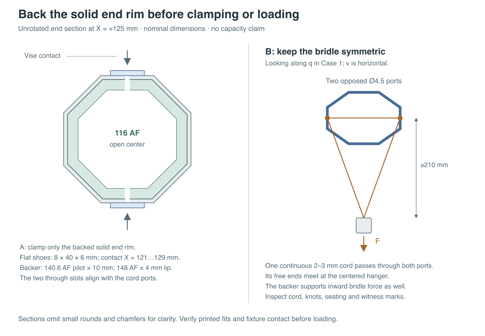

Trace the complete test path with your finger while it is unloaded: mass → cord → B rim and backer → B frame and hub → shaft and bearings → A frame → backed A rim → shoes → vise. A slipped knot or shoe can change a reading even if every printed diagonal remains intact. That is why the fixture contacts are part of the experiment.

**Follow this route for the two cases:** set up Case 1 in Step 47, carry out Step 49's measurement sequence, then use Step 50 to review the readings. If the assembly and fixture checks remain satisfactory, unload fully, prepare Case 2 in Step 48, and repeat Step 49 with a fresh baseline and measured arm. Keep the two cases' records separate. A stop condition takes precedence over continuing this route.

## 47 Case 1: force perpendicular to the pivot axis

Your original question concerned force across the rotational axis. This first arrangement applies that kind of force while letting you watch the complete structure.

1. Set the joint in its **straight pose**. Position **q horizontal**, **u = (X−Y)/√2 vertically upward**, and **v = Z horizontally along the vise-jaw normal**.
2. Check the visible pose: **A rises from the joint toward the clamp, B slopes downward, and the diagonal mating plane is vertical**. Use the setup block to establish the body's 45° slope, then verify the shaft axis itself.
3. Remove the setup block. Let B settle with its bridle centered across v. During a reading, do not hold B by hand or rest it on another support.
4. Measure the **horizontal distance from the joint center to the hanging line, along q in this view**. At the centered **X = −125 mm** station, the nominal arm is `125/sqrt(2) = 88.388 mm`. Record the actual hanging line and distance.

The weight acts downward along **−u**, perpendicular to q. The centered bridle has nominally **zero torque about q**, so the intended test does not deliberately turn the free pivot. It does produce a **bending moment about v** through its offset. Moving the bridle sideways can introduce an unwanted twisting moment about q and rotate the joint.

For this bending calculation, measure from the **joint center to the force's hanging line**. Do not use the shortest distance from the force to the infinite horizontal shaft axis: that is a different geometric question. Step 49 uses the measured arm to calculate the applied bending moment.

**Keep Case 1 in this orientation while you carry out Step 49.** Label its records **C1 — q horizontal** and review the results using Step 50. After recording Case 1, remove the added mass. If the checks remain satisfactory, return to Step 48 to prepare Case 2.

## 48 Case 2: axial force and an overturning moment

After recording and reviewing Case 1, change the direction of force relative to the shaft while keeping the same loading method. This helps separate a transverse support problem from movement in the axial retention stack. Resolve any slipping, cracking, binding or nonrecovering displacement from the first case before beginning another test.

1. Unload the assembly, then reorient the fixture so **q is vertical** and the **mating plane is horizontal**. Keep the opposed **Z-normal rim faces** toward the vise jaws.
2. Recheck both shoes, backers and the centered bridle. Use the setup block as needed, then remove it. Do not assume that contacts stayed seated simply because the same parts are present.
3. Measure the **horizontal shaft-center-to-hanging-line distance**. In the same straight-pose geometry its nominal value is again **88.388 mm**, but use the measured value in the log.

The vertical force is now **parallel to q**. Its horizontal offset also creates an **overturning moment**, so this is an axial force with bending rather than an isolated axial-load test. Both cases leave the body sloping 45°; that slope alone cannot identify the load case. Check the shaft axis or joint plane.

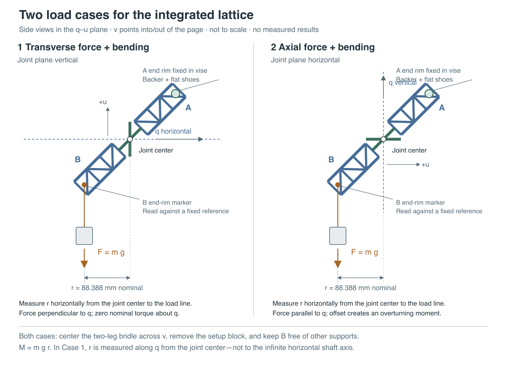

Before loading, cover the case labels in the diagram and identify the force direction from q alone. If q is horizontal, the downward force is transverse; if q is vertical, it is axial. The offset still matters in both. This is a useful check whenever a later robot pose changes the apparent meaning of “down.”

With this setup ready, **repeat Step 49** and label the records **C2 — q vertical**. Establish a fresh baseline for this orientation and use its measured arm. Review this case with Step 50 before comparing the two sets of results.

## 49 Use a repeatable sequence

Measure a small, repeatable change before trying to find a maximum load. These are proposed exploratory increments for an untested prototype; reaching the last row would not establish a working-load rating.

Run the complete sequence below **once for Case 1 and again for Case 2**, including the baseline readings and initial three 50 g cycles. Use these three plain CSV worksheets in a spreadsheet app or copy their fields into your notebook:

| Worksheet | What to record | Prepared rows |
| --- | --- | --- |
| [Setup and baseline](load-baseline-log.csv) | Measured arm, pose, hanger/cord mass, process, fixture notes and three initial unloaded readings | One row for C1 and one for C2 |
| [Load cycles](load-test-log.csv) | Each added mass, hold/recovery readings, timing and contact observations | Three 50 g cycles, then one each at 100, 200 and 250 g, per case |
| [Repeatability summary](load-summary-log.csv) | The initial-reading, loaded and recovered spreads, plus the decision for each case | One row for C1 and one for C2 |

Open each CSV as a comma-separated table with its first row as headers; widen columns as needed to read the field names. Give this test session a short **`test_id`**, such as `baseline-A`, and enter it in the rows you use in all three files. The prepared **`case_id`** values C1/C2 keep the orientations separate; **`cycle_id`** identifies an individual loading cycle. A later revision or rerun gets a new test ID and fresh copies of the rows. The templates contain planned loads, timing, the intended straight **0° pose**, and labels, with measured-result cells left blank. Confirm the pose when setting the baseline. The files do not calculate results automatically. Leave unused load rows blank and record why you stopped.

1. With no added test mass, inspect free rotation, the fixture contacts and existing shaft/collar/hub marks. Add witness marks at the **A rim, shoes and vise**.
2. Put a fixed reference beside a marker on **B's end rim**. For a first coarse check, hold a ruler vertically on a separate stable support and place a thin pointer or line on B beside its scale. Read at the pointer's height to reduce parallax, and write down the smallest change you can distinguish. Do not rest the ruler on B. Let the assembly settle, then record the unloaded reading and pose. B, its hub, the hanger and cord already load the joint; setting the readout to zero does not remove their weight.
3. Before adding mass, take **three unloaded readings** from the same viewing position without changing the fixture. Enter all three in this case's baseline row and calculate **largest minus smallest** for `initial_reading_spread_mm` in the summary. Record the smallest change you can distinguish separately; the ruler's markings and the spread of your actual readings are different things.
4. Add **50 g gently**, without dropping it onto the hanger. Hold for **30 seconds**. In the cycle row, record the actual added mass, frame reading, pose and witness marks. If you can take an early reading, record both its value and seconds since loading, then the reading at 30 seconds; subtract early from final to obtain the signed `drift_during_hold_mm`. Leave the optional early reading and drift blank if you could not observe them.
5. Remove the added mass, wait **60 seconds**, and record the return in the same cycle row. Enter the actual hold/recovery times and note any departure from the targets. Check for slip, cracks, new binding or a changed gap. If those checks remain clear, repeat the same **50 g / 30 second hold / 60 second recovery** cycle until you have **three cycles**, using the three prepared rows. Keep every reading; do not reset the reference to hide a changed return position.
6. Compare the three loaded readings and the three recovered readings separately. For each set, calculate **largest minus smallest** and enter `loaded_spread_mm` and `recovered_spread_mm` in the summary. Their spreads estimate how repeatable this setup is at the first load. If the recovery drifts progressively, witness marks move or the results are inconsistent, diagnose the cause before increasing mass; a large spread is not permission to accept more movement. If a test stops before three cycles, record the completed count and reason; leave `loaded_spread_mm` and `recovered_spread_mm` blank.
7. Continue to **100 g, 200 g and 250 g** only after the first cycles are stable, and only while each subsequent step remains stable and returns within the established measurement repeatability. Use the same **30 second hold and 60 second recovery**. Stop for slipping, cracking, binding, rapidly increasing movement or nonrecovering displacement. A stopped test is a useful result to diagnose, not a reason to force the next increment.

A mass becomes a force through gravity. The bending effect also depends on how far its force line lies from the joint center. For these setups, use:

`F = m × g` and `M = F × r = m × g × r`

Here **m** is mass in **kilograms**, **g = 9.81 m/s²**, and **r** is the measured perpendicular arm in **meters**. Force comes out in **newtons (N)** and moment in **newton-meters (N·m)**. You can instead multiply force in N by an arm in mm, giving N·mm, then divide by **1000** to obtain N·m. The units prevent a thousand-fold error.

For a worked example, **250 g = 0.250 kg** and **88.388 mm = 0.088388 m**. The added force is `0.250 × 9.81 = 2.4525 N`. The added moment is `2.4525 × 0.088388 = 0.21677 N·m`, or about **216.77 N·mm**. This calculates an imposed load; it says nothing by itself about the joint's capacity.

The opening example in Step 2 used the same **250 g** mass at a **100 mm** arm, giving about **0.245 N·m**. The force is unchanged here; the fixture's shorter **88.388 mm** arm reduces the moment to **0.21677 N·m**. That is why the test log needs both the mass and its measured perpendicular arm.

| Added mass | Added force | Added moment |
| --- | --- | --- |
| 50 g | 0.4905 N | 0.04335 N·m |
| 100 g | 0.981 N | 0.08671 N·m |
| 200 g | 1.962 N | 0.17342 N·m |
| 250 g | 2.4525 N | 0.21677 N·m |

The table gives **added** force and moment at the nominal arm. Include the hanger, cord and body's own mass distribution separately when you later assess the total loading. For another example to reason through—without increasing this trial's load—imagine a **0.5 kg** module whose center of mass lies on a vertical force line **0.1 m horizontally from the joint center**. Its gravity moment would be `0.5 × 9.81 × 0.1 = 0.4905 N·m`. Doubling the distance doubles that moment even though the module weighs the same. OpenStax's free [University Physics section on torque](https://openstax.org/books/university-physics-volume-1/pages/10-6-torque) explains the perpendicular lever arm; focus on its door example and force-line diagram.

Calculate each cycle's `added_force_N` and `added_moment_Nm` from its actual added mass and the measured arm in that case's baseline row. Use the `test_id` and `case_id` to match those records. Keep material, print profile, fixture contacts, hardware adjustments and room conditions in the baseline row; use the cycle notes to record any change or stop. A changed setup needs a fresh baseline rather than silently continuing the same comparison. The reading combines both integrated housings, the bearing/shaft core and workholding. It does not isolate one part's stiffness or establish a certified working load.

## 50 Distinguish play, deflection and drift

Several different kinds of movement can look like “the joint is weak.” Give each observation a name before choosing a fix.

| Observation | What you are measuring | A useful next check |
| --- | --- | --- |
| **Play** | Free movement when you gently reverse a small force | Watch which fit or contact changes sides before the structure carries the new load |
| **Loaded deflection** | Position change under a known added load | Compare the same force, pose and arm after the same settling time |
| **Drift during a hold** | Continued movement while added load stays constant | Check witness marks and timing before attributing it to the printed material |
| **Residual displacement** | Movement still present after unloading and the specified wait | Check slip, local damage and longer-term recovery; do not immediately add load |

**Creep** is time-dependent material deformation under sustained load. Drift in this experiment can include creep, but also a settling knot, slipping clamp, moving hub or changing contact. A single endpoint reading cannot separate those causes. Tightening a clamp may remove one clearance while adding friction or deforming a printed support.

1. Read B's marker against the independent reference. Reading the cord would add cord stretch and knot motion.
2. After each cycle, inspect the shaft, collars, hub, vise and shoe witness marks. If one shifts, write down that contact and stop treating the entire reading as frame bending.
3. Repeat the same small load several times before comparing differences of a few tenths of a millimeter. The spread between repeated readings tells you how small a change your setup can distinguish.
4. Keep the **force case, joint pose, measured arm, material, hardware adjustment and fixture contacts** fixed during a comparison. Also keep the hold and recovery times the same.

Try diagnosing this hypothetical result: B moves **0.4 mm** under a repeated load, returns close to its initial reading after unloading, and the witness marks stay aligned. That supports an observation of mostly recoverable assembly deflection at that load; it does not prove which diagonal bent. If a hub witness mark instead shifts and the marker fails to return, connection slip becomes a hypothesis to investigate before changing brace geometry. The numbers are examples, not measured results for this model.

The two-bearing core and both integrated frames are deliberately tested together. To isolate a bearing, frame region or clamp in a future study, you would need additional measurement locations or another fixture that changes what is held. Begin with a reliable whole-assembly measurement before making those narrower claims.

**Where to go next:** after reviewing Case 1, unload fully and return to Step 48 if the assembly and fixture checks remain satisfactory. After reviewing Case 2, continue to Step 51. Resolve a stop condition before resuming either route.

## 51 Make one measured revision

Use the first physical results to choose your next question. A loose pocket, slipping collar, flexible frame region and support-damaged node call for different changes. Weigh the neighboring module and locate its center of mass before choosing a higher test load. The **250 g increment is not an established payload**. A motor, battery or extension changes both the mass and where it acts; this freely rotating joint also tells you nothing yet about the holding torque of a future actuator.

For your first independent revision, choose **one** of these questions:

| Choose one experiment | Prediction to write before changing it | Evidence to compare |
| --- | --- | --- |
| Change one fit allowance identified by a coupon | Where should resistance change, and which deeper contact must stay unchanged? | Cooled dry fit, seating and free movement under the same process |
| Change one support-contact setting after a damaged trial | Which contact should release more cleanly, and what surface quality might you trade away? | The same exact brace trial, cleanup access, surface and intact member thickness |
| Change one existing member-width parameter after a stable load test suggests frame flexibility | Which member gains material, which adjacent openings shrink, and what access might be lost? | Rebuilt geometry, slices, clean part mass and the same low-load measurement |

Carry the chosen experiment through a complete comparison:

1. **Preserve the baseline.** Save a new Fusion design or slicer-project copy with a clear experiment name. Keep the original part and its notes. Write one sentence predicting the effect before entering the new value.
2. **Change one cause.** For a geometry experiment, edit the existing named parameter in **Modify > Change Parameters**. Choose a modest value whose resulting geometry you can inspect. Do not change material, layer settings and several dimensions at once.
3. **Inspect the rebuild.** Check Timeline warnings, sketch constraints, one connected solid, intended contact faces and tool routes. A wider member should reduce nearby openings; it may also block a driver or support-removal route. A parameter accepts numbers, but not every accepted number produces a useful design.
4. **Re-slice and predict the cost.** Inspect the same critical layers and record estimated filament and time. Print the relevant small trial first. If the change affects the full structure, repeat the baseline assembly checks before comparing loads.
5. **Make a fair physical comparison.** Use the same material, process apart from the one chosen variable, fixture contacts, pose, measured arm, load, hold and recovery times. Compare at a low load already shown repeatable on both variants; do not increase load simply to make a difference easier to see.
6. **Explain the result.** Record whether the observation agrees with the prediction and at least one alternative explanation. If the change is smaller than repeatability, say the experiment did not distinguish the variants. If a witness mark slips, fix that measurement problem before claiming a stiffness improvement.
7. **Restore or retain deliberately.** Reopen the baseline copy or restore the original parameter and confirm it rebuilds. Keep the new version only with its reason and evidence attached. The ability to return to a known state makes the next experiment more useful.

Record **predicted** filament and time separately from **measured** clean part mass and actual printer time. The integrated V4.1 envelope is **150 mm across flats and 260 mm long**, larger than the earlier **110 mm across-flats, 180 mm design**. Their raw totals are not an equal-size comparison: an open frame can improve access and place material along useful paths while still using more plastic or time overall.

At the end of this experiment, you should be able to show what changed, point to the affected contacts or members, and explain what the measurements do and do not establish. That gives you a sound starting point for the neighboring module—and eventually for choosing an actuator from measured mass, geometry and motion needs.

# Downloads and evidence

## 52 Keep the editable checkpoints with your print records

The numbered native checkpoints retain Fusion's sketches, constraints and feature history. **Use checkpoint 15 for the final assembly and print geometry.** Revision 4.2 expands the teaching; the supplied geometry is unchanged from V4.1. Earlier checkpoints make it easier to inspect one lesson without later features obscuring it; they precede the final edge-refinement pass.

Treat the table as a **comparison inventory**, not an automatic resume sequence. The teaching order differs from the historical modeling order: for example, Step 28 teaches reinforced driver access, but that feature first appears in checkpoint 13. Opening checkpoint 10 afterward would lose that feature. Step 18 gives two explicit resume routes: checkpoint 04 into Step 19, or checkpoint 06 through Step 19's checks into Step 20. For later recovery, compare the relevant features with checkpoint 15 in a separate document and repair your saved working copy. Keep your measured fit choices with that copy; none of the supplied files contains your printer's results.

| Checkpoint | What it contains |
| --- | --- |
| [01 Shared layout and tubes](checkpoints/01-shared-layout-and-tubes.f3d) | Master octagon, symmetric blank, diagonal split, gap and two open-ended shells |
| [02 First triangulated facet](checkpoints/02-first-triangulated-facet.f3d) | Final access-aware A0 construction triangles, offsets, cuts and root rounds |
| [04 A triangulated shell](checkpoints/04-A-triangulated-shell.f3d) | All eight facets of A before its carrier |
| [06 Two triangulated shells](checkpoints/06-two-triangulated-shells.f3d) | Both 24-opening frames, including B90's tool-access reversal |
| [08 Both integrated bulkheads](checkpoints/08-both-integrated-bulkheads.f3d) | Deep spokes, carriers and bearing/hub details |
| [09 Housing edge relief](checkpoints/09-housings-edge-relief.f3d) | Outer joint bevels, corner bevels, distal rim relief and cord ports |
| [10 Six printed parts](checkpoints/10-six-printed-parts.f3d) | A through F, with the removable bearing holder, caps and hub adapter |
| [11 Hardware and shaft](checkpoints/11-hardware-and-shaft.f3d) | Simplified purchased hardware and screw envelopes |
| [12 Integrated swivel assembly](checkpoints/12-complete-integrated-swivel.f3d) | Integrated assembly and joint relationships before the final print-edge pass |
| [13 Reinforced driver access](checkpoints/13-assembly-access-complete.f3d) | B's corrected capsule reinforcement and mount-driver passages |
| [14 Bearing and fastener trials](checkpoints/14-bearing-and-fastener-fit-trials.f3d) | Eight bearing-seat variants and three sleeve/nut blocks with matching 0.3 mm bottom entry relief |
| [15 Final print-edge refinements](checkpoints/15-print-edge-refinements.f3d) | Final reference assembly with selected A/B internal bed contours, B nut entrances and F sleeve/shaft entrances relieved |
| [A0 exact rim trial](checkpoints/PRINT-FIRST-A0-rim.f3d) | Native crop of the distal +Y brace/rim region |
| [A90 exact brace trial](checkpoints/PRINT-FIRST-A90-brace.f3d) | Native crop retaining the shallow +Z brace span |
| [Load-test fixtures](checkpoints/load-test-fixtures.f3d) | Backer, clamp shoe and temporary angle block |

For a complete local set, download every volume in each group, extract them into the same folder, and keep that folder beside the standalone HTML guide. Each volume is an ordinary ZIP containing different files; none is a multipart archive that needs a special extractor.

- **Editable native models:** [volume 1](native-CAD-01.zip), [volume 2](native-CAD-02.zip), [volume 3](native-CAD-03.zip).
- **Print files, images, guide source and records:** [volume 1](print-and-guide-01.zip).

The [complete STEP assembly](checkpoints/integrated-octagonal-pivot.step) exchanges the finished solid geometry. Use the native checkpoints when you want to edit the sketches, expressions and Timeline.

The digital checks cover [native model health](model-validation.json), the [parameter edit and restore](parameter-edit-validation.json), [fit-sample geometry](fit-coupon-validation.json), [exact brace crops](brace-trial-validation.json), [mesh integrity](mesh-validation.json), and [mechanical envelopes and motion](review/mechanical/native-mechanics-validation.json). The [mechanical review](review/mechanical/design-review.md) explains the scope and remaining physical questions. The [slice audit](review/fdm/slice-audit.json) and [release summary](review/fdm/release-summary.json) record the current printable inventory, orientation, bed placement and estimates.

The [geometry-continuity record](review/ready-to-learn/geometry-continuity.json) verifies that revision 4.2 carries forward the V4.1 CAD, meshes and engineering evidence without changing their bytes. Historical reports retain their original paths and dates; a teaching rewrite is not a new physical test.

The [parameter table](parameters.csv), [facet coordinates](facet-coordinates.csv) and [spoke coordinates](spoke-coordinates.csv) connect the written dimensions to the editable features. Keep the [fit log](fit-log.csv), [brace-trial log](brace-trial-log.csv) and [load baseline](load-baseline-log.csv), [load cycles](load-test-log.csv) and [load summary](load-summary-log.csv) with the version you printed.

**The supplied design has not been physically printed, assembled or load-tested.** Native geometry, mesh and slicer checks describe the digital files; the fit, removal, assembly and load procedures collect the physical evidence needed for the next revision.

# Keep learning from this build

You do not need to read a textbook before making the first coupon. Use these companions when a particular question comes up, then return to your own part and try the idea. The explanations and exercises in this guide were written for this project; the sources below provide additional instruction and reference material.

| When you want help with… | Companion | A useful thing to do afterward |
| --- | --- | --- |
| A sketch that still moves | [Autodesk's sketch-constraints video lesson](https://www.autodesk.com/learn/ondemand/tutorial/sketch-constraints) | Draw a circle away from the origin. Dimension its diameter, then drag its center. Add the missing location relationship and explain why size alone did not fix it. |
| Predictable parameter changes | [Autodesk: Introduction to design intent in Fusion](https://www.autodesk.com/learn/ondemand/module/introduction-to-design-intent-in-fusion) | Return to `bodyWidth` and name which dimensions should follow it and which purchased hardware dimensions should stay fixed. |
| Choosing an orientation, chamfer or fillet | [Prusa: Modeling with 3D printing in mind](https://help.prusa3d.com/article/modeling-with-3d-printing-in-mind_164135) | Mark the build direction on a sketch of one brace. Identify its lowest unsupported surface before choosing an edge treatment. |
| Forces, moments and support reactions | *Engineering Statics*, by Daniel Baker and William Haynes — read [§4.1, “Moment of Force”](https://engineeringstatics.org/moment-of-force.html), then [§5.2, “Free-Body Diagrams”](https://engineeringstatics.org/Chapter_05-free-body-diagrams.html) in this free online textbook | Draw the joint as a simple body with an applied force and support reactions. Mark the perpendicular lever arm; keep a force balance separate from a moment balance. If you halve the arm but keep the mass, what changes? **Check:** the force stays the same; its moment halves. |
| How bearing rings are located | [SKF: Rolling bearings catalog](https://www.skf.com/binaries/pub12/Images/0901d196802809de-Rolling-bearings---17000_1-EN_tcm_12-121486.pdf) — printed **page 70**, section **B.2, “Bearing type and arrangement,”** subsection **“Locating/non-locating bearing arrangements,”** including Fig. 1 | Why would an arrangement deliberately allow axial movement at one support? **Check:** that freedom accommodates changes in bearing spacing from thermal expansion and accumulated component tolerances. Return to our section diagram and trace the inner-ring and outer-ring contact paths with different pencils; identify which contacts locate a ring axially and which permit movement. |
| Broader ideas for moving inventions | [Making Things Move: DIY Mechanisms for Inventors, Hobbyists, and Artists, by Dustyn Roberts](https://www.mheducation.com/highered/mhp/product/making-things-move-diy-mechanisms-inventors-hobbyists-artists.html) — optional book | Choose one small mechanism you want to understand, sketch its moving parts, and list the contacts, fasteners and tools you would need before opening Fusion. |

The book recommendation is based on its publisher's description and listed scope; it is not the source of a strength rating for this joint. None of these resources replaces the fit and load evidence from your own build.

For your next small design, reuse the process on a **removable sensor bracket** that attaches to an end ring. Start with a measured sensor or cardboard stand-in. Choose its attachment and tool approach, sketch the load path, make a constrained model, print a fit sample if needed, and assemble it without forcing the parts. Explain which dimensions describe the hardware, which describe the printed fit, and which you chose for structure. Those distinctions are the same ones that make the larger pivot understandable.
