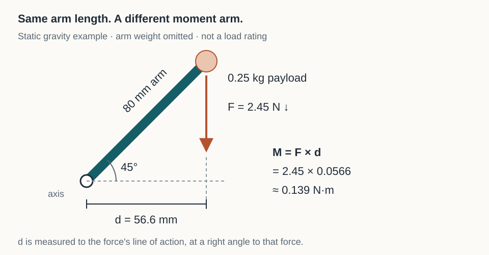

# Math and physics at the workbench

A bracket is 80 mm long. Its payload has a mass of 0.25 kg. Those two measurements already let you make a useful prediction: extending the payload farther from its support increases the turning effect at the support. You do not need a full simulation to notice that consequence. You need a sketch, a clear definition of distance and a few quantities whose units stay attached.

This chapter develops that small set of tools. You will convert units, rearrange a relationship, resolve a direction into components and distinguish force, energy and power. Bring the project brief from [Chapter 1](../start/), a ruler, paper and a calculator with trigonometric functions. Algebra helps; the examples show the substitutions rather than assuming you remember every formula. Calculus is a later extension, not an entrance examination.

## Units are part of the calculation

A number without a unit leaves the reader guessing. Write `80 mm`, not just `80`, in a drawing note, data table or program variable description. A calculation can use any consistent units, but a set built around kilograms, metres, seconds and amperes avoids many surprises in mechanics and electricity.

Conversion is multiplication by a ratio equal to one:

`80 mm × (1 m / 1000 mm) = 0.080 m`

The millimetres cancel. That cancellation is a useful diagnostic. If your moment calculation ends in newtons per metre when you expected newton-metres, the equation or substitution needs attention. Unit consistency cannot prove the model is appropriate, but inconsistency can disprove a calculation before you build anything.

Area and volume require extra care. A 10 mm × 10 mm square has an area of 100 mm². In metres, each side is 0.01 m, so its area is 0.0001 m². There are one million square millimetres per square metre, not one thousand. Similarly, 1 cm³ is 1000 mm³. This is why a plausible looking density calculation can be wrong by orders of magnitude.

| Quantity | Meaning here | Example unit |
|---|---|---|
| Mass, m | Amount of inertia; used to calculate weight | kg |
| Force, F | A push or pull with direction | N = kg·m/s² |
| Moment or torque, M | Turning effect about an axis | N·m |
| Energy or work, E | Capacity transferred through a process | J = N·m |
| Power, P | Energy transferred per unit time | W = J/s |
| Pressure or stress | Force per area, with different physical interpretations | Pa = N/m² |

Moment and energy share dimensions, but describe different things. Do not convert a shaft's torque into energy without also knowing its angular displacement. Names and physical interpretation matter alongside units.

## One model, with its assumptions visible

For a stationary payload near Earth's surface, use `F = mg`, with `g ≈ 9.81 m/s²`. A 0.25 kg payload has a downward weight of about 2.45 N. If that force acts 0.080 m horizontally from a support axis, its moment magnitude is:

`M = Fd = 2.45 N × 0.080 m ≈ 0.196 N·m`

This is a planar example: the arm and force lie in the page, and the support axis points perpendicular to the page. Here `d` is the perpendicular distance from the support point to the force's line of action. It is not always the length of the bracket. If the same 80 mm arm points vertically and gravity acts along it, the moment from that idealized force about its base is zero. The support still carries a force. If the arm points upward at 45° from horizontal, the perpendicular distance is `0.080 cos(45°) ≈ 0.0566 m`, and the moment is about 0.139 N·m. In three dimensions, moment is a vector; its component along a chosen axis determines the turning effect about that axis.

These are static weight calculations. They omit the bracket's own weight, acceleration, cable tension, impacts, joint friction and assembly eccentricity. List those omissions before using the result to choose hardware. In the pivot project, the neighboring module's mass and centre of mass remain inputs to measure. The presence of two bearings does not turn this arithmetic into a validated load rating.

*The dashed distance is perpendicular to the downward force. Rotating the arm changes that distance even when its length stays constant.*

A relationship is also a way to ask what matters. `M = mgd` says doubling mass doubles moment, doubling perpendicular distance doubles moment, and doubling both multiplies moment by four. Before refining decimal places, check whether you have chosen the right mass and distance.

## Solve for the quantity you need

Suppose an early experiment is limited to a hypothetical moment of 0.10 N·m, chosen solely as a planning example. With a 0.25 kg mass, what distance corresponds to that moment?

Start with `M = mgd`. Divide both sides by `mg`:

`d = M / (mg) = 0.10 / (0.25 × 9.81) ≈ 0.0408 m = 40.8 mm`

This is an algebraic result, not permission to load a particular printed part. You must establish a suitable test limit separately. The distinction matters: equations describe relationships; allowable values come from evidence, requirements and applicable practice.

Estimation gives you a second check. Round gravity to 10 N/kg and distance to 0.04 m. Then `0.25 × 10 × 0.04 = 0.10 N·m`. Agreement at that scale makes a misplaced decimal less likely. If the detailed answer were 40.8 metres, the rough calculation would expose it.

## Directions become components

A 50 mm line at 30° counterclockwise from a horizontal positive x-axis has components:

`x = 50 cos(30°) ≈ 43.3 mm`

`y = 50 sin(30°) = 25.0 mm`

Those two distances reconstruct the endpoint. Their squared sum is the squared length: `43.3² + 25.0² ≈ 50²`. The small discrepancy comes from rounding. Change the angle to −30°, and x stays positive while y becomes negative. The sign records direction rather than an impossible negative physical length.

This is the beginning of vectors. A vector has magnitude and direction; its component numbers depend on a coordinate frame. Label the origin and positive axes on your sketch. Later, a robot's camera and arm will each have their own frame, and transforming between them will be a central task. For now, use a single frame consistently.

Watch the calculator's angle mode. Many programming libraries accept radians. A half-turn is π radians or 180°, so `30° × π/180 ≈ 0.524 rad`. Passing `30` to a function expecting radians asks a different question. State the unit in variable names such as `angle_deg` and `angle_rad` when you write the software lab.

## Change, accumulation and conservation

A sensor that moves 20 mm in 0.5 s has an average speed of 40 mm/s. That does not establish its speed at every instant. A plot of position against time makes the distinction visible: slope describes rate of change. If the slope changes, the speed changes; a changing velocity implies acceleration.

The reverse idea is accumulation. If a load draws a steady 2 W for 10 minutes, it consumes `2 × 600 = 1200 J`, or about 0.333 Wh. Doubling operating time doubles that energy when power stays constant. If power varies, split the time into small intervals, multiply each interval's power by its duration and add the contributions. Differentiation formalizes local rate; integration formalizes accumulation. Those concepts will recur in [control](../controls/) and battery budgeting.

Energy accounting prevents another class of impossible design. Raising 0.25 kg by 0.10 m increases gravitational potential energy by about `mgh = 0.245 J`. Completing that lift in 0.50 s requires an average mechanical output of at least 0.49 W for the lift alone. Electrical input must also supply losses and any other work. A motor's shaft torque specification alone does not tell you whether it can perform the motion at the required speed.

Heat belongs in the same accounting. A device continuously losing 3 W as heat puts 180 J into its surroundings each minute. Whether it overheats depends on the path from the source to the environment, including conduction, convection and radiation. An enclosure can obstruct that path. A temperature reading at the outside of a case is not automatically the hottest internal component's temperature. Leave thermal limits as a measured design question rather than assuming low voltage means no heating.

## Scale changes more than appearance

Imagine uniformly scaling a solid part by a factor of two, keeping its material and shape proportions. Length doubles, surface area grows by four and volume grows by eight. At constant density, mass grows by eight. A larger part therefore has less surface area per unit volume. That can affect cooling and manufacturing as well as weight.

Real redesigns are often not uniform: you may increase an octagonal housing's radius while keeping strut thickness fixed. In that case, the simple cube law does not predict its mass. Count what actually changed. Likewise, removing material from the middle of a beam and removing it near an outer surface do not generally produce equal stiffness changes. [Mechanics](../mechanics/) develops why placement matters.

Graphs help reveal such relationships. Put the controlled variable on the horizontal axis, the response on the vertical axis and units on both. A straight line through the origin suggests direct proportionality over the tested range. A curved trend is information, not a plotting mistake. Do not extend a fitted line far outside the measurements merely because the software can draw it.

## Paper lab: predict a position before measuring it

Use paper, a ruler, a pencil and a protractor if available. No powered mechanism or hanging load is needed.

1. Draw an origin and horizontal x-axis. Mark a 60 mm line at 0°, 30° and 60°, using separate sketches if they overlap.
2. Before measuring the endpoints, calculate each expected x and y component. Record your calculator mode.
3. Measure horizontal and vertical distances from each endpoint to the origin. Record to a precision your ruler can support; do not invent hundredths of a millimetre.
4. Compare prediction and drawing. At 30°, expect approximately `(52.0, 30.0) mm`; at 60°, expect `(30.0, 52.0) mm`.
5. Draw a downward force arrow through each endpoint. Measure the horizontal distance to that line and predict which orientation produces the largest gravity moment.

The 0° arm should have the largest horizontal distance. Disagreement may come from a protractor referenced to the wrong axis, exchanged sine and cosine, a nonhorizontal page reference or an angle-mode error. Diagnose the geometry before changing the equations.

These are expected observations, not measurements taken from your drawing. Keep your actual values. This simple exercise joins an abstract coordinate pair to a physical position, which is the same translation you will later make between CAD, a fixture and a robot frame.

## Check your understanding

**A 0.5 kg mass sits twice as far from an axis as a 0.25 kg mass. How do their moments compare under the same perpendicular geometry?** The larger mass produces four times the moment: two times the force and two times the distance.

**Does 0.196000 N·m describe the example better than 0.196 N·m?** Extra digits in the calculator do not create better knowledge of mass, position or model assumptions. Retain enough digits during calculation, then report a precision appropriate to the inputs and purpose.

**Can a static calculation establish impact strength?** No. Impact involves motion, deformation, time and often a different load path. It needs a suitable model and experiment.

**What mathematical topic should you learn next?** Choose from the obstacle in your project: algebra for rearranging relationships, trigonometry for geometry, statistics for variable measurements, calculus for changing systems, or linear algebra for coordinates and coupled equations.

For independent practice, make a small table of payload mass, arm angle and predicted static moment for your own proposed sensor mount. Mark every assumed value. Use [the workbench tools](../tools/) to check the arithmetic, then explain one result without the tool.

For deeper study, [OpenStax College Physics 2e](https://openstax.org/books/college-physics-2e/pages/preface) is an algebra-based reference; [Precalculus 2e](https://openstax.org/books/precalculus-2e/pages/preface) supplies the algebra and trigonometry bridge. [3Blue1Brown's vector lesson](https://www.3blue1brown.com/lessons/vectors/) helps connect arrows and components. When rates and accumulation become a recurring need, [MIT's Single Variable Calculus](https://ocw.mit.edu/courses/18-01sc-single-variable-calculus-fall-2010/) provides archived videos and problems for independent study. Start with a specific question and work a problem after watching.
