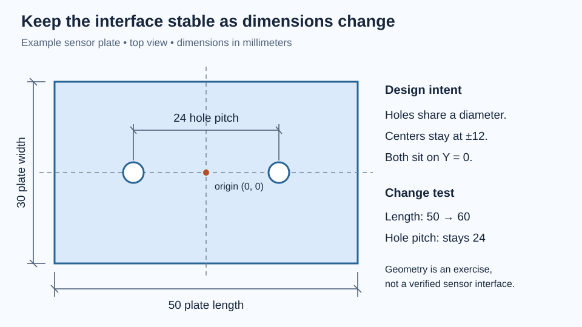

# CAD that explains how a part should change

A useful CAD model records decisions. If a sensor moves, its mounting holes should follow it. If a bracket gets longer, a purchased bearing should keep its actual diameter. A model that looks correct once but breaks when edited has captured a picture more successfully than an engineering idea.

This chapter teaches you to build a small parametric mounting plate, change it deliberately, and prepare it for someone else to manufacture. You need basic millimeter arithmetic and the measurement habits from the earlier chapters. Fusion is the example environment; the relationships also apply to other parametric solid modelers. A paper construction is provided if you cannot use CAD today.

## Begin with interfaces, then choose the shape

Imagine a lightweight bench sensor with two mounting holes 24 mm apart. Its cable must leave one end without rubbing. The bracket mounts to a tabletop fixture and must fit within a 60 mm-wide space. These are three different kinds of information: a hardware interface, an access requirement, and an envelope constraint.

Do not turn every number into a freely adjustable design choice. Record which dimensions come from hardware, which are measured estimates, and which you selected. Changing a measured hole spacing to make the drawing prettier would break the interface. Changing a chosen border width might be harmless.

For our first plate, use the following **exercise dimensions**, not a claim about a particular sensor:

| Parameter | Value | Meaning |
|---|---:|---|
| `plate_length` | 50 mm | Chosen envelope along X |
| `plate_width` | 30 mm | Chosen envelope along Y |
| `plate_thickness` | 4 mm | Initial prototype choice |
| `hole_pitch` | 24 mm | Simulated sensor interface |
| `hole_diameter` | 3.4 mm | Initial clearance-hole candidate |
| `edge_chamfer` | 0.5 mm | Initial edge-break candidate |

The hole diameter is not a universal recommendation for printed M3 joints. The actual screw, print process, and desired fit determine the final value. Its purpose here is to make the clearance an explicit decision that can later be tested with a coupon.

Choose a reference system before drawing. Put the plate center at the sketch origin, with its long direction along X. Locate the hole centers at X = −12 mm and +12 mm, both at Y = 0. Now the part is symmetrical by construction, and increasing its length adds equal material at both ends.

This reference is a **datum choice**: a stable basis for locating features. On a finished part, a datum may be an actual mounting face, bore axis, or edge. A digital origin is useful only when its relationship to those physical references makes sense.



*The origin and symmetry keep the interface centered when the surrounding plate changes.*

## Constraints remove unintended freedom

An unconstrained circle in a plane has three adjustable quantities: its center’s X position, its center’s Y position, and its radius. A diameter dimension controls only the last one. The circle can still wander unless its center is located.

Geometric constraints express relationships: two lines remain perpendicular, two circles remain concentric, two lengths remain equal. Dimensions supply sizes or distances. Prefer a relationship when the relationship is the requirement. Two mounting holes that must share a diameter should be equal, rather than separately assigned the same number and left free to diverge later.

For the plate, a center rectangle establishes symmetry about the origin. Length and width finish its size. The two holes share a horizontal construction line through the origin, sit symmetrically about the vertical centerline, and have a center-to-center dimension of `hole_pitch`. Give one hole a diameter and make the second equal.

A fully constrained sketch has no unintended freedom left. It does not prove that your dimensions are correct. You can fully constrain the wrong hole pitch. Autodesk’s short [design-intent module](https://www.autodesk.com/learn/ondemand/module/introduction-to-design-intent-in-fusion) connects these ideas to parameter-driven parts and assemblies; its [sketch-constraints tutorial](https://www.autodesk.com/learn/ondemand/tutorial/sketch-constraints) demonstrates the tools.

Avoid using Fix merely to stop a sketch moving. Fix can freeze an accidental position without explaining it. Likewise, adding redundant dimensions can overconstrain a sketch: if equality already links two circles, independently controlling both diameters may impose the same requirement twice. Ask which fact each constraint expresses.

## Build a short, readable feature history

Create a named component before creating the plate. In an assembly, a component represents a meaningful part with its own origin and motion relationships. A body is a connected solid within a component. Two solids intended to move independently usually deserve separate components; a temporary construction body does not automatically need one.

Create the plate outline sketch on an origin plane, then extrude it by `plate_thickness`. Name the sketch `Plate outline` and the feature `Plate thickness`. Create a second sketch for the holes and cut them through the plate. Through All communicates the intention better than a cut depth of 4 mm: if the plate becomes 6 mm thick, the holes should still pass through.

For this simple part, an origin-plane hole sketch and a through cut can be especially stable. Inspect the cut arrow: Through All still has a direction, and the cut must extend from the sketch through the body. Sketching on a generated face is convenient, but the reference may become fragile if earlier features split or replace that face. This is not a ban on face sketches. It is a reason to prefer durable references for important interfaces.

Add small edge treatments after the primary shape and holes exist. A chamfer replaces an edge with a flat bevel; a fillet replaces it with a rounded transition. They are functional features, not a final “make it engineered” command. A chamfer may guide assembly or relieve a bed-contact edge. A fillet can spread stress at a rib root, while also affecting tool access or printing overhangs.

Apply separate features for separate purposes. Name a hole-entry chamfer differently from an external cosmetic edge break. If one must change, the other should not be accidentally swept along. Avoid selecting every edge in the model just because the preview looks attractive.

## Nominal geometry, tolerance, and resolution

A CAD hole of 3.4 mm is **nominal geometry**. A manufacturing tolerance describes the acceptable departure from a specified value. Printer layer height, mesh density, and a caliper’s display increment are forms of resolution; none establishes the accuracy of the finished hole.

Suppose an imaginary drawing allows a hole from 3.30 to 3.50 mm, and a mating pin can measure from 2.95 to 3.05 mm. The possible diametral clearance is:

```
minimum clearance = smallest hole − largest pin
                  = 3.30 − 3.05 = 0.25 mm
maximum clearance = largest hole − smallest pin
                  = 3.50 − 2.95 = 0.55 mm
```

For centered circular parts, the radial gap is half the diametral clearance. Calling 0.25 mm a “gap on each side” would therefore double the intended allowance. This simple limit calculation is more useful than assuming every nominal dimension arrives exactly as modeled.

Position also matters. Two individually generous holes can still refuse to assemble if their spacing is wrong. A single round hole plus a slot can sometimes accommodate one direction of variation, but it changes how the part locates and carries load. Do not add slots automatically; decide which directions need precise location and which can float.

For prototypes, record what you actually need to function: both screws insert by hand, the sensor sits flat, the cable clears, and tightening does not distort the plate. Later, translate critical requirements into a drawing and inspection method. Avoid attaching tight tolerances to every surface without a functional reason.

## Lab: make one model survive three changes

Allow 45–75 minutes. Use Fusion, paper for notes, and optionally a ruler. No printer is needed.

1. Create a new design in millimeters and name the component `Sensor plate`. Enter the six parameters from the table.
2. Sketch the centered rectangle and constrain its size. Try dragging a corner before and after adding dimensions. Observe which freedoms disappear.
3. Extrude the plate, create the symmetric hole layout, and cut through it. Name the features as you build.
4. Add the selected external chamfers. Inspect a section or side view to verify that the bevel removes material rather than adding an unintended ledge.
5. Save a baseline. Change `plate_length` from 50 to 60 mm. Predict the new end margin before examining the result.
6. Restore 50 mm, then change `hole_pitch` from 24 to 30 mm. Finally, change thickness from 4 to 6 mm. Check that the holes remain through and the component remains centered.
7. Restore the baseline and capture a top view, a side view, and the parameter table. Add a short note explaining why each parameter exists.

The expected center-to-end margin for the original holes is `(50 − 24)/2 = 13 mm`. At 60 mm plate length it becomes 18 mm. At 30 mm pitch in the original plate it becomes 10 mm. These are distances to hole centers; the remaining material beyond the hole edge is smaller by its radius.

If a hole stays behind during an edit, inspect whether it was dimensioned from an unrelated edge or fixed in place. If the cut stops inside the thicker plate, inspect its extent. If a chamfer fails, suppress it temporarily and check whether the underlying design still works. A downstream edge failure should not force you to redraw the entire part.

The paper alternative is to draw the origin, centerlines, rectangle, and holes at full scale. Repeat the three variants on tracing paper. Label the relationships that must survive. This teaches design intent even though paper cannot enforce the constraints for you.

These are expected outcomes of the exercise, not a report that a physical sensor plate has been manufactured or fitted.

## Deliver a model someone can use

Keep the editable native design with its parameters and history. Exporting a mesh does not preserve that design logic. STEP is useful for exchanging solid geometry, while STL describes a triangulated surface and carries no reliable unit declaration in the format itself. A 3MF package can carry units and additional information, but a slicer project may also contain machine-specific settings. Tell the recipient what each file is for.

Before handing off, reopen the exported file and check the bounding dimensions. An incorrectly interpreted unit can create a beautifully detailed part at the wrong scale. Inspect curved holes for obvious faceting and confirm that each intended part is a closed solid. Finer mesh settings improve geometric approximation, not printer calibration.

Include a simple drawing showing critical mounting dimensions, material/process assumptions, and revision. An isometric image explains appearance; orthographic views explain dimensions. Avoid dimensioning everything from everything else. Locate related interfaces from shared references so a reviewer can see the chain of decisions.

In the [triangulated pivot case study](../../projects/triangulated-pivot/), the 150 mm across-flats envelope and 260 mm straight length are chosen geometry, while the 608 bearing interfaces and 8 mm shaft derive from hardware. The 25.1 mm bearing-center spacing is another deliberate geometric choice. Parameter edits must preserve those distinctions. The downloadable model is a teaching prototype, not evidence that the assembly has been physically tested.

## Check your reasoning

**Prediction:** The plate width increases from 30 to 40 mm. Should the two sensor holes move apart? **Answer:** Not with our intent. Their pitch comes from the sensor interface, so both remain on the same centerline at ±12 mm.

**Prediction:** A sketch is fully constrained, but its dimensions use an incorrect measurement. Is it ready to print? **Answer:** Constraint completeness only describes freedom inside the model. The measured interface still needs verification.

**Prediction:** A 0.1 mm layer height means the hole diameter is accurate to 0.1 mm. **Answer:** No. Vertical slicing resolution does not establish in-plane dimensional accuracy, shrinkage, or repeatability.

## Your next independent part

Choose a real lightweight sensor, switch, or cable guide. Measure its interfaces twice, identify an assembly direction, and model a mount using no more than eight meaningful parameters. Produce two size variants without rebuilding the sketch. Ask another person to identify the fixed hardware dimensions from your parameter names and drawing.

Keep the part on the bench until its fit and fastening method are checked. Your deliverable is a clear model, a change test, and a list of uncertainties. The [3D-printing chapter](../3d-printing/) turns those uncertainties into small, measurable trials.
