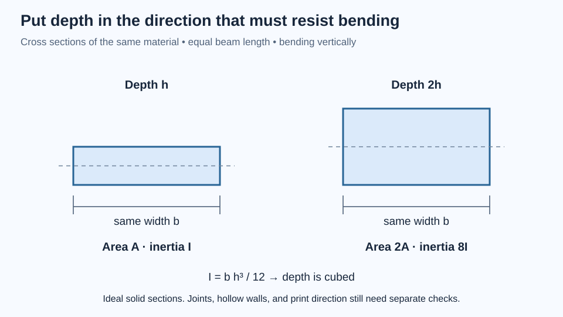

# Choose a material and a way to make it

A bracket can fail without breaking. It may bend enough to point a sensor in the wrong direction, slowly relax under a screw, swell after absorbing moisture, or soften near a motor. “Strong plastic” does not describe those requirements well enough to choose a material.

This chapter gives you a practical way to connect a part’s job to its material, shape, and manufacturing process. You need the earlier measurement ideas, plus multiplication and unit conversion. CAD familiarity helps with later design comparisons but is optional for the card-strip lab. By the end, you will be able to explain a material choice, recognize missing evidence in a datasheet, and run a modest comparison without mistaking it for a certified test.

## Translate the job into property questions

Start with the environment and the failure you want to prevent. A bench sensor mount may need to hold its angle for a month, survive occasional handling, and accept repeated assembly. A protective cover may care more about impact and appearance. A bearing seat may depend on dimensional stability and local contact pressure.

Separate properties that everyday language tends to combine:

| Property | Question it answers | Example consequence |
|---|---|---|
| Stiffness | How much does it deform elastically under load? | A sensor shifts despite an unbroken mount |
| Strength | What stress produces a specified failure or permanent deformation? | A rib yields or fractures |
| Toughness | How much energy can it absorb before fracture? | A dropped cover cracks |
| Hardness | How resistant is its surface to localized indentation? | A washer dents the mounting face |
| Creep resistance | How well does it resist time-dependent deformation under sustained load? | A clamped polymer slowly changes shape |
| Fatigue resistance | How does it tolerate repeated loading? | A vibrating root develops a crack |

These properties are related but not interchangeable. A material can be stiff and brittle. A flexible material can survive large deformation while being unsuitable for accurate positioning. A short pull test cannot establish months of creep performance.

Temperature and time belong in the requirement, not in an afterthought. “Supports 200 g” is incomplete if the mount sits in direct sunlight or carries that load for years. Specify the orientation, duration, temperature range, and acceptable motion. For more depth, MIT’s [Mechanical Behavior of Materials](https://ocw.mit.edu/courses/3-032-mechanical-behavior-of-materials-fall-2007/) connects elasticity, deformation, creep, and fracture to material mechanisms. It is an undergraduate technical course, best approached after basic mechanics rather than used as a first shopping guide.

## The process is part of the material

A material name alone does not define the object you manufacture. A molded polymer specimen and an FDM part made from a related polymer can differ in voids, bonding, orientation, and residual stress. Even two prints from one spool may differ if their layer orientation or thermal history changes.

**Anisotropy** means properties depend on direction. Wood has grain. Fiber composites have reinforcing directions. FDM parts have deposited roads and layer interfaces. A force that mainly stretches roads can create a different failure mode from a force that tends to separate layers. “Print it stronger” therefore begins by identifying the load direction and the weak interfaces.

Infill percentage does not turn a print into a homogeneous material with a proportionally reduced strength. Perimeters, skins, infill connections, and local geometry form a structure. A bolt hole surrounded by several continuous walls behaves differently from one crossing a sparse interior. The material label and the slicer settings must travel together in your build record.

Metal stock also has process history. Alloy, temper or heat treatment, and product form matter. An unidentified piece of aluminum is not equivalent to a certified grade simply because its density looks familiar. Plywood depends on veneer construction and moisture; acrylic and polycarbonate should not be grouped as “clear sheet” when impact behavior matters.

The useful decision is therefore a package: **material grade + stock form + manufacturing process + geometry + inspection**.

## Compare realistic manufacturing routes

For one sensor bracket, several routes may work:

| Route | Useful advantage | Constraint to design around |
|---|---|---|
| FDM polymer | Fast geometry changes and integrated features | Directional behavior, surface steps, heat and time effects |
| Drilled stock angle | Existing stiff section with little fabrication | Available sizes, tool access, drilling and deburring |
| Laser-cut sheet | Fast flat profiles and repeated panels | Approved material, kerf, joints, and sheet-only geometry |
| Milled stock | Controlled solid surfaces and accurate interfaces | Tool access, workholding, setup time, machine training |
| Folded sheet metal | Stiff thin structures from bends | Bend radius, bend allowance, tooling, and access |
| Purchased bracket | Known catalog geometry and short lead time | Your design must accommodate its interfaces |

The table is a screening aid, not permission to operate equipment. Laser cutting requires a machine-approved identified material and the shop’s ventilation and fire procedures. Unknown plastics do not belong in a laser. Cutting, drilling, and milling require the relevant local training.

Buying stock tube or angle can be a good engineering decision. The manufactured section already puts material away from its neutral axis, which often helps bending stiffness. Print the custom adapter where it adds value, and use purchased stock for the long uniform span. This hybrid approach also makes replacement easier.

MIT’s [Design and Manufacturing II](https://ocw.mit.edu/courses/2-008-design-and-manufacturing-ii-spring-2025/) is a deeper route into process selection, production systems, and design for manufacture. Its free archived notes and assignments are useful; access to course materials does not provide the supervised shop experience of the original class.

## Worked example: geometry changes the material comparison

Consider a solid rectangular prototype arm 100 mm long, 20 mm wide, and 4 mm thick. Its volume is:

```
V = 100 × 20 × 4 = 8,000 mm³ = 8 cm³
```

Using illustrative densities of 1.25 g/cm³ for a polymer and 2.70 g/cm³ for an aluminum alloy gives masses of 10.0 g and 21.6 g. These are arithmetic assumptions, not measured values for your spool or stock. An FDM part with cavities will contain less material than the solid CAD volume, and supports add material that does not remain in the finished part.

Now imagine bending through the 4 mm thickness. For a rectangular section, the second moment of area is `I = b h³ / 12`, where `h` is the dimension in the bending direction. Doubling thickness from 4 to 8 mm multiplies `I` by eight while doubling volume. Doubling width from 20 to 40 mm multiplies both `I` and volume by two.



*Shape is part of the material decision. This ideal section comparison does not include joints or print direction.*

For the same length and loading, beam deflection is inversely proportional to the product `E I`: material modulus times geometric second moment of area. This explains why changing shape can be more effective than choosing an expensive filament. It also explains why a thin sheet can feel floppy in one direction and rigid when turned on edge.

There is no free gain. A deeper arm occupies more space, alters connections, and may become difficult to print or machine. A hollow section needs enough wall stability and suitable load introduction at its ends. Remove material only after considering where the force enters, travels, and leaves.

Michael Ashby’s [Materials Selection in Mechanical Design](https://shop.elsevier.com/books/materials-selection-in-mechanical-design/ashby/978-0-443-16028-8) develops this material–shape–process reasoning systematically. It is a paid university-level book; start with selection basics and process effects before the more mathematical optimization chapters.

## Read a datasheet as an experiment report

When comparing two listed strengths, ask how each number was obtained. Look for specimen process, orientation, conditioning, temperature, test method, and whether the value is typical or guaranteed. A tensile modulus does not directly supply impact toughness. A heat-deflection result under a specified test load is not a universal continuous service temperature for your geometry.

For filament, prefer data that identifies printed specimen conditions when evaluating a printed part. If a table only describes raw resin, record that limitation. Short carbon fibers can change stiffness, dimensional behavior, surface finish, and processing requirements; the word “carbon” alone does not establish better layer adhesion or stronger joints.

Manufacturer material guides help narrow candidates. Prusa’s [filament material guide](https://help.prusa3d.com/filament-material-guide) compares printing and application characteristics across materials, but its settings belong to its documented process context. For a Bambu printer, confirm nozzle compatibility, drying guidance, build surface, and temperature settings against the actual filament and printer instructions.

Use a decision table with three columns: requirement, evidence, and unresolved question. “Must hold its angle indoors” might have an initial stiffness estimate and a planned sustained-load observation. “Must survive a hot car” requires a different evidence trail. Do not silently turn an unknown into a pass.

## Lab: separate shape effects from time effects

Allow an hour for setup and observation. You need thin card, scissors, a ruler, tape, two small paper clips, and a flat table. An optional second stage uses a spare thin printed strip. Keep loads close to the table, away from eyes and fragile objects. Do not use heat or bend specimens toward your face.

Cut two card strips approximately 120 × 20 mm. Keep one flat. Fold the other lengthwise into an L-shaped section without cutting it. Tape 40 mm of each strip securely to the table so 80 mm projects beyond the edge; support them only a few centimeters above a clear surface if possible.

First observe both under their own weight. Then attach the same small paper clip at each free end. Use a ruler placed beside the tip to record the change in height. Photograph from the side to reduce parallax. Do not keep adding load until something breaks; this experiment compares response at modest deformation.

Expect the folded strip to resist vertical bending more effectively because the fold distributes material over a greater section depth. Your actual result depends on the fold, tape compliance, and card grain. If the folded strip twists, the load may be off-center or the open section may be responding in torsion. If both strips move at the tape, you are measuring the fixture as well as the strips.

For the optional time observation, load a thin spare printed strip only enough to produce a small visible deflection. Record immediately, after ten minutes, and after an hour; then remove the load and observe recovery. Record room conditions and the print orientation. You may see little change at this load and duration. That does not prove creep is absent over longer periods or at higher temperature.

A no-material alternative is to predict the two card responses with sketches and compare their section depths. The learning target is to separate material, shape, fixture behavior, and time. These are proposed observations, not laboratory results already established for the pivot.

## Check your reasoning

**Prediction:** A polymer arm is too flexible. Would a higher tensile-strength label guarantee less deflection? **Answer:** No. Elastic modulus and section geometry determine small elastic deflection; strength describes a different limit.

**Prediction:** The same strip is twice as thick, with length and width unchanged. What happens to solid mass and ideal bending stiffness? **Answer:** Mass doubles and `I` increases eightfold. Actual printed structure and joint compliance may prevent the complete assembly from improving by eightfold.

**Prediction:** A bolt stayed tight during a ten-minute test. Have you checked long-term clamp stability in plastic? **Answer:** No. Sustained contact pressure and changing temperature can alter the joint over time. Longer observation and an appropriate joint design are still needed.

For a more hands-on reading path, Dustyn Roberts’s [Making Things Move](https://www.mheducation.com/highered/mhp/product/making-things-move-diy-mechanisms-inventors-hobbyists-artists.html) connects materials, joining, forces, and purchased motion components. Start with its fastening chapter and sketch two ways to make your mount replaceable. It is a paid maker-oriented book published in 2010, so check current parts and electronics guidance separately.

## Choose a route for your own mount

Take the real part you modeled in [CAD](../cad/), or use a dimensioned sketch if you have not completed that chapter. Compare an FDM version, a stock-material version, and a purchased component. State one condition under which each would be the better choice. Include total effort: sourcing, setup, finishing, inspection, and replacement, not just grams of material.

For the [triangulated pivot](../../projects/triangulated-pivot/), the open structure reduces enclosed material and improves access, but its performance still depends on member dimensions, layer direction, nodes, and bearing interfaces. It has not been physically printed or load-tested. Your next experiment should answer one material or process uncertainty at a time, beginning with a small representative feature instead of the full assembly.
