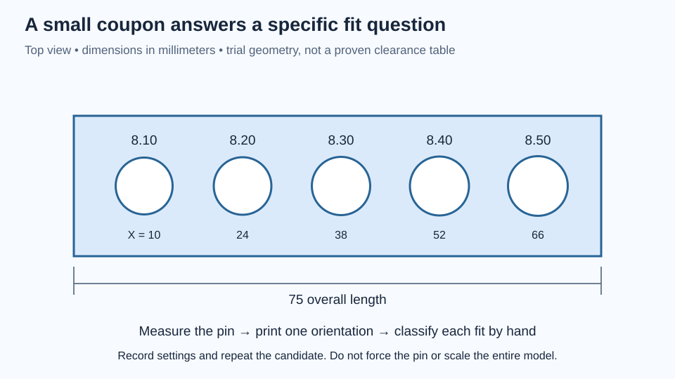

# Design the print, then inspect the toolpaths

A solid model describes the volume you want. A slicer describes the roads of plastic that attempt to create it. Those are different objects. A thin rib can exist in CAD yet disappear in the slice. A smooth overhang can become a staircase with little support beneath each new layer. A circular hole can print smaller than its nominal diameter.

Your task is to connect geometry, orientation, extrusion paths, and measured fit. This chapter assumes you can sketch and extrude a simple part. You will build a small fit coupon, inspect it layer by layer, and decide what to change from evidence. A printer is optional for the first half; Bambu Studio can prepare and preview a project without a physical print. The [official Bambu Studio project](https://github.com/bambulab/BambuStudio) identifies its slicing, G-code viewing, support, and project features.

## Think in deposited roads

In fused-filament fabrication, a hot nozzle deposits plastic in successive layers. Within one layer, the slicer typically creates boundary walls, interior fill, and solid surface regions. The nozzle diameter constrains useful extrusion widths, but it does not force every line to equal that diameter. Modern slicers can vary line widths, and adjacent roads overlap according to the extrusion model.

Layer height sets vertical sampling. Reducing it can improve sloped-surface stair steps, but it does not automatically improve a vertical hole’s in-plane size. A tall vertical wall may look smoother while its diameter error remains unchanged. Prusa’s [layers and perimeters reference](https://help.prusa3d.com/article/layers-and-perimeters_1748) is useful for understanding the distinction between layer height, shell paths, and thin features; setting names differ between slicers.

A CAD wall 1.2 mm thick does not guarantee exactly three 0.4 mm paths. The slicer must fit its chosen widths and spacing into that region. It may create variable-width walls, gap fill, or a different count than you expected. Inspect the result at the narrowest point, especially where a diagonal brace joins a node.

Likewise, increasing infill may do little for a member already filled almost entirely by walls. For bending, outer material often matters greatly because stress grows with distance from the neutral axis. For bolt contact, local solid material and continuous wall paths may matter more than distant infill. Strength settings should answer a structural question.

## Choose orientation by several consequences

A reasonable orientation balances at least four concerns: load direction, support access, critical surface quality, and bed stability. Optimizing only print time can create an awkward or weak interface.

Consider an L-shaped sensor bracket loaded at the end of its upright leg. Standing it in the same orientation as its use may put tension across layer interfaces near the corner. Laying it on a side may give more continuous roads through that corner, while changing the quality of its holes and contact faces. Neither choice is universally best; draw the load and examine the layer direction at the stressed region.

Overhangs require the new road to be sufficiently supported by material below, or by a designed bridge or support structure. The familiar “45-degree rule” is a starting heuristic, not a guarantee. Cooling, material, layer height, line width, speed, and local geometry change the outcome. A short bridge anchored at both ends differs from a broad cantilevered ceiling.

Supports also need an exit route. A cavity that a slicer can fill with supports may be impossible to clean without damaging the part. Keep bearing seats and mating faces away from support contact when practical, or plan a finishing operation and allow for it. Prusa’s [modeling guide](https://help.prusa3d.com/article/modeling-with-3d-printing-in-mind_164135) discusses orientation, overhangs, tolerances, and splitting parts as connected design decisions.

## Chamfers and fillets have specific jobs

A small chamfer at a bed-contact edge can provide relief for first-layer spreading, often called elephant foot. It removes nominal material locally so the bottom lip is less likely to interfere with assembly. It does not repair an incorrectly calibrated first layer, and too much relief reduces the contact footprint.

A chamfer at a hole entrance can help a shaft or screw find the opening. Its size must leave enough cylindrical engagement and enough material around the hole. A fillet at a structural rib root can soften a stress concentration, but a rounded underside may introduce a difficult shallow overhang near the bed. The same shape can help mechanics and complicate manufacturing.

For the 4 mm-thick exercise coupon below, begin with a 0.3 mm bed-edge chamfer and a 0.5 mm entrance chamfer as **trial geometry**. These values are intentionally small enough to study on a coupon; they are not verified settings for every printer or every pivot interface. Keep an unchamfered comparison if you want to isolate the effect.

Do not bevel every bearing-seat edge. A bearing needs an adequately long cylindrical seat and a shoulder that contacts the intended race. Unplanned edge removal can change axial location or reduce support. Apply an edge treatment only after stating the surface’s function.

## Worked example: a clearance ladder

Suppose the smooth pin you intend to fit measures 7.98 mm. You want a freely removable fit, but you do not yet know the printed-hole bias. Model holes at 8.10, 8.20, 8.30, 8.40, and 8.50 mm. Their nominal diametral clearances relative to this pin are:

```
8.10 − 7.98 = 0.12 mm
8.20 − 7.98 = 0.22 mm
8.30 − 7.98 = 0.32 mm
8.40 − 7.98 = 0.42 mm
8.50 − 7.98 = 0.52 mm
```

If the first hole actually prints at 7.95 mm, it has 0.03 mm interference despite the nominal clearance. That example is hypothetical: measure or functionally gauge your own result. Small-hole caliper readings can be unreliable because the jaw tips and alignment affect contact. A measured smooth pin is a useful fit gauge, but it does not reveal an exact diameter or roundness by itself.

Do not scale the entire part to enlarge one hole. Scaling also moves hole centers and changes the envelope. Adjust the relevant CAD dimension or a documented hole-compensation setting, then verify that other interfaces are unaffected. Keep enough information to reproduce the successful process.



*One measured pin and one controlled print process turn the diameter ladder into useful evidence.*

## Lab: make the coupon and read the slice

Allow 45–60 minutes for modeling and slicing, plus optional printing. Use CAD, Bambu Studio, and a notebook. For the physical stage, use the measured smooth pin, a ruler or caliper, and a familiar printer/filament combination. Never force a pin into a tight hole or hammer it through a thin coupon.

Create a 75 × 20 × 4 mm rectangular plate. Put five hole centers on its lengthwise centerline at X = 10, 24, 38, 52, and 66 mm measured from its left end. Assign the five diameters above from left to right. Keep a screenshot of this order; you can mark the finished coupon with a pen. Add the trial edge treatments as separate named features.

Export and open the model in the slicer. Confirm its dimensions are 75 × 20 × 4 mm before doing anything else. For an X1 Carbon with a 0.4 mm nozzle already installed, choose the matching printer/nozzle profile and the actual filament profile. Start with the manufacturer's ordinary 0.20 mm process preset if available. Retain its established thermal settings; this is a geometry and fit experiment, not a temperature-tuning exercise.

Place the broad face on the bed and slice. Read the preview rather than stopping at the estimated time:

1. At the first layer, check that the footprint is continuous and that the hole openings remain visible. Determine whether a brim touches a fit surface.
2. Move to a middle layer. Use the line-type legend to distinguish walls from infill. Count the paths around a hole and inspect the narrow ligaments between holes and outside edges.
3. Step through the last layers. Identify the top solid skin and the gradual widening caused by each entrance chamfer. A chamfer should not unexpectedly close the hole.
4. Enable travel visualization briefly. Identify moves without extrusion so you do not mistake them for structural material. Turn it off if it obscures the deposited paths.
5. Save one screenshot of the middle layer and record estimated material and time. These are slicer estimates, not measured consumption or duration.

Now duplicate the project and change only the wall-loop count, for example from the preset value to four. Reslice and inspect the same layer. Write what actually changed: extra walls, less interior infill, or little difference because a narrow region was already filled. Do not assert that four walls made the part a particular percentage stronger.

For a second software-only comparison, rotate a copy onto its long edge and reslice. The holes now have horizontal axes. Inspect their upper arcs for bridge or overhang paths and compare support need, footprint, and estimated time. Use this comparison to explain why an orientation that helps one feature may complicate another. Keep the flat version for the simple first print.

## Inspect the physical result without erasing the evidence

If printing, follow the printer and filament instructions for ventilation, build-surface preparation, supervision, and handling. Let the plate and part cool before removal. Keep hands away from the hot nozzle and moving mechanism. Remove a brim carefully without putting a cutting tool toward your hand.

Before sanding or drilling, label the coupon and record its as-printed condition. Try the pin by hand in each hole from the intended entry side. Classify the result as “will not enter,” “enters with noticeable hand resistance,” “slides freely,” or “visibly loose.” Avoid using a threaded screw as a precision cylindrical gauge.

Record the smallest hole that gives your desired fit, along with printer, nozzle, filament identity, orientation, layer height, wall count, and revision. Reprint that candidate if repeatability matters. One successful hole is evidence about one specimen, not a universal correction for every orientation and feature size.

If every hole is poor, diagnose the pattern. A bottom-only obstruction suggests first-layer spreading or residual brim. A rough upper arc in the edge-oriented comparison suggests overhang behavior. Uniform shrinkage-like error across outside dimensions and holes may need broader process investigation. A single damaged opening may be a removal problem. Change one plausible cause, then compare again.

If you have no printer, submit the two sliced projects, annotated layer screenshots, and predictions. That is a complete software lab; the fit conclusion remains pending. This handbook does not claim these coupons have already been printed.

## Apply the lesson to larger structures

A full lattice housing adds nodes, short bridges, changing slopes, and access constraints. Inspect the narrowest member, the first unsupported layer of each opening, and the places where load enters a bearing seat or fastener boss. A pleasing exterior render cannot reveal missing internal paths.

For the [triangulated pivot](../../projects/triangulated-pivot/), use the downloadable geometry to study orientation and access, but print representative fits and structural junctions before the complete assembly. Its model has not been physically printed, assembled, or load-tested. The 608 bearing fit, shaft clearance, and axial stack need actual measurements and trials. A bearing that can be forced into a seat is not automatically an acceptable fit; the housing can crack or distort the bearing.

## Check your reasoning and extend the experiment

**Prediction:** Halving layer height fixes every undersized hole. **Answer:** No. It changes vertical discretization. In-plane extrusion, shrinkage, shape, and calibration still affect hole size.

**Prediction:** Increasing wall count will always increase the material used. **Answer:** Often, but not necessarily by the amount expected. Existing solid regions and the slicer's treatment of narrow sections can limit the change. Inspect the actual paths and estimate.

**Prediction:** The 8.30 mm coupon hole fits well. Should every future 8 mm hole become 8.30 mm? **Answer:** Treat it as evidence for this process and geometry. Orientation, thickness, material, and required fit can differ.

Your independent challenge is to redesign the sensor mount so its critical mating surfaces need no support contact. Keep the required interfaces fixed. Compare two orientations and one geometric change, then choose using a short explanation that includes strength direction, finish, access, and print time. Preserve the rejected slices: they show why the final choice makes sense.
