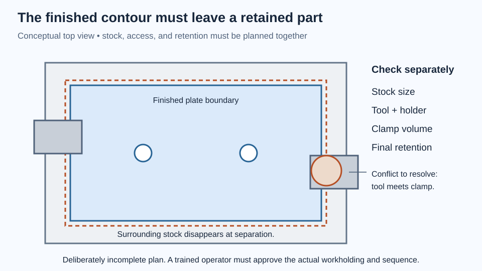

# CAM begins with how the work is held

A milling machine can follow a toolpath accurately and still make the wrong part. The stock may be located differently from the digital setup. A clamp may sit in the cutter’s path. The last contour may release the part before machining is finished. These are planning errors that attractive CAM animation can conceal.

This chapter teaches the reasoning between a CAD model and a manufacturing setup. You need the CAD and measurement chapters and basic unit arithmetic. You will make a paper workholding plan and, optionally, a simulated CAM setup. You will not generate a machine-ready operating recipe. Actual machining requires training on the specific machine, tooling, controller, and shop procedures.

## A manufacturing plan has several coordinate systems

Start with the finished part, then identify the stock from which it will be made. A 50 × 30 × 4 mm plate cannot simply be held by empty space while every outer surface is cut. The stock may need extra thickness, a larger border, or a fixture so the cutter can reach the required faces while the part remains restrained.

CAD coordinates describe the model. A **work coordinate system**, or WCS, relates the program to the physical workpiece. The machine also has its own coordinates, established through its machine-specific reference procedure. Tool offsets account for the actual tool geometry and its location in the holder.

These systems must agree, but they are not interchangeable. Moving the digital model to an attractive place in the viewport does not establish a real work offset. Changing the selected top surface in CAM can alter where the program expects Z = 0. The operator must be able to identify and establish the same reference physically.

For a simple planning exercise, choose the top of the raw stock as Z = 0 and one identifiable stock corner as the XY origin. Draw arrows for positive X, Y, and Z. If the stock top is later faced away, decide whether subsequent operations retain the original reference or use a newly established finished surface. Record the decision instead of relying on memory.

## Tool access changes the design

A rotating end mill has a finite diameter. It cannot create an arbitrarily sharp internal corner in an ordinary planar pocket. A 6 mm cutter leaves an internal radius of at least roughly 3 mm in that cutting plane, subject to the actual tool geometry and path. If a square mating tab must fit, you can round the tab's corners to clear that radius, add deliberate relief to the pocket, enlarge the pocket where the fit allows, or choose another process. Simply increasing the pocket's internal corner radius leaves more material in its corners and can worsen interference with an unchanged square tab.

Smaller tools can reach tighter geometry, but are generally less rigid and may require different engagement, speed, and feed choices. Longer reach also increases deflection and collision concerns. The cutter tip reaching a pocket does not prove the shank or holder clears its walls.

Distinguish through holes, blind holes, pockets, slots, and external contours. Their tool access and inspection differ. A blind pocket must leave a known floor thickness. A through cut needs a plan for the material beneath it and the part’s retention. A deep narrow slot may be disproportionately difficult compared with a small redesign.

Machining drawings should make important functional surfaces clear. Unnecessary tight tolerances and polished finishes can add operations without improving function. Conversely, a bearing seat or a pair of locating holes may require careful control even when the rest of the part is rough.

## Workholding is a force problem

The cutter exerts forces on the stock. The fixture must resist translation, rotation, and lifting without distorting the part or obstructing the tool. Friction alone is not a complete explanation unless you know the clamping force, contact conditions, and cutting loads.

Think through the force path: cutter into stock, stock into supports or locating faces, clamps into the fixture, fixture into the machine table. A thin plate can bow under a clamp and spring back after release. The machine then produces a surface that is accurate only while the part is distorted.

Separate **locating** from **clamping**. Locators define where the part sits; clamps hold it against those references. The familiar 3–2–1 principle illustrates how three contacts on a primary plane, two on a second plane, and one on a third can constrain a rigid body. Real fixtures must also account for contact area, debris, accessibility, and cutting forces.

Do not overinterpret a schematic. Six carefully drawn dots do not prove a real fixture is rigid, secure, or safe. Local shop review determines an appropriate setup. Never hand-hold work near a rotating cutter, and do not treat a hand-held object as a substitute for approved drill-press workholding.

## Worked example: feed, speed, and units

Three quantities often get confused:

- **Spindle speed** is rotation rate, usually revolutions per minute.
- **Cutting speed** is the speed of the cutting edge relative to the material, often meters per minute.
- **Feed rate** is the programmed advance, often millimeters per minute.

For a purely arithmetic example, assume a 6 mm-diameter cutter, two effective teeth, 6,000 rpm, and 0.020 mm advance per tooth. These are invented calculation inputs, **not recommended cutting conditions for any material or machine**.

```
feed = feed per tooth × teeth × revolutions per minute
     = 0.020 mm/tooth × 2 teeth/rev × 6,000 rev/min
     = 240 mm/min

cutting speed = π × diameter × rpm / 1,000
              = π × 6 mm × 6,000 / 1,000
              ≈ 113.1 m/min
```

The division by 1,000 converts millimeters to meters. If a trained setup plan kept feed per tooth unchanged while doubling rpm, feed would also double. Doubling rpm while leaving feed unchanged halves the nominal feed per tooth. Neither alteration is automatically appropriate: tool engagement, chip evacuation, runout, workpiece material, and machine capability also matter.

Sandvik Coromant’s [milling formulas and definitions](https://www.sandvik.coromant.com/en-gb/knowledge/machining-formulas-definitions/milling-formulas-definitions) is a primary reference for these quantities. Use manufacturer cutting data with the correct tool and operation under qualified supervision. A formula converts chosen inputs; it does not choose safe inputs for you.

## From setup to toolpath to machine code

In CAM, a setup typically identifies the model, stock, orientation, and work origin. Operations then describe how tools remove material: facing, roughing a pocket, drilling, finishing a wall, or contouring the outside. Their order matters because each operation changes the stock available to support the next.

Roughing removes bulk material while leaving a controlled allowance. Finishing aims at final surfaces and dimensions. “Leave 0.3 mm” means something only if you know whether it applies radially, axially, or both. Entry, exit, retract, clearance, and linking moves deserve the same attention as cutting moves: a rapid motion can collide with a clamp even if the cutting contour is correct.

A **post processor** translates the CAM operations into code for a particular controller and machine configuration. It is not a generic export button. Tool changes, work offsets, arcs, and other commands can be interpreted differently across systems. A file extension alone does not establish compatibility.

Simulation can reveal stock left behind and some collisions, especially when tools, holders, fixtures, and machine geometry are represented correctly. It cannot validate an omitted clamp, an incorrectly measured tool, weak workholding, or the true behavior of a flexible part. Review warnings and compare the simulation assumptions with the physical setup.

Autodesk’s [Haas and Fusion manufacturing course](https://www.autodesk.com/learn/ondemand/course/haas-fusion-360-blueprints-cad-cam-cnc) connects drawings, CAM setup, machine preparation, and inspection. It includes downloadable learning material. Its machine-oriented content should support supervised instruction; it does not authorize unsupervised operation of another shop’s equipment.

## Lab: plan a plate without running a machine

Allow 60–90 minutes. Use paper, a ruler, colored pencils, and the plate model from [CAD](../cad/). Optional CAD/CAM software lets you represent the same plan digitally. Do not connect to a machine or run generated code for this exercise.

Draw a top view of hypothetical 60 × 40 × 6 mm stock and center the desired 50 × 30 × 4 mm plate inside it. Mark the two 3.4 mm holes, 24 mm apart. Make a side view showing the extra thickness. Choose and label a work origin that you could physically identify.

On a separate overlay, draw supports and clamps conceptually. Shade every region occupied by workholding. Then draw a 6 mm-diameter cutter circle around a proposed outer-profile toolpath, including approach and exit regions. That cutter cannot make the 3.4 mm holes: identify a separate appropriately sized drill or smaller milling tool in the plan. Add a larger circle representing the holder where it could come close to the work. The sizes are visualization choices, not an approved fixture design or cutting recommendation.



*This deliberately incomplete plan exposes an access conflict and the need to retain the plate after separation.*

Write a proposed operation sequence. For each operation, answer four questions: what locates the work, what retains it, what surface is being created, and what references remain afterward? You should encounter a problem when the outside contour separates the plate from the surrounding stock. Do not erase that problem with “cut all the way through.” Mark it as a workholding decision requiring an appropriate fixture or second setup.

If using CAM, build a stock/setup representation and inspect one pocket or hole operation in simulation. Include simplified fixture bodies so you can see why missing geometry matters. Record any warnings and the assumptions that the software cannot check. There is no requirement to post-process or produce an NC file.

Finally, write an inspection plan: overall length and width, thickness at more than one location, hole size or functional gauge, and hole spacing relative to chosen references. Ask how a burr could affect the measurement. Include a requirement to inspect and deburr through the shop’s approved process before handling or assembly.

Expected observations include limited clamp access, a retention problem after final separation, and a need to define the second setup if both faces require machining. If everything looks effortless, check whether the holder, clamps, remaining stock, and reverse side were actually included. These are planned observations; no machining has been performed for this chapter.

## Choose the simplest adequate process

A CNC mill is not the default answer to every flat plate. A stock bracket with two drilled holes may solve the problem more quickly. Turning suits rotational features; a sheet process suits flat profiles; additive manufacturing can create inaccessible cavities but introduces its own constraints. Compare functional accuracy, quantity, setup time, material, and access to trained help.

For one-off work, setup often dominates cutting time. For repeated work, a fixture or different process may become worthwhile. A useful rough model is `total effort = setup effort + quantity × effort per part`. If route A takes 60 minutes to prepare and 5 minutes per part, while route B takes 10 minutes to prepare and 15 minutes per part, they tie at five parts: 85 minutes each. This is a planning example, not a quotation or production estimate.

MIT’s [2025 Design and Manufacturing II materials](https://ocw.mit.edu/courses/2-008-design-and-manufacturing-ii-spring-2025/) are a deeper path into these process and production tradeoffs. Begin with the manufacturing-process overview and compare its assumptions with the equipment you can actually access.

## Check your reasoning and propose a real setup

**Prediction:** A successful simulation guarantees no collision. **Answer:** Only modeled conditions were checked. Missing fixtures, incorrect offsets, or physical setup errors can invalidate the result.

**Prediction:** A 6 mm end mill can leave a sharp square internal corner in a flat pocket. **Answer:** Its circular sweep leaves a radius. The design or process needs a deliberate solution.

**Prediction:** The arithmetic example uses four effective teeth instead of two, with rpm and feed per tooth unchanged. What feed results? **Answer:** `0.020 × 4 × 6,000 = 480 mm/min`. This remains an arithmetic result, not a cutting recommendation.

For an independent challenge, bring a drawing of a small sensor mount to a trained shop instructor. Ask them to critique your stock choice, datums, tool access, workholding, and inspection sequence. Revise the design from their feedback before booking machine time. A good outcome is a simpler, inspectable part and a credible setup plan—even if the best answer is to buy an existing bracket.
