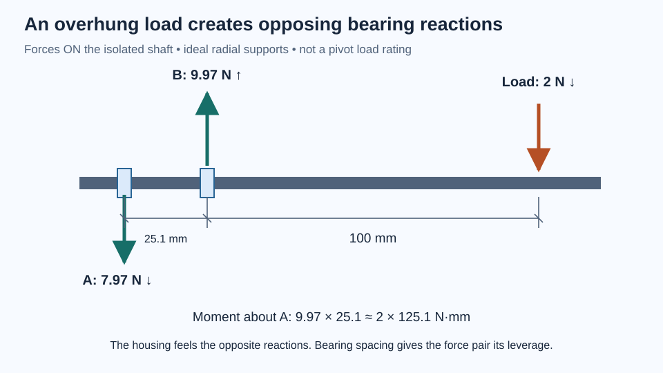

# Follow the force before strengthening the part

A robot module hanging from a joint does more than pull downward. Its weight acts at a distance, creating a moment. The joint transfers that moment through bearings, shaft, housing, fasteners, and the neighboring structure. Improving one piece can simply move the weakest point elsewhere.

This chapter teaches you to trace that load path, draw a free-body diagram, and use simple calculations to compare designs. You need units, basic algebra, and the materials chapter. The examples use idealized structures to explain trends. They do not establish a payload rating for a printed joint.

## Draw the object you are analyzing

A **free-body diagram** isolates one object or assembly and replaces its contacts with external forces and moments. Draw the boundary first. If you isolate the complete robot module, internal bearing forces do not belong on that diagram. If you isolate its shaft, bearing reactions do.

For a stationary object, the net force and net moment must balance. In a two-dimensional problem, this usually gives three equilibrium equations: horizontal forces sum to zero, vertical forces sum to zero, and moments sum to zero. Choose a positive direction and keep signs consistent. A negative answer tells you the actual force acts opposite your assumed arrow.

A moment is force times perpendicular distance from a reference point to the force’s line of action. A 2 N downward force acting 100 mm away produces `200 N·mm = 0.20 N·m`. The perpendicular distance matters; using a slanted member’s full length can give the wrong result.

The freely available [Engineering Statics: Open & Interactive](https://engineeringstatics.org/) provides diagrams and exercises for forces, equilibrium, structures, and moments of area. Start with free-body diagrams and moments before attempting a complicated assembly. The [author-linked statics videos](https://www.youtube.com/playlist?list=PLkrFJ_Qn-1ckKNtR2O2eKdX0BHN4Sfr5a) offer a complementary visual explanation; pause to draw your own arrows before watching a solution.

## Two bearings resist a moment through a force pair

Two separated bearing stations can react an overturning moment because they apply forces at different positions along the shaft. The important distance is their center-to-center spacing along the bearing axis. Two bearings pressed immediately beside one another do not provide the same leverage as widely separated stations.

Consider an ideal shaft with bearing A at X = 0 and bearing B at X = 25.1 mm. Apply a 2 N downward force at X = 125.1 mm: the force is 100 mm beyond bearing B. Ignore shaft weight and assume the bearings act as simple radial supports.



*The arrows are forces on the isolated shaft. The housing receives the opposite forces.*

Taking moments about A gives:

```
R_B × 25.1 − 2 × 125.1 = 0
R_B = 250.2 / 25.1 ≈ 9.97 N upward

R_A + R_B − 2 = 0
R_A ≈ −7.97 N
```

Bearing A therefore pushes downward on the isolated shaft while B pushes upward. The shaft applies equal and opposite forces to the bearings and housing. The supports see forces several times the 2 N external load because the load is overhung.

Another way to see it is a direct 2 N reaction plus a force pair reacting the `2 × 100 = 200 N·mm` overhang moment. The pair magnitude is `200/25.1 ≈ 7.97 N`. Increasing station spacing reduces this component for the same applied moment, but shaft length, packaging, alignment, and housing stiffness also change.

This example explains the role of spacing in the [triangulated pivot](../../projects/triangulated-pivot/), which uses two 608 bearings with 25.1 mm center spacing and an 8 mm shaft. Its actual load geometry is more complicated. The calculation is not a bearing-life calculation, a shaft check, or a validation of its printed seats. That assembly has not been physically printed, assembled, or load-tested.

Also distinguish overturning moment from torque about the rotation axis. Bearings intended to allow rotation do not hold the joint at an angle by themselves. A brake, actuator, detent, or other restraint is needed if the mechanism must resist rotation about its own free axis.

## Stress and stiffness answer different questions

Average direct stress is force divided by load-carrying area. With force in newtons and area in square millimeters, the result is N/mm², numerically equal to MPa. A 20 N tensile force through 10 mm² produces an average stress of 2 MPa.

“Average” matters. Holes, abrupt corners, notches, and contact points create local concentrations. A bearing seat or bolt hole may also experience contact pressure, splitting, or bending that a simple force-over-area calculation misses. Local wall thickness and how load spreads into the structure matter.

Stiffness describes deformation under load. A part can remain below its failure stress while bending too much to function. For an ideal straight cantilever beam with a tip force, constant rectangular section, linear elastic material, and small deflection:

```
I = b h³ / 12
maximum bending stress = F L (h/2) / I
tip deflection = F L³ / (3 E I)
```

Here `b` is width, `h` is depth in the bending direction, `L` is unsupported length, and `E` is Young’s modulus. The second moment of area `I` has units of mm⁴; it describes section geometry, not mass.

Take a 40 mm-long arm, 15 mm wide and 3 mm deep, with a 2 N tip load. Assume `E = 2,000 N/mm²` solely for the example:

```
I = 15 × 3³ / 12 = 33.75 mm⁴
root moment = 2 × 40 = 80 N·mm
maximum stress = 80 × 1.5 / 33.75 ≈ 3.56 MPa
deflection = 2 × 40³ / (3 × 2,000 × 33.75)
           ≈ 0.632 mm
```

Doubling depth to 6 mm multiplies `I` by eight. The maximum bending stress falls by four, because the outer-fiber distance also doubles; deflection falls by eight. Doubling length instead doubles the bending stress and multiplies deflection by eight. Long, thin arms can become frustratingly flexible before they look close to breaking.

These formulas assume a rigid clamp and a homogeneous beam. FDM directionality, sparse interiors, flexible joints, and large deformation can invalidate that model. MIT’s [Mechanics & Materials I](https://ocw.mit.edu/courses/2-001-mechanics-materials-i-fall-2006/) develops the underlying relationships. Its university sequence expects classical mechanics and substantial mathematics; use its notes as a deeper path, not a prerequisite for the small experiment below.

## Why triangles help, and where they stop helping

A rectangle made from four ideal pin-connected bars can change into a parallelogram without changing bar lengths. Add a diagonal and that easy motion disappears: changing the shape now requires stretching, compressing, or otherwise deforming members.

That is the basic attraction of triangulation. An ideal truss carries loads primarily as axial tension and compression when loads enter at joints and the joints behave as pins. A printed lattice is usually a frame with continuous nodes, finite member widths, and some bending. Calling it a truss does not make the ideal assumptions true.

For an octagonal housing, triangulating side faces can reduce racking, but the load must also enter and leave through well-supported ends. A strong diagonal ending at a thin ring can concentrate deformation there. A bearing-support face needs paths from the hub to the outer structure, sufficient node area, and clearance for assembly.

Compression introduces **buckling**. A long slender member can bow sideways at a load much lower than its crushing strength. For an ideal slender elastic column, Euler’s result is `P_cr = π² E I / (K L)²`, where the effective-length factor `K` represents end restraint. Doubling length quarters this ideal buckling load. Real imperfections, eccentric loading, printed surfaces, and uncertain end restraint often reduce performance. Do not apply the formula blindly to short blocks or assume a printed node is perfectly fixed.

## Repeated loads and safety factors

A mechanism sees more than one load case. List gravity in different orientations, cable pull, acceleration, contact with a stop, handling, and repeated motion. A brief impact can exceed a static weight estimate. Repeated stresses can initiate and grow fatigue cracks, especially near notches, joints, and defects.

A factor of safety compares a justified failure limit with the predicted demand for a stated failure mode. For example, if an applicable failure stress were 12 MPa and a valid model predicted 4 MPa, their ratio would be three. An allowable design stress may already include a required safety factor; dividing that allowable by demand describes reserve against the allowable, so do not count the original factor twice. The word “justified” carries much of the work: a catalog resin strength is not automatically an applicable limit for a printed, notched, aging component.

A large numerical factor does not repair the wrong load direction, omitted buckling, uncertain attachment, or a weak support. Different failure modes need different checks. Strength, stiffness, fit retention, fatigue, and bearing life do not collapse into one number. Early prototypes should be tested at low energy with a clearly limited purpose rather than advertised with a load rating.

## Lab: triangulate a frame and observe the whole system

Allow 45 minutes. Gather card strips, paper fasteners or loose tape hinges, a ruler, and a sheet of paper. Scissors are sufficient; no powered tools are needed. Keep the frame flat on a table and use fingertip forces only.

Build a four-sided frame with approximately 100 mm-long sides. Make the corners flexible enough to rotate. Draw its starting shape on the paper. Gently push one upper corner sideways while holding the opposite lower corner. Observe whether it racks into a parallelogram.

Add a diagonal card strip between opposite corners, attached at the joints. Repeat the same gentle displacement attempt. Expect less racking, but look for what now deforms: the diagonal may bow, a fastener hole may elongate, or a corner may rotate and peel. Turn the frame over or reverse the push so the diagonal changes from tension to compression.

Now add the other diagonal and compare again. Do not describe the result only as “stronger.” Record which motion decreased and which part became the most visibly flexible. If the diagonal does not help, check whether its attachment is slack or whether the load bypasses it.

Draw a free-body diagram of one diagonal for the direction where it is in tension. At its two ends, draw forces along the member, pulling outward. Then sketch the compression case with inward forces. This is a deliberately simplified model; the card and taped joints also bend.

For a no-material version, draw a rectangle, move its top edge sideways while preserving the four side lengths, and compare the changing diagonal length. Explain why adding a fixed-length diagonal prevents that motion. The expected observations are instructional predictions, not measured structural test data.

## Check your reasoning and plan a load test

**Prediction:** An overhung 2 N load means each of two bearings carries 1 N. **Answer:** Only some symmetric load cases divide that way. Our overhung example produces approximately 9.97 N upward and 7.97 N downward reactions on the shaft.

**Prediction:** A deeper rectangular arm halves deflection when its depth doubles. **Answer:** Under the stated beam assumptions, deflection falls by eight. Its overall assembly may improve less if the attachment dominates compliance.

**Prediction:** A diagonal that works in tension must work equally well in compression. **Answer:** No. Slender compression members can buckle, and their attachments may respond differently.

For your independent challenge, choose a lightweight bench mount and define one low-energy load case. Draw its load path and identify a measurable limit, such as a chosen maximum tip displacement. Plan a fixture, small incremental loads close to the table, a ruler or indicator, and stop conditions: cracking, loosening, permanent set, unexpected movement, or reaching the planned displacement limit. Keep hands and valuables out of the fall path and never use the prototype to support a person or overhead load.

Measure unloading as well as loading. Recovery, residual deflection, and changing response across repeated trials tell you more than whether the part survived once. Your deliverable is a test plan and an evidence record with limits—not an unsupported claim that a new lattice is strong enough.
