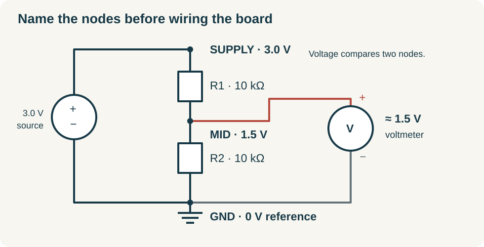

# DC circuits: predict the reading before touching the probe

A sensor logger needs an electrical signal that represents something in the world. Before adding a sensor, build a signal whose value you can predict: two resistors dividing a small supply voltage. This modest circuit introduces the ideas behind power wiring, sensor interfaces, fault finding, and eventually circuit boards.

By the end of this chapter, you should be able to name a circuit's nodes, calculate currents and power, explain why a measurement can change a circuit, and check a breadboard without using a meter as an accidental short circuit. You need arithmetic, unit prefixes, and the habit of writing a prediction before measuring. The core calculations and software lab require no purchased hardware. The optional bench route uses only a current-limited 3.0 V supply.

## Voltage belongs between two points

Electric current is the rate at which charge passes a location. Its unit is the ampere, A; one milliampere, mA, is 0.001 A, and one microampere, µA, is 0.000001 A. Voltage is an electrical potential difference, measured in volts, V. Informally, it describes the energy available per unit charge moving between two points. A voltmeter therefore always compares two points, even when people casually say “the voltage at this pin.”

We will call the supply's positive node `SUPPLY`, the shared reference node `GND`, and the resistor junction `MID`. A **node** is a set of points connected by conductors that we treat as having the same voltage. An ideal wire has no voltage drop; a real wire has resistance and other properties that become important later. Ground in this little isolated circuit is our chosen zero-volt reference. It is not automatically the building's protective earth.

Connect resistor R1 from SUPPLY to MID and resistor R2 from MID to GND. The supply connects between GND and SUPPLY. Current has a complete loop: through the source, R1, R2, and back to the source. Removing either resistor breaks this loop. The circuit diagram records electrical connections, not the physical arrangement of parts on the bench.

Conventional current in the external resistor path goes from higher to lower potential. Electrons in metal move the other way; either description is consistent when used correctly. We use conventional current throughout this handbook. Charge is not used up by a resistor: energy is transferred, while the steady current entering a two-terminal resistor equals the current leaving it.

## One component law and two accounting laws

For an ideal resistor, Ohm's law relates voltage across it, current through it, and resistance: `V = IR`. Resistance is measured in ohms, Ω. A 10 kΩ resistor has 10,000 Ω resistance. At a 1 V drop, it carries `1 / 10,000 = 0.0001 A`, or 100 µA. The law models a resistor over its operating conditions; it is not a universal description of LEDs, motors, or every component bearing two leads.

Kirchhoff's current law says that current entering a node equals current leaving it. It is charge accounting. Kirchhoff's voltage law says that signed voltage changes around a closed loop sum to zero. It is energy accounting in the ordinary lumped circuits considered here. Pick a direction around the loop and keep the signs consistent. Going through our source from GND to SUPPLY gives a +3.0 V rise; the resistor drops must total −3.0 V.

With R1 and R2 both 10 kΩ, their series resistance is 20 kΩ. Current is `3.0 / 20,000 = 150 µA`. Each resistor drops `150 µA × 10 kΩ = 1.5 V`, so MID is 1.5 V relative to GND. If the red meter probe touches MID and black touches GND, expect +1.5 V. Reverse the probes and expect −1.5 V. A negative reading is often useful information about your reference direction, not evidence that the circuit is broken.

The divider expression follows directly from that reasoning:

`V_MID = V_SUPPLY × R2 / (R1 + R2)`

Notice that R2 is the resistor between the measured node and the reference node. Memorizing “use the bottom resistor” becomes unreliable when a schematic is rotated. Naming the actual nodes survives changes in drawing orientation. MIT's [Circuits and Electronics course](https://ocw.mit.edu/courses/6-002-circuits-and-electronics-spring-2007/) develops this style of circuit reasoning through lectures and problems.

## Power explains why some mistakes become hot

Electrical power is the rate of energy transfer. For a component with a voltage drop V and current I entering its higher-potential terminal, absorbed power is `P = VI`. The unit is the watt, W. Substituting Ohm's law for a resistor gives `P = I²R = V²/R`.

Each divider resistor dissipates `1.5 × 0.00015 = 0.000225 W`, or 0.225 mW. The source supplies `3.0 × 0.00015 = 0.00045 W`. The two resistor powers add to the source power, giving another useful check on the arithmetic. If a calculation said each resistor dissipated 225 W, the unit conversion would deserve immediate attention.

A resistor's wattage rating limits how much heat it may dissipate under specified conditions. Resistance value and power rating are different properties. A 100 Ω resistor across 12 V would dissipate `12² / 100 = 1.44 W`; a physically small resistor rated for 0.25 W is unsuitable. Real design also considers temperature, mounting, tolerances, and derating, meaning operating below a maximum rating to accommodate actual conditions.

An LED introduces a nonlinear device. If a particular LED drops approximately 2.0 V at a desired 2 mA from a 3.3 V source, its series resistor needs approximately `(3.3 − 2.0) / 0.002 = 650 Ω`. Choosing 680 Ω gives about 1.9 mA under that assumption. The resistor dissipates only about 2.5 mW. The LED drop is not an exact universal constant; check its datasheet and calculate worst cases before relying on the current. The resistor must remain in series with the LED, wherever you place the pair in the loop.

## Why the divider cannot power the logger

Suppose you connect a third 10 kΩ resistor, RL, from MID to GND. It is in parallel with R2: both ends connect to the same two nodes. Their equivalent resistance is 5 kΩ, because two identical current paths together conduct twice as much current at the same voltage.

The source now sees 10 kΩ in series with 5 kΩ. Source current rises to `3 / 15,000 = 200 µA`. MID falls to `200 µA × 5 kΩ = 1.0 V`. At MID, 200 µA enters through R1 and splits into 100 µA through each lower resistor. The source still provides 3 V; the circuit's loading has changed the division ratio.

This is why a resistor divider can provide a signal to a suitably high-impedance input but usually cannot replace a power regulator. **Input impedance** describes how much an input loads a signal; for this DC example it behaves like an input resistance. A meter also draws some current. If its input resistance is very large relative to our divider resistors, its effect is small. If not, the measurement changes the value being measured. Later, ADC inputs add time-dependent loading as well.

## Put the meter in the right circuit

A voltmeter is connected across two nodes. Its high input resistance aims to disturb the circuit little. An ammeter measures current by becoming part of the current path, usually with a low-resistance internal shunt. Connecting a meter configured for current directly across a supply can create a short circuit. This lab deliberately obtains current from measured resistor voltage instead.

Before applying power, put the black lead in COM and the red lead in the meter's voltage/resistance socket, according to its manual. Select DC voltage and a suitable range if it is not automatic. Do not leave the red lead in a current socket after a previous task. Resistance and continuity measurements use the meter's own stimulus, so make them only on an unpowered circuit, with stored charge discharged as appropriate. [Adafruit's multimeter guide](https://learn.adafruit.com/multimeters/voltage) demonstrates the measurement modes; your specific meter manual remains the authority for sockets and limits.

Breadboards add another source of mistaken assumptions. A group of holes may be connected internally, while a neighboring group is separate. Power rails may be split halfway along. A component's two leads placed in one connected group are electrically shorted together. Map these connections with continuity mode while the board is unpowered. A tidy photograph cannot replace a node map.

## Lab: one circuit, two useful failures

For the no-purchase route, download [circuit_lab.py](../examples/embedded/circuit_lab.py) and run `python3 circuit_lab.py` with Python 3. It uses only the standard library and prints the node voltages and currents calculated below. Read the named component values at the top, then change one value and predict the output before rerunning. This is an ideal algebraic model, not a simulation of breadboard parasitics.

For an optional graphical route, draw the same nodes in [CircuitJS](https://www.falstad.com/circuit/), using a 3 V DC source, two 10 kΩ resistors, wires, and a ground reference. The author's [instructions](https://www.falstad.com/circuit/directions.html) explain component editing and viewing values. Start with the circuit description here rather than assuming that a preloaded example has our values.

For the bench route, use a breadboard, three 10 kΩ resistors, a digital multimeter, insulated jumpers, and a supply set to **3.0 V with a 20 mA current limit**. A supply with an adjustable limit allows a wiring error to remain a small experiment. If you lack one, complete the software route; an arbitrary battery pack is not an equivalent current-limited source.

1. With power off, measure each loose resistor and record its value. Map breadboard connections, then wire R1 from SUPPLY to MID and R2 from MID to GND.
2. Check that SUPPLY and GND are not directly connected. Enable the limited supply. Measure SUPPLY relative to GND, then MID relative to GND. Expect approximately 3.0 V and 1.5 V.
3. Measure across R1. Divide that voltage by R1's measured resistance to infer current. Expect approximately 150 µA. Keep the meter configured for voltage throughout powered measurements.
4. Turn power off. Add RL from MID to GND, then power up and measure again. Expect approximately 1.0 V at MID and 200 µA through R1.
5. Turn power off and remove RL and R2. Power up briefly and measure MID. With only R1 connecting it to SUPPLY, a high-resistance meter will read close to 3 V. This is an open lower branch, not a functioning divider. Power off before restoring it.

These are expected hardware observations, not claimed bench results. Resistor tolerances and meter loading explain small deviations. A 0 V supply accompanied by current limiting suggests a short or excessive load; switch off and inspect the node map. Correct SUPPLY but a 0 V MID suggests MID may be tied to GND or R1 may be disconnected. Approximately 3 V MID suggests an open R2 path. “Wrong voltage” becomes useful when paired with a hypothesis and a measurement that distinguishes it.

## Prediction checks and a first independent circuit

**Predict:** With a 3 V source, R1 = 20 kΩ and R2 = 10 kΩ, what is MID? If both resistor values double, does MID change? Does source current change?

**Answers:** MID is 1 V. Doubling both leaves the ideal ratio unchanged but halves source current. It also makes the divider easier to disturb with a given load. Saving power and preserving signal drive can pull a design in opposite directions.

Design a divider producing approximately 1 V from 3 V, then specify the largest load current you will permit before its output falls more than 5%. You can begin by trying different load resistors in the supplied model. Hand in the schematic, calculations, predicted readings, actual or simulated readings, and one diagnosed fault. This is a small but complete engineering record.

For deeper practice, the free archived MIT course offers a structured problem-solving path, though later material needs more mathematics. For a desk reference, Paul Scherz and Simon Monk's paid [*Practical Electronics for Inventors*, fourth edition](https://www.mheducation.com/highered/mhp/product/practical-electronics-inventors-fourth-edition.html) spans components, circuits, and prototyping. Start with resistors and measurement; use current component documentation alongside its older platform examples.
