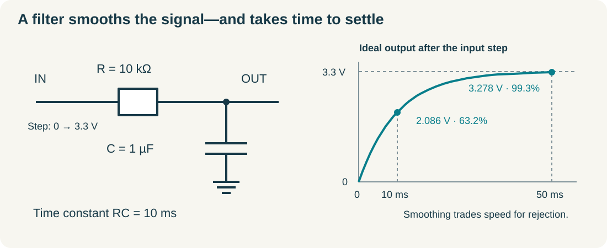

# Signals, sensors, and power: preserve the meaning of a measurement

The divider from the [circuit chapter](../circuits/) produces a predictable voltage. A sensor makes that voltage—or a digital message—depend on temperature, position, light, or another physical quantity. The logger's job is to preserve that meaning through wiring, conversion, timing, and storage. A long column of numbers is useful only when you know what each number measures and what can make it wrong.

This chapter follows one signal into a microcontroller and follows the power that makes the measurement possible. You will distinguish resolution from accuracy, calculate a simple filter, recognize aliasing, and make a supply budget. Prerequisites are voltage, current, resistance, and power. The main lab runs on a laptop with no electronic hardware.

## Follow the quantity through the chain

Write a measurement chain before selecting parts: **physical quantity → sensor → electrical signal → conversion → engineering units**. A hypothetical temperature sensor might output 0.50 V at 0°C and increase by 10 mV per degree Celsius. A measured 0.75 V then represents `(0.75 − 0.50) / 0.010 = 25°C`. Those numbers define this teaching sensor; they are not a specification for every analog temperature sensor.

An analog signal can vary continuously within its range. An analog-to-digital converter, ADC, assigns a numerical code to a sampled input. A digital sensor performs some conversion internally and sends a coded result. It still has an analog sensing element, uncertainty, response time, and a power supply. A digital connector moves some engineering work inside the package; it does not remove it.

Read a candidate sensor's datasheet in this order: operating supply range, absolute maximum limits, interface levels, pinout, measurement range, transfer equation, accuracy conditions, sample or update rate, and recommended circuit. **Absolute maximum** values are damage boundaries, not normal design targets. A breakout board may add a regulator or level shifting, but only its actual schematic can establish that. An I²C label by itself does not mean a board accepts 5 V signals.

Then inspect conditions underneath the attractive headline. Is the accuracy typical or guaranteed? Does it apply only around room temperature? Does a stated response time include the protective enclosure? Does a measurement consume more current than standby? These questions connect the component to the experiment you intend to perform.

## More digits do not guarantee more knowledge

A 12-bit ADC has `2¹² = 4096` possible codes. For an illustrative unipolar input range of 0 to 3.3 V, the ideal code width is `3.3 / 4096 = 0.000806 V`, about 0.806 mV. A voltage near half scale produces a code near 2048. This width is a quantization step, not a promise that every reading is within 0.806 mV of truth.

For our hypothetical 10 mV/°C sensor, one ideal code corresponds to about `0.806 / 10 = 0.0806°C`. Yet a sensor offset of 10 mV already means a 1°C error. Supply-reference error, ADC offset, gain error, nonlinearities, and noise add other effects. Printing ten decimal places does not undo them. A conversion using `code × Vref / 4095` maps endpoint codes to endpoint voltages; using code-bin widths involves 4096. Follow the actual ADC's transfer definition rather than silently mixing conventions.

Calibration compares measurements with a trustworthy reference. One reference point can reveal an offset at that point. Two separated points can estimate offset and scale, assuming a sufficiently linear response between them. Neither proves performance everywhere or removes a drifting reference. Record the reference, conditions, conversion equation, and uncertainty with the calibration result.

TI's [ADC Precision Labs videos](https://www.ti.com/video/series/precision-labs/ti-precision-labs-analog-to-digital-converters-adcs.html) explain conversion architectures, error sources, and sampling through short lessons. Start with basic operation and aliasing; the advanced input-driver lessons become useful when a circuit meets the voltage limits yet produces unreliable readings.

## A capacitor gives the circuit a memory

A capacitor stores charge. Its capacitance is measured in farads, F; a microfarad, µF, is one millionth of a farad. With resistor R from an input node to an output node and capacitor C from the output to GND, the output cannot instantly follow an abrupt input change. Current through R charges C, and the charging slows as their voltage difference shrinks.

For an initially discharged capacitor and an ideal step from 0 to V, the output is `V × (1 − e^(−t/RC))`. You do not need calculus to use its most helpful landmark: the **time constant** `τ = RC`. After one time constant the output reaches about 63.2% of its final value; after five it reaches about 99.3%.

For `R = 10 kΩ` and `C = 1 µF`, `τ = 0.010 s = 10 ms`. A 3.3 V step produces approximately 2.086 V after 10 ms and 3.278 V after 50 ms. The filter smooths rapid changes but introduces delay. Its cutoff frequency is `fc = 1 / (2πRC) ≈ 15.9 Hz`; at that frequency its sinusoidal output amplitude is about 0.707 times the input, not zero. A single RC filter gradually attenuates higher frequencies rather than cutting them off sharply.

The ADC may complicate this model. Many ADC inputs briefly connect an internal sampling capacitor to the signal. The source must charge it sufficiently during the acquisition interval. A high-resistance divider or an added filter can make that settling too slow. Consult the converter's recommended source impedance and acquisition timing; an amplifier used as a buffer may be needed. “The voltage is within range” and “the input settles accurately” are separate requirements.

## Sampling can create a convincing false signal

Sampling frequency, measured in hertz, Hz, is the number of samples per second. Sampling at 20 Hz observes the input every 0.05 seconds. If an unwanted signal changes between observations, its samples may be indistinguishable from a slower signal. That ambiguity is **aliasing**.

Consider an 18 Hz sine wave sampled at 20 Hz. At those exact sample times, its values equal those of a negative 2 Hz sine wave. A plot of the samples can therefore suggest a slow oscillation that was not present in the physical input. After sampling, no arithmetic can determine which of those indistinguishable inputs occurred without additional information.

For a signal strictly limited below a highest frequency, sampling faster than twice that frequency is the theoretical boundary for reconstruction. Real designs need additional margin and an analog filter before sampling because real filters are not perfect. A motor's switching noise can alias into a slowly varying temperature measurement. A digital moving average applied afterward cannot reliably remove an alias already mixed into the wanted band.

Averaging independent, zero-mean random noise can reduce its standard deviation approximately with the square root of the number of samples: sixteen such samples give about one quarter of the noise. Offset, drift, correlated interference, and repeated copies of the same erroneous reading do not obey that improvement. Compare a quieter display with an independent reference before calling it more accurate.

## The power system is part of the measurement

Make a current budget by operating mode. Suppose a processor uses 30 mA, a sensor 10 mA, and an indicator 2 mA from 3.3 V while measuring. The rail needs 42 mA in that mode, or `3.3 × 0.042 = 0.139 W`. Startup, radio transmission, storage writes, and actuator motion may create larger short demands. A budget must include both sustained and transient requirements.

A linear regulator dropping 5.0 V to 3.3 V at 42 mA dissipates approximately `(5.0 − 3.3) × 0.042 = 0.071 W`, ignoring its own small current. Raising the load to 400 mA makes that loss 0.68 W. The unchanged voltage hides a major thermal change. A switching regulator can reduce losses but introduces its own layout, ripple, and component requirements. Use the regulator's actual stability and capacitor guidance.

Local decoupling capacitors help supply rapid changes in current through short paths near a chip. Bulk capacitance supports slower or larger local demands. Neither replaces a suitable supply or cures every layout problem. Wire and trace inductance makes a distant capacitor less effective during rapid changes, so placement matters as well as capacitance. [Analog Devices' decoupling tutorial](https://www.analog.com/media/en/training-seminars/tutorials/MT-101.pdf) explains the physical reasons; follow each chip's recommended circuit rather than adding arbitrary capacitor values everywhere.

An inductive load stores magnetic energy. When its current is interrupted, that energy needs a controlled path. In a simple one-direction low-side coil circuit, a flyback diode is commonly placed across the coil with its cathode at the positive supply and anode at the switched low side. It normally blocks and then conducts the decaying coil current. A reversible H-bridge needs the driver's intended recirculation arrangement; a diode placed blindly across a reversing motor can short one commanded polarity. Use a documented driver design rather than connecting a coil to a processor pin.

Keep motor current out of thin sensor return paths. If both share a resistive wire, a changing motor current creates a changing voltage along the supposed ground reference. Separate the high-current route while preserving the required common reference for non-isolated logic. This is about current paths, not assigning unrelated ground symbols and assuming they communicate magically.

## Lab: make a wrong signal look plausible

Download [signal_lab.py](../examples/embedded/signal_lab.py). It requires Python 3 and no additional libraries. Save it in an empty folder, then run `python3 signal_lab.py`. It prints calculated RC landmarks, compares the aliased samples, and writes `rc_step.csv` and `alias_samples.csv` in that folder. These are synthetic model results, not recorded sensor measurements.

1. Before running it, predict the output voltage at 10 ms and 50 ms for the 3.3 V step. Compare your answers with the printed values.
2. Open `rc_step.csv` in a spreadsheet. Make an XY plot with time in milliseconds horizontally and voltage vertically. Mark 10 ms and 50 ms. Identify a plausible waiting time if a reading must settle within 1% of the final value.
3. Open `alias_samples.csv`. Plot the sampled 18 Hz column and the negative 2 Hz column against time. They should overlap to numerical precision. The continuous high-frequency curve is deliberately not sampled densely in this file: the exercise is about what the logger actually knows.
4. Change `SAMPLE_HZ` from 20 to 50 and rerun. The two columns should no longer coincide. Reusing the same false 2 Hz interpretation now fails because the observation times changed.
5. Double the resistor value. Predict which RC landmarks move in time and which final voltage stays unchanged, then verify the model.

If a plot has a straight horizontal time axis with unordered labels, use an XY scatter plot rather than treating the first column as categories. If you see a decimal-comma import problem, select comma-separated data explicitly. If changing sample rate leaves the output unchanged, confirm that you edited the file you actually ran. The supplied default numerical checks were executed during handbook preparation; no physical RC circuit or sensor was tested.

## Transfer the model to a real measurement

**Predict:** Will a 16-bit ADC necessarily fix a sensor's 1°C offset? Can an RC filter remove all motor noise without delaying the wanted signal? What changes if a divider's resistors are made much larger to save power?

**Answers:** extra codes do not remove offset; filtering trades frequency response against settling and cannot reject every interference path; higher divider resistance reduces DC current but increases sensitivity to loading and can slow ADC input settling. Each answer points to an experiment rather than a universal component choice.

For an independent project, choose one low-voltage temperature or light sensor and write a one-page measurement contract: physical range, maximum acceptable error, update interval, electrical limits, conversion equation, calibration reference, and supply budget. Build the logger only after every field has a source or an explicit assumption. In the first trial, store raw readings alongside converted units and timestamps. That preserves the evidence you need when the first attractive graph turns out to be misleading.
