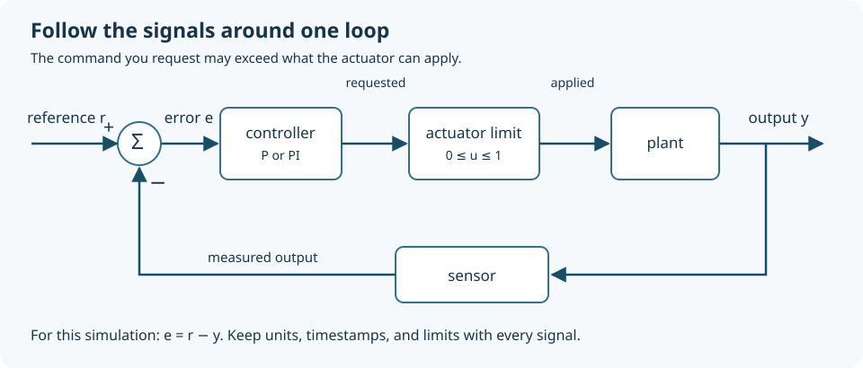

# 16. Feedback control: correct the error without creating a new one

Giving a motor a command does not specify exactly where a mechanism will end up. Friction, supply voltage, load, and temperature alter the response. Feedback measures what happened and uses the difference from the desired result to choose the next command. This closes a loop through both software and the physical world, so a mistake in either can grow on every pass.

You will predict proportional-control offset, see how integral action removes it, and reproduce a case in which an actuator limit makes an otherwise useful controller behave badly. The lab is a simulation requiring Python 3 and arithmetic; the software/data chapter supplies the programming background. It does not energize a motor. A successful simulated controller is a hypothesis to test on an appropriately guarded, low-energy mechanism, not evidence that the existing pivot is ready for actuation.

## Draw the loop before choosing gains

Let `r` be a reference, `y` the measured output, and `e = r − y` the error. A controller converts error into command `u`. The plant is the mechanism being controlled: motor, load, friction, structure, and relevant electronics. A sensor returns a measurement. The next calculation begins with that measurement, so sensing delay and incorrect signs are part of the loop.

Use units on the drawing. If `r` and `y` are position in millimetres and `u` is a normalized motor command, proportional gain has units of command per millimetre. If you change position from millimetres to metres without changing the numerical gain, the effective response changes by a factor of a thousand. “Gain 2” is meaningless without the signal definitions.

A disturbance changes the plant's behavior without changing your reference: someone adds a load, friction increases, or a fan blows on a heated object. Measurement noise changes what the controller thinks happened. These enter different locations. Raising gain may reject a slow disturbance more strongly while sending more sensor noise to the actuator. There is no single “more accurate” knob independent of the rest of the loop.



Before any physical closed-loop experiment, verify the direction with a tiny permitted command while the mechanism is in a safe state. A positive position command should cause the sensor reading to increase under your convention. If it decreases, the feedback can reinforce the error. Gain tuning cannot repair the wrong sign.

## A simple plant makes the arithmetic visible

Our simulated output is dimensionless and tends toward the applied command with a time constant of one second. The update is:

`next_y = y + (dt / tau) × (u − y)`

Here `dt = 0.02 s` and `tau = 1 s`. If `y = 0` and `u = 0.9`, the next output is `0 + 0.02 × 0.9 = 0.018`. The change becomes smaller as output approaches command. This is a first-order model: it has one evolving state and no explicit inertia, backlash, or transport delay.

A proportional controller uses `u = Kp × e`. With `Kp = 2`, reference 0.6, and initial output 0, it requests 1.2. Our actuator can apply only values from 0 to 1, so it applies 1. The first output is 0.02. The second request is `2 × (0.6 − 0.02) = 1.16`, still limited to 1. Requested command and applied command are different signals; log both.

At equilibrium, this model has `y = u`. If the command is no longer limited, then `y = Kp(r − y)`. Rearranging gives `y = Kp × r / (1 + Kp)`. For `Kp = 2` and `r = 0.6`, the settled output is 0.4 and the remaining error is 0.2. The controller needs some error to maintain a nonzero command. This explains the offset without assuming that the code is broken.

This result belongs to this plant and this controller. A position plant containing an integrator behaves differently. Do not carry the formula to every motor and conclude that all proportional controllers must have this exact offset.

## Integral action remembers persistent error

An integrator accumulates error over time. In our implementation the integral contribution is already in command units:

`next_integral = integral + Ki × e × dt`

The PI request is `Kp × e + integral`. A small error that persists keeps increasing the contribution until the plant receives enough command to reach the reference. With zero steady error, the integrator can retain the command needed to hold that output. For a position error in millimetres, `Ki` would have units of command per millimetre per second.

Time is essential. Omitting `dt` means that changing the loop from 50 to 100 updates per second doubles the accumulation rate. A gain that seemed successful then changes merely because the program runs faster. Use measured elapsed time where appropriate, and establish a policy for a missed deadline rather than allowing a very late update to produce a huge unexpected increment.

Integral action has a cost: stored history continues to act after the reference changes. If a command is limited, the integrator may keep accumulating a demand the actuator cannot deliver. This is windup. A motor already at maximum drive cannot move faster just because the software requests ten times the maximum. After the target comes down, the stored integral can keep the actuator at maximum while the current error asks it to slow down.

Our anti-windup rule conditionally stops accumulation when the proposed command is outside its range and the error would push farther into that limit. It allows integration that moves the command back toward the usable range. Other designs feed the difference between requested and applied commands back into the integrator. The [MathWorks PID video series](https://www.mathworks.com/videos/series/understanding-pid-control.html) provides separate visual treatments of saturation, anti-windup, and derivative noise; its software demonstrations are optional for this lab.

## Run four experiments with the same plant

Download [control_lab.py](../examples/computing/control_lab.py). From its folder run:

```sh
python3 control_lab.py
python3 control_lab.py --csv control-results.csv
```

The first two runs hold a reference of 0.6 for 20 seconds. The proportional controller settles to 0.400; the PI controller reports 0.600 to three decimal places. The next two runs request the impossible output 2.0 for ten seconds, then reduce the reference to 0.4. At time 12 seconds, the unprotected PI output is 1.000 with integral contribution 9.800. With conditional integration, output is 0.292 and integral contribution 0.095. These are actual outputs of the provided deterministic simulation; they are not measurements of a physical motor.

The protected controller has already returned toward the reachable target; it has not instantly become perfect. Look at the full trace before judging it from one sample. Compare time to settle, maximum deviation, applied command, and integral history. The CSV includes all of them, so a spreadsheet can graph each run without needing a plotting package.

Change only one parameter per experiment. Start by changing `kp` in a copy of the file from 2 to 1. Predict the proportional equilibrium: `1 × 0.6 / 2 = 0.3`. Next restore `kp` and set a constant disturbance of −0.1. The model becomes `next_y = y + dt × (u − 0.1 − y)`. Ask whether the actuator has enough remaining command to reach the target. PI can remove the offset only when the required command lies within the allowed range.

The [shared tests](../examples/computing/test_labs.py) verify the proportional result, PI disturbance rejection for a reachable target, command limits, and recovery from windup. Run them as described in the [example README](../examples/computing/README.md). Add a test for your changed target using a separately calculated equilibrium, rather than only checking that the program finishes.

## Why more gain can make the response worse

For the unsaturated proportional case, substituting the controller into the update leaves a coefficient of `1 − dt(1 + Kp)/tau` multiplying the previous output. A disturbance shrinks on each iteration only if the absolute value of that coefficient is less than one. This simple numerical model therefore requires `0 < dt(1 + Kp)/tau < 2` for that behavior.

With `tau = 1`, `Kp = 2`, and `dt = 0.02`, the coefficient is 0.94: successive deviations decay without changing sign. With `dt = 0.8`, it is −1.4: deviations alternate and grow. Saturation may bound the displayed output, but a bounded oscillation is not successful regulation. This is a stability condition for this particular discrete simulation, not a universal gain limit.

The real plant introduces additional reasons to lose stability. A delayed measurement describes an earlier position. Flexible parts can continue moving after the motor changes direction. Backlash creates motion that an input-side encoder cannot see. Large gains can excite these effects. Begin with a model that exposes the essential response, then add measured complications when the simpler model cannot explain the trace.

Derivative action responds to the rate at which a signal changes. A small noisy difference divided by a short interval can become a large derivative. Filtering can reduce that noise but adds delay. A moving average over many samples is therefore a control decision, not merely a cosmetic improvement to a graph. This chapter uses PI so that the roles of stored error and actuator limits remain visible before adding derivative filtering and more tuning choices.

## A sensible bridge from simulation to a rig

Define startup, enabled, stopping, and fault states before writing a live loop. Decide what happens when feedback is stale, a limit is reached, the computer disconnects, or the sensor reports an impossible jump. A user-interface stop button is not a substitute for an appropriately designed physical means to remove hazardous energy. The right stop response depends on the mechanism: removing drive from a supported horizontal rig and releasing a gravity-loaded arm are different events.

For a future low-energy bench rig, establish sensor scale and direction with actuation disabled, measure a small open-loop response within known travel, and compare it to the model. Then use conservative output and travel limits, a reachable target, and logging of actual timestamps. Look at friction, delay, and repeatability before increasing gains. Keep the early experiments supported and unloaded; the mechanical load test and electrical checks remain separate prerequisites.

If the output is noisy only while the actuator runs, investigate electrical interference, grounding, vibration, and supply behavior before trying to tune it away. If it drifts slowly despite PI, inspect saturation and sensor bias. If the trace shows regular pauses, inspect scheduling and blocking work. These explanations lead to different repairs even when all three symptoms are described as “unstable.”

## Predict, explain, extend

**Predict:** Doubling loop frequency without multiplying the integral increment by `dt` does what? **Answer:** It doubles accumulated error per second for the same error history, changing the controller.

**Predict:** Can integral action make an actuator with maximum output 1 hold this plant at 2? **Answer:** No. It can only accumulate an impossible request. The design needs a reachable specification or a different actuator and plant.

**Predict:** Why retain both requested and applied command in the log? **Answer:** Their difference reveals saturation. Output alone does not show whether the controller is limited, poorly tuned, or responding to a disturbance.

For an independent challenge, add a measurement delay of five samples using a short queue. Keep the physical model and sample interval unchanged. Compare proportional response with and without that 0.10-second delay, then predict what happens when gain increases. Submit the two traces, the exact parameters, a description of any oscillation, and a reasoned limit on what this simulation says about a real positioning rig. A useful result is a clearly explained failure as well as a successful response.
