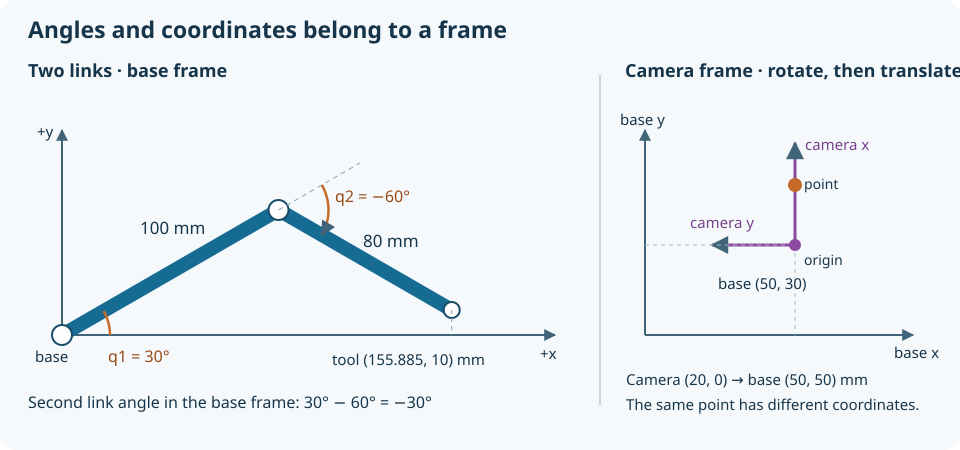

# 17. Robotics: agree on where things are before moving them

A robot combines a mechanism, sensors, computation, and actuation. Each part can work on its own while the assembled system behaves incorrectly. A camera reports a point relative to its lens; a motion planner assumes a point relative to the robot base; a motor driver expects counts relative to an encoder zero. If those meanings are not connected explicitly, a perfectly valid number can send the mechanism in the wrong direction.

This chapter builds a small planar robot model and uses it to connect coordinate frames, kinematics, sensing, and integration. You will calculate a tool position, find two joint configurations that reach it, and identify a target the mechanism cannot reach. Prerequisites are the measurement, software, and feedback chapters, plus basic sine and cosine. The lab needs Python 3 or paper, a ruler, and a protractor. Motors and ROS are optional later extensions; no actuated pivot is assumed to have been validated.

## Give every position a frame and a time

A coordinate frame is an origin plus directions for its axes. “The object is at x = 20 mm” is incomplete unless you know where x starts and which way it points. Put a base frame on the tabletop and draw positive x to the right and positive y away from you. Place another frame on the camera. Its axes may be rotated relative to the tabletop, and its origin is generally elsewhere.

A two-dimensional rotation by angle `a` maps a local point `(x, y)` into `(x cos a − y sin a, x sin a + y cos a)`. Add the location of the local origin to express the point in the destination frame. The order matters: rotating a local point and then translating it describes a different operation from translating it and then rotating the entire result.

Suppose the camera's local x-axis points along the base's positive y-axis: a 90° rotation. Its origin is at `(50, 30) mm` in the base frame. A camera-frame point `(20, 0) mm` rotates to `(0, 20) mm`, then translates to `(50, 50) mm`. Adding the camera offset without rotating would incorrectly give `(70, 30) mm`.

A position also belongs to a time. At 100 mm/s, a 0.10-second-old observation can be 10 mm behind the current position, even if every coordinate conversion is correct. Record the measurement time, not merely the time the application finishes processing it. A moving camera needs the camera-to-base relationship at that measurement time. This is why robotics messages often carry frame identifiers and timestamps together.

## Kinematics describes motion geometry

Imagine two rigid links connected by revolute joints in a plane. The first link is 100 mm long and the second is 80 mm. Joint angle `q1` is the first link's angle relative to base x; `q2` is the second link's angle relative to the first link. Positive angles turn counterclockwise. The second link's angle relative to the base is therefore `q1 + q2`.

The endpoint coordinates follow by adding the two link vectors:

`x = 100 cos(q1) + 80 cos(q1 + q2)`

`y = 100 sin(q1) + 80 sin(q1 + q2)`

For `q1 = 30°` and `q2 = −60°`, the second link points at −30° relative to the base. Thus `x = 100 × 0.8660 + 80 × 0.8660 = 155.885 mm`, while `y = 100 × 0.5 + 80 × (−0.5) = 10 mm`. This is forward kinematics: joint configuration in, tool position out.

The calculation assumes rigid links and exact joint locations. A long printed link may deflect under load; an encoder may measure a motor before a flexible transmission. Kinematics describes the nominal geometry. Dynamics concerns the forces and torques required to produce motion, and structural analysis concerns deformation and failure. A reachable point is not evidence that a loaded mechanism can hold it.



For orientation and homogeneous-transform foundations, the [Modern Robotics companion lessons](https://modernrobotics.northwestern.edu/nu-gm-book-resource/) provide a deeper progression. Start with configuration and rigid-body motion before inverse kinematics; the vocabulary becomes much easier once you have drawn a frame yourself.

## Inverse kinematics has choices and boundaries

Inverse kinematics asks which joint angles reach a desired point. For our two-link arm, the distance from the base gives:

`cos(q2) = (x² + y² − 100² − 80²) / (2 × 100 × 80)`

The cosine of a real angle must lie between −1 and 1. A target at `(190, 0) mm` would require a cosine greater than 1, so it is impossible even before considering obstacles. The arm's maximum reach is 180 mm; its minimum radius is 20 mm because the longer link cannot be completely cancelled by the shorter one.

At most ordinary reachable positions there are two solutions: one with the elbow on one side of the base-to-tool line and one on the other. Our worked point has solutions approximately `(30°, −60°)` and `(−22.659°, 60°)`. They share an endpoint but occupy different space. A table edge, cable, joint stop, or nearby object may allow only one.

Near a fully straight or folded configuration, small Cartesian changes can require disproportionately large joint changes in certain directions. This is a singularity: the local mapping between joint motion and tool motion loses a direction. Do not infer a safe trajectory from a list of individually reachable endpoints. The path between them must also respect joint limits, collision clearance, speed, acceleration, and the chosen elbow branch.

## Run the model, then check it with paper

Download [robot_arm.py](../examples/computing/robot_arm.py) and run:

```sh
python3 robot_arm.py
```

The program prints the forward result `x=155.885 mm y=10.000 mm`, both inverse solutions, the camera-to-base result `(50.0, 50.0) mm`, and rejection of `(190, 0)`. The mathematical functions use radians internally. The demonstration converts readable degree values at the interface; `30` passed directly to a sine function expecting radians is a very different angle.

On graph paper, draw a 100 mm first link at 30°. From its end draw an 80 mm second link at −30° relative to the page's x-axis. Measure the endpoint. Alternatively, draw and cut two paper strips with pivot marks at those lengths, then rotate them by hand on the page. Do not confuse the −60° relative elbow angle with the second strip's −30° absolute angle.

Your drawing will have line thickness and angle-setting uncertainty. Agreement within a millimetre or two may be reasonable for a quick paper construction; record your actual uncertainty rather than forcing the measured endpoint to match the computed number. The point of the paper check is an independent geometric prediction, not a precision certification.

Next test `(180, 0)`, `(20, 0)`, and `(0, 0)`. Predict the straight configuration, folded configuration, and unreachable origin. Change a link length and update both the drawing and function arguments. Run the [shared tests](../examples/computing/test_labs.py), which check forward geometry, coordinate transformation, inverse round trips, and rejection outside the workspace. Round trips alone would be insufficient if both functions shared the same mistaken convention; the independently calculated example provides another check.

## Sensors and actuators report different kinds of truth

An incremental encoder reports changes in rotation; establishing absolute position usually requires a known reference or additional sensing. An absolute encoder reports a position code within its specified range, but its mounting zero, gear relationship, and multi-turn behavior still matter. A limit switch indicates a boundary or reference event; it does not measure the entire motion.

A stepper driver can issue a known number of steps while the motor loses motion under load. Counting commands then estimates intended position rather than measuring actual position. A hobby servo usually closes an internal position loop, but its command interface does not necessarily expose accurate feedback to your application. A geared DC motor with an encoder gives useful measurements, yet gearbox backlash can let the output move without an equivalent motor-side change.

Choose sensing according to the error you must detect. If the experiment concerns tool deflection, an upstream encoder cannot observe all of it. A camera may observe the tool but add latency and lighting sensitivity. Comparing sensors can reveal disagreement, but two sensors sharing the same loose bracket can share the same error.

Actuator selection also needs more than a torque headline. Required speed, continuous heating, supply current, duty cycle, backlash, and holding behavior determine whether the motor fits the task. A simulation can estimate trajectories and nominal loads. Begin physical validation with separate measurements of the mechanism and actuator, then integrate them gradually.

## Integration is a sequence of contracts

Break the system into parts with explicit interfaces: sensor acquisition, state estimation, planning, low-level control, and user commands. Define units, frames, timestamps, valid ranges, expected update rates, and failure behavior at each boundary. Replay a recorded sensor trace into the computation before connecting live actuation. Replace one simulated component at a time so that a new discrepancy has a small set of explanations.

A simulator can check geometry, collision models, and software interactions. Its friction, contact stiffness, sensor noise, and delay are assumptions unless identified from measurements. A robot that succeeds only in simulation may be exploiting unrealistic contact, unlimited torque, or perfect sensing. Keep a table of model assumptions and the bench observation that could invalidate each one.

Make operation states explicit. `DISABLED` permits inspection; `READY` means prerequisites are satisfied; `RUNNING` accepts permitted motion; `FAULT` prevents automatic resumption after a detected problem. A stop request should enter a defined stopping process, and a fault should require an intentional recovery decision. Whether the appropriate physical response is controlled deceleration, drive disable, braking, or another action depends on stored energy and the mechanism. A software state name alone cannot make a gravity-loaded arm safe.

## Add ROS 2 when multiple components need coordination

ROS 2 supplies conventions and tools for composing robot software. A node performs a responsibility; topics carry streams; services support request-and-response interactions; actions support longer operations with progress and cancellation. A framework does not determine your units, make a motor controller safe, or compensate for an inaccurate mechanical model.

As reviewed on November 4, 2026, the official release table lists Lyrical Luth through May 2031 and Jazzy Jalisco through May 2029. For a deliberately conservative optional learning setup, this handbook points to Jazzy and its Ubuntu 24.04 binary installation path. It is a supported choice, not a claim that it is the newest distribution. See the [official release-table source](https://github.com/ros2/ros2_documentation/blob/rolling/source/Releases.rst) and [Jazzy installation source](https://github.com/ros2/ros2_documentation/blob/jazzy/source/Installation.rst).

On a Mac, keep the core lab native Python. For ROS exercises, plan a supported Linux computer or a carefully configured Linux virtual machine/container; USB access, graphics acceleration, processor architecture, and networking need separate verification. Native source builds are an additional maintenance task. This guide does not promise a one-click macOS ROS-and-Gazebo setup.

Once the platform works, follow the [official tutorials](https://docs.ros.org/en/jazzy/Tutorials.html) in order. Publish the simulated joint angles, inspect their messages, and visualize the resulting links before connecting hardware. Use one distribution consistently and choose a simulator integration documented for that distribution. Record versions so that a future learner can reconstruct the environment.

## Check the interpretation

**Predict:** Why can two inverse solutions be mechanically different if the tool point matches? **Answer:** Their intermediate link locations differ, changing collision clearance, joint limits, and cable routing.

**Predict:** A target is inside the 180 mm reach radius but only 10 mm from the base. Is it reachable? **Answer:** No; this arm has a 20 mm inner unreachable radius.

**Predict:** Does an encoder reading at the desired position prove the tool is there? **Answer:** Only within the sensor placement and model assumptions. Backlash, compliance, slip, and reference errors can separate encoder position from tool position.

For an independent project, add a rectangular obstacle to the paper workspace and sample a proposed joint-space trajectory. Draw both links at every sample, identify collisions, and compare the two inverse branches. Deliver the frame convention, link lengths, rejected poses, and an explicit statement that discrete collision samples can miss collisions between samples. That limitation suggests the next useful skill: planning and checking the entire swept motion.
