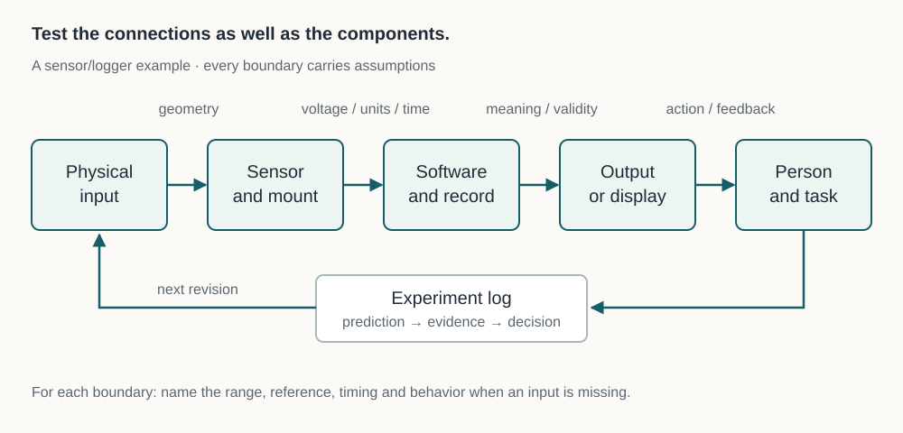

# From guided build to independent project

A tutorial gives you a destination and many of the decisions that lead there. An independent project asks you to choose the destination, discover the missing information and decide when the result is adequate. The transition is manageable if you preserve the habits you have practiced: define the job, expose interfaces, predict behavior, test one uncertainty and retain the evidence.

This chapter turns the handbook into three project briefs and a repeatable delivery process. Start with [project framing](../start/), [measurement](../measurement/) and [product design](../product-design/), then follow the technical prerequisites for your chosen branch. You do not need to finish every chapter before starting a modest project. You do need to know which gaps matter before increasing complexity or energy.

## Choose a project with an observable finish

“Build a robot” can expand indefinitely. “Make a tabletop indicator move between two marked positions in simulation, then evaluate a low-energy physical version” has a first finish line. A useful early project combines one familiar skill with one or two new skills, while keeping the consequences of failure manageable.

Write a one-sentence job and three acceptance checks. Each check should name the configuration, action and observable result. Separate required behavior from optional extensions. An enclosure, wireless link and AI classifier can each become another project; adding them all before the basic measurement works makes diagnosis much harder.

A project is allowed to stop with a negative finding. Discovering that a chosen sensor cannot resolve the intended change is a successful feasibility experiment, even if it ends that concept. Record the evidence and the conditions so another person does not need to repeat the same uncertainty blindly.

## Define interfaces before detailed implementation

An interface contract records what two subsystems expect from each other. For a mechanical interface, include reference surfaces, dimensions, tolerances, insertion direction and fastener access. For an electrical interface, include voltage range, current demand, signal reference, connector pinout and behavior when power is absent. For software, include field names, units, timing, valid ranges and failure behavior.

Use the [interface worksheet](../worksheets/interface-contract.md). Write the assumptions on both sides. A sensor can be mechanically compatible and electrically incompatible; a message can parse successfully and contain a value in the wrong unit. These are integration problems that isolated component demonstrations will miss.

For example, agree that a logger records `distance_mm`, an explicit timestamp and a validity flag. If the device cannot produce a valid distance, it should report invalid status rather than silently repeat an old value. The consumer must then decide what invalid data means. In a display it may show a gap; in an actuator controller it may require stopping. The contract joins the data format to behavior.

*Test the boundaries as well as the boxes. Many failures occur when individually working parts disagree about units, timing or physical access.*

## Capstone A: a measured sensor bracket

**Result:** a removable bracket for a light, noncritical sensor or dimensionally representative dummy, with a drawing, fit coupon, assembly record and placement measurements. Study CAD, materials, printing and mechanics first: [Chapters 5–9](../cad/) provide the relevant concepts. Use the existing [pivot tutorial](../../projects/triangulated-pivot/) as a detailed CAD and assembly case study when you want a more demanding mechanism.

**Materials:** paper or card, a ruler or caliper, the actual sensor envelope and connector, suitable ordinary fasteners, access to CAD and a printer or a makerspace. A card-only first stage is valid. Do not purchase the whole bill of materials before measuring the inherited interfaces.

**Stage 1 — understand the fit.** Measure mounting geometry and connector clearance. Make a full-size card envelope. Record which dimensions are measured and which come from a drawing. Choose reference surfaces and an installation sequence. Stop if the connector or tool cannot reach its working position.

**Stage 2 — manufacture the uncertainty.** Model a small coupon containing the fit that most affects success: a hole, nut pocket, slide or insert location. Print it using the planned material and orientation. Compare several justified clearance values and record actual assembly behavior. A fit established in a different orientation or material may not transfer unchanged.

**Stage 3 — build the minimum complete bracket.** Preserve the selected interface dimensions, add only the structure needed for the chosen low-load demonstration and inspect the sliced toolpaths. Record printer profile, orientation, material and revision. Assemble without forcing a mismatched interface. Keep the first failed coupon as evidence if useful.

**Acceptance checks:** confirm connector and tool access; remove and replace the dummy at least five times using the same reference; compare measured placement spread with your provisional requirement. If a low-load stiffness observation is needed, define the load, fixture, reference and stop condition before testing. Use a harmless supported setup, not an overhead or safety-critical load. This project does not establish a general load rating.

**Independent extension:** change one inherited dimension, such as sensor width, and regenerate the model. Explain which features should update and which should remain fixed. Then verify the changed interface physically. This tests design intent more deeply than reproducing a shape once.

## Capstone B: a low-voltage sensor/logger

**Result:** a small sensing system that produces interpretable records, handles invalid input and can be restarted without losing the meaning of its data. Study circuits, signals, software and embedded behavior before the hardware integration: [Chapters 11–15](../circuits/) supply the pieces.

**Materials:** begin with the supplied desktop Python labs and synthetic data. For the optional physical stage, choose a documented low-voltage development board and compatible sensor from their official specifications, a suitable protected supply, a breadboard where appropriate and a meter. The chapter-specific circuit defines the connections; this capstone is an integration brief, not a universal wiring diagram. Verify pin voltage limits and the sensor's supply requirements before connecting it.

**Stage 1 — make the data contract work.** Generate a short file containing normal values, a missing value and an out-of-range value. Define units and timestamps. Run a parser that retains valid observations and records why it rejected others. Confirm that a missing reading does not become a plausible zero by accident.

**Stage 2 — add state and timing.** Extend the desktop model using the IDLE, RECORDING, and FAULT table in [the embedded chapter](../embedded/). The supplied debounce/heartbeat example demonstrates event handling; it does not already implement this logger. Define what makes a reading stale and whether that condition marks a record invalid, pauses recording, or enters FAULT. Predict and test delayed readings, recovery, and restart before connecting a board. A passing simulation establishes behavior under its inputs, not electrical correctness.

**Stage 3 — connect one physical sensor.** Check the unpowered wiring against the named pin diagram. Use the chapter's appropriate low-energy supply and measurement procedure. Log a known stable condition and a controlled change. Record warm-up, placement and environmental conditions. If readings move when the cable moves, investigate the interface before adjusting software filters.

**Acceptance checks:** records retain units and validity; a sensor interruption is distinguishable from a real low reading; the system restarts into a defined state; a second person can reproduce a short measurement from the instructions. Compare a few readings with an appropriate reference where possible. Do not claim calibration from merely matching a single point.

**Independent extension:** add a local display or a network mirror. Keep the local logger useful when the extension fails. Demonstrate a disconnected network without losing the distinction between fresh and stale data. Keep credentials and personal measurements out of a public repository.

## Capstone C: a tabletop positioning system

**Result:** a simulated axis or two-link arm with explicit coordinates, limits, sensing assumptions and stop behavior, followed only if appropriate by a small physical demonstrator. Study mechanisms, embedded systems, controls and robotics first. The [control lab](../controls/) and [robotics lab](../robotics/) provide runnable starting points.

**Materials:** the desktop simulation is the first build and needs no motor purchase. A later physical version requires a documented actuator, compatible driver and supply, a suitable support structure, position sensing if the task needs it, and a deliberate means of removing actuator energy. Select these after calculating torque, speed and travel, rather than treating a motor's advertised torque as a complete system specification.

**Stage 1 — make the geometry explicit.** Draw the reference frame, travel region and obstacles. Predict reachable positions. Run the kinematics examples and check several points by hand. A mathematically reachable point may still collide with a fixture or exceed a joint's physical limit.

**Stage 2 — model behavior over time.** Use a simple plant model and bounded command. Test target changes, sensor delay, noise and output saturation. Compare error, settling behavior and control effort. A more aggressive controller may reduce one error measure while creating oscillation or larger peak commands. Keep the model's omissions visible.

**Stage 3 — plan the physical test before energizing.** Identify pinch points, stored energy, travel limits, loose wiring and the consequences of a wrong direction. Design the first test to observe direction and stop behavior at low energy, with the moving assembly secured and no person in its path. Obtain appropriate equipment-specific instruction when needed. An emergency stop is a physical system design issue, not merely a button drawn in an app.

**Acceptance checks:** the coordinate convention matches observed motion; commands stay within established bounds; stale or invalid sensor input produces the defined response; restarting does not cause an unexpected move; the mechanism's load and travel remain within the tested setup. Increasing payload, speed or reach creates a new validation question.

**Independent extension:** add an AI perception suggestion only after the baseline works. Evaluate the perception separately and bound what it can command. A classifier's confidence number is not a physical safety guarantee. The pivot joint remains an unpowered mechanical learning project until its own actuation and load requirements have been designed and tested.

## Budget time for evidence and rework

A schedule that contains only fabrication and coding is missing integration. In an illustrative ten-hour allocation, reserve two hours for requirements and interface checks, three for the smallest working build, two for integration, two for tests and documentation, and one for rework. These are planning proportions, not a promise that every project fits ten hours. If the uncertainty is large, shorten the first milestone instead of compressing its testing to zero.

Keep a bill of materials with quantity, exact part identifier, supplier, cost basis and acceptable substitutions. A substitution should preserve the relevant specifications, not just the name. A different sensor may need a different voltage; a different bearing may need a different shaft fit. Record consumables and failed iterations too, so your cost model improves.

Choose a few checkpoints at which you decide whether to continue, revise or stop. Useful checkpoints include a working interface coupon, a validated data format and an integrated demonstration. Each should produce something reviewable: measurements, a drawing, a trace or a short video with the conditions stated.

## Hand over a reproducible project

A public project needs more than a photograph of the successful moment. Include the purpose, build revision, prerequisites, bill of materials, source files, manufacturing orientation, assembly order, runnable commands, expected outputs, known limitations and actual test record. Distinguish CAD predictions, simulated results and physical measurements. Preserve earlier releases so a reader can identify which version their parts came from.

Before publishing, open the download in a clean folder and follow the instructions as a new reader would. Check relative links, file names and units. Remove credentials, private data and machine-specific paths. State reuse permissions deliberately and check the licenses of third-party code or assets you redistribute. If a project will be sold or used in a regulated setting, investigate the requirements for that product and jurisdiction separately; a successful hobby demonstration is not certification.

For broader project inspiration, [Fab Academy](https://fabacademy.org/about/) combines fabrication, electronics and documented projects through a distributed program. Its public archives can show how others record iterations; enrolled instruction and local lab access are separate from reading those archives. Choose one documented project and study its failed attempts as carefully as its final image.

## Final lab: a short design review

Use the [project review worksheet](../worksheets/project-review.md). Give a colleague, makerspace mentor or future version of yourself five minutes of evidence: the job, one interface, one prediction, one measured or simulated result and one unresolved risk. Ask them to identify a claim unsupported by the evidence. Revise that claim or design a test.

**What counts as finished?** The agreed checks have been performed, the result and limitations are recorded, and another person can understand the configuration. Optional improvements can become a new revision.

**What if the test fails?** Preserve the raw result, identify which assumption it challenges and choose a focused next experiment. Do not silently change the acceptance threshold to turn a failure into a pass.

**What should the next project teach?** Choose the next constraint your current system exposes: a better fit, a cleaner measurement, a more reliable interface or a more understandable control. That gives further study a purpose and keeps an expanding tool collection connected to things you can explain and build.
